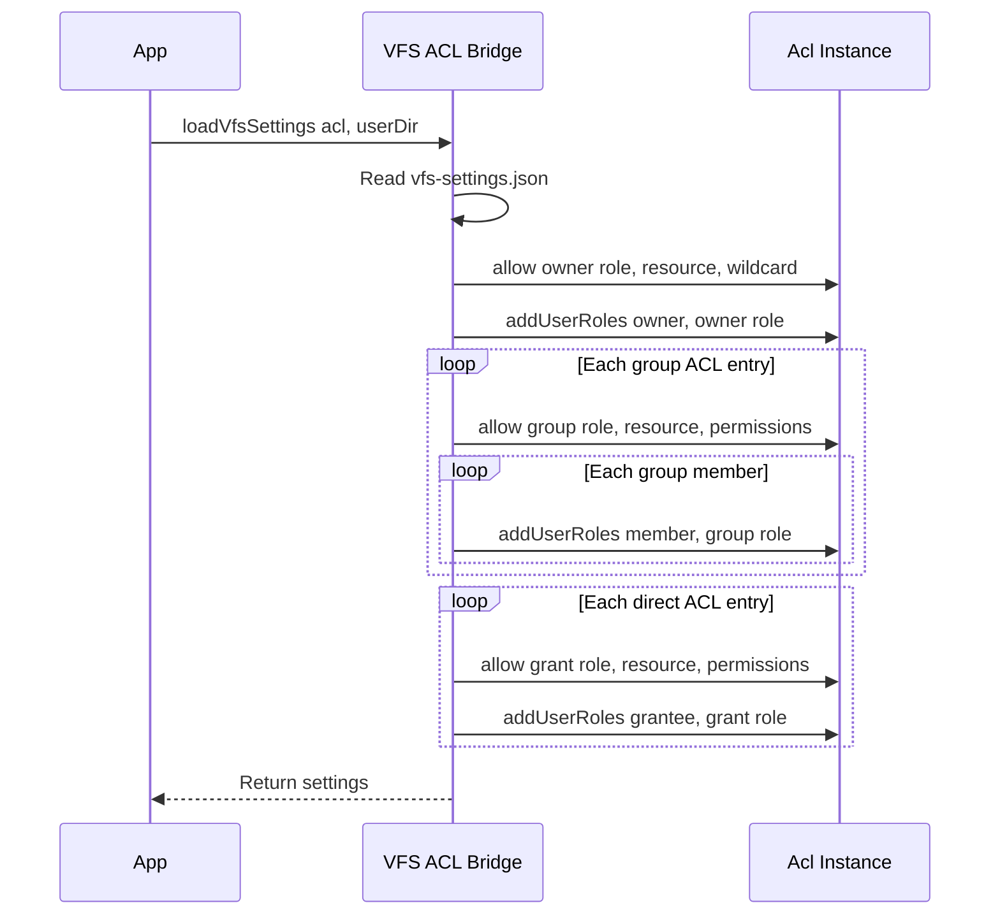

# @polymech/acl

[](https://www.npmjs.com/package/@polymech/acl)


Role-based access control (RBAC) library inspired by [Zend_ACL](https://framework.zend.com/manual/1.12/en/zend.acl.html).  
[Source Repository: polymech/mono](https://git.polymech.info/polymech/mono) | Used in [Filebrowser](https://service.polymech.info/app/filebrowser/machines?mode=thumb) at [https://service.polymech.info/](https://service.polymech.info/).


Pure ESM, `async/await`, zero runtime dependencies (except [pino](https://github.com/pinojs/pino) for optional logging).

> **Supabase integration?** See [Supabase RLS Mirror — VFS Guide](docs/supabase-rls-vfs.md)  
> **Pure Postgres?** See [Postgres RLS — VFS Guide](docs/postgres-rls-vfs.md)

## Source Layout

```
src/
├── Acl.ts                  # Core ACL class
├── interfaces.ts           # Type definitions & backend interface
├── index.ts                # Barrel export
├── data/
│   ├── MemoryBackend.ts    # In-memory backend (default)
│   └── FileBackend.ts      # JSON file backend (dev/testing)
├── vfs/                    # Virtual filesystem extensions
│   ├── AclVfsClient.ts     # Guarded VFS bindings
│   ├── DecoratedVfsClient.ts # Extensible client wrapper
│   └── vfs-acl.ts          # VFS permission settings loader
└── acl.test.ts             # Functional tests (vitest)
```

## Concepts

| Term | Description |
|------|-------------|
| **User** | An identifier (string or number) representing a subject |
| **Role** | A named group of permissions assigned to users |
| **Resource** | Something being protected (e.g. `"posts"`, `"settings"`) |
| **Permission** | An action on a resource (e.g. `"read"`, `"write"`, `"delete"`) |
| **Parent** | Roles can inherit permissions from parent roles |

Wildcard `"*"` grants all permissions on a resource.

## Quick Start

```ts
import { Acl, MemoryBackend } from '@polymech/acl';

const acl = new Acl(new MemoryBackend());

// Define permissions
await acl.allow('viewer', 'posts', 'read');
await acl.allow('editor', 'posts', ['read', 'write', 'delete']);
await acl.allow('admin', 'settings', '*');

// Assign roles to users
await acl.addUserRoles('alice', 'editor');
await acl.addUserRoles('bob', 'viewer');

// Check access
await acl.isAllowed('alice', 'posts', 'write');   // true
await acl.isAllowed('bob', 'posts', 'write');     // false
await acl.isAllowed('bob', 'posts', 'read');      // true
```

## Role Hierarchy

Roles can inherit from parents. A child role gets all permissions of its ancestors.

```ts
await acl.allow('viewer', 'docs', 'read');
await acl.allow('editor', 'docs', 'write');
await acl.allow('admin', 'docs', 'admin');

// editor inherits from viewer, admin inherits from editor
await acl.addRoleParents('editor', 'viewer');
await acl.addRoleParents('admin', 'editor');

await acl.addUserRoles('carol', 'admin');

await acl.isAllowed('carol', 'docs', 'read');   // true  (from viewer)
await acl.isAllowed('carol', 'docs', 'write');  // true  (from editor)
await acl.isAllowed('carol', 'docs', 'admin');  // true  (own)
```

## Batch Grants

Use the array syntax to define complex permission sets at once:

```ts
await acl.allow([
  {
    roles: 'moderator',
    allows: [
      { resources: 'posts',    permissions: ['read', 'edit', 'flag'] },
      { resources: 'comments', permissions: ['read', 'delete'] },
    ],
  },
  {
    roles: 'author',
    allows: [
      { resources: 'posts', permissions: ['read', 'create'] },
    ],
  },
]);
```

## Querying Permissions

```ts
// All permissions a user has on given resources
const perms = await acl.allowedPermissions('alice', ['posts', 'settings']);
// → { posts: ['read', 'write', 'delete'], settings: [] }

// Which resources does a role have access to?
const resources = await acl.whatResources('editor');
// → { posts: ['read', 'write', 'delete'] }

// Which resources grant a specific permission?
const writable = await acl.whatResources('editor', 'write');
// → ['posts']
```

## Removal

```ts
// Remove specific permissions
await acl.removeAllow('editor', 'posts', 'delete');

// Remove all permissions for a resource from a role
await acl.removeAllow('editor', 'posts');

// Remove a role entirely
await acl.removeRole('editor');

// Remove a resource from all roles
await acl.removeResource('posts');

// Remove a role from a user
await acl.removeUserRoles('alice', 'editor');
```

## File Backend (Dev/Testing)

[`FileBackend`](src/data/FileBackend.ts) extends [`MemoryBackend`](src/data/MemoryBackend.ts) with JSON persistence:

```ts
import { Acl, FileBackend } from '@polymech/acl';

const backend = new FileBackend('./acl-data.json');
backend.read();                     // load from disk

const acl = new Acl(backend);
await acl.allow('admin', 'all', '*');
await acl.addUserRoles('root', 'admin');

backend.write();                    // persist to disk
```

## Logging

Pass a [pino](https://github.com/pinojs/pino) logger as the second constructor argument:

```ts
import pino from 'pino';
import { Acl, MemoryBackend } from '@polymech/acl';

const logger = pino({ level: 'debug' });
const acl = new Acl(new MemoryBackend(), logger);

await acl.allow('admin', 'posts', '*');
// logs: { roles: ['admin'], resources: ['posts'], permissions: ['*'] } allow
```

## Custom Backend

Implement the [`IBackend`](src/interfaces.ts) interface to plug in any storage:

```ts
import type { IBackend, Value, Values } from '@polymech/acl';

class RedisBackend implements IBackend<RedisTx> {
  begin(): RedisTx { /* ... */ }
  async end(tx: RedisTx): Promise<void> { /* ... */ }
  async clean(): Promise<void> { /* ... */ }
  async get(bucket: string, key: Value): Promise<string[]> { /* ... */ }
  async union(bucket: string, keys: Value[]): Promise<string[]> { /* ... */ }
  async unions(buckets: string[], keys: Value[]): Promise<Record<string, string[]>> { /* ... */ }
  add(tx: RedisTx, bucket: string, key: Value, values: Values): void { /* ... */ }
  del(tx: RedisTx, bucket: string, keys: Values): void { /* ... */ }
  remove(tx: RedisTx, bucket: string, key: Value, values: Values): void { /* ... */ }
}
```

## Real-World Example — VFS Per-User Folder Permissions

Fine-grained, path-scoped access control for a virtual filesystem where each user owns a folder and can grant specific permissions to others — individually or via **groups**.

### How It Works

Each user's VFS folder contains a `vfs-settings.json` that declares who can do what:

```json
{
  "owner": "3bb4cfbf-318b-44d3-a9d3-35680e738421",
  "groups": [
    {
      "name": "team",
      "members": ["aaaaaaaa-...", "cccccccc-..."]
    },
    {
      "name": "viewers",
      "members": ["dddddddd-...", "ffffffff-..."]
    }
  ],
  "acl": [
    {
      "group": "team",
      "path": "/shared",
      "permissions": ["read", "write", "list", "mkdir", "delete"]
    },
    {
      "group": "team",
      "path": "/docs",
      "permissions": ["read", "list"]
    },
    {
      "group": "viewers",
      "path": "/docs",
      "permissions": ["read", "list"]
    },
    {
      "userId": "ffffffff-...",
      "path": "/shared",
      "permissions": ["read", "list"]
    }
  ]
}
```

- **Groups** bundle users — grant once, apply to all members.
- **Direct user grants** coexist with groups for individual overrides.
- **Path scoping** — grants apply to a specific folder and its children (`/shared`, `/docs`).
- The **owner** always gets `*` on `/` (entire tree).

### Permission Model

| Permission | Operations |
|------------|------------|
| `read` | `stat`, `readfile`, `exists` |
| `list` | `readdir` |
| `write` | `writefile`, `mkfile` |
| `mkdir` | `mkdir` |
| `delete` | `rmfile`, `rmdir` |
| `rename` | `rename` |
| `copy` | `copy` |
| `*` | All of the above — auto-granted to the folder owner |

### Path-Scoped Resolution

When a user accesses `/shared/reports/q1.pdf`, the guard walks the **resource chain** upward:

```
vfs:<ownerId>:/shared/reports/q1.pdf   ← most specific
vfs:<ownerId>:/shared/reports
vfs:<ownerId>:/shared                  ← team group matches here ✓
vfs:<ownerId>:/
```

Access is granted if **any** level allows the operation.

### Setup Flow



### Code Example

```ts
import { Acl, MemoryBackend, AclVfsClient, loadVfsSettings } from '@polymech/acl';

// 1. Create ACL and load settings from the user's folder
const acl = new Acl(new MemoryBackend());
const userDir = './data/vfs/3bb4cfbf-318b-44d3-a9d3-35680e738421';
await loadVfsSettings(acl, userDir);

// 2. Create a guarded client for a specific caller
const ownerId = '3bb4cfbf-318b-44d3-a9d3-35680e738421';
const callerId = 'aaaaaaaa-1111-2222-3333-bbbbbbbbbbbb'; // team member

const client = new AclVfsClient(acl, ownerId, callerId, {
  root: userDir,
});

// 3. Allowed — team has read+list on /docs
const files = await client.readdir('docs');           // ✓ works
const exists = await client.exists('docs/readme.txt'); // ✓ works

// 4. Allowed — team has full access on /shared
await client.writefile('shared/notes.txt', 'hello');  // ✓ works
await client.mkdir('shared/reports');                  // ✓ works

// 5. Denied — team has no access on /private
await client.readdir('private');                      // ✗ throws EACCES
await client.writefile('private/x.txt', '...');       // ✗ throws EACCES

// 6. Denied — team has read-only on /docs, no write
await client.writefile('docs/hack.txt', '...');       // ✗ throws EACCES
```

### Test Fixtures

```
tests/
├── vfs/root/
│   ├── 3bb4cfbf-…/
│   │   ├── vfs-settings.json          # Path-scoped direct grants
│   │   ├── docs/readme.txt
│   │   ├── shared/data.txt
│   │   └── private/secret.txt
│   ├── groups-test/
│   │   └── vfs-settings.json          # Group grants + mixed direct
│   ├── edge-cases/                    # Edge case fixtures
│   │   └── vfs-settings.json
│   └── anon-test/                     # Anonymous access fixtures
│       └── vfs-settings.json
├── vfs-acl.e2e.test.ts                # 26 permission boundary tests
├── vfs-acl-fs.e2e.test.ts             # 24 real filesystem tests
├── vfs-acl-paths.e2e.test.ts          # 34 per-path nested tests
├── vfs-acl-groups.e2e.test.ts         # 27 groups e2e tests
├── vfs-acl-edge.e2e.test.ts           # 18 edge case tests  
├── vfs-acl-decorated.e2e.test.ts      # 15 decorated VFS tests
└── vfs-acl-anonymous.e2e.test.ts      # 8 anonymous access tests
```

## Scripts

```bash
npm run build        # Compile TypeScript
npm run dev          # Watch mode
npm run test:core    # Core ACL tests (23)
npm run test:all     # Full suite (175 tests)
npm run lint         # ESLint
```

## References

- **[A Social Filesystem: Summary and Practical Paths (Decentral, Offline-capable, Community-owned)](https://service.polymech.info/user/cgo/pages/a-social-filesystem-summary-and-practical-paths-decentral-offlinecapable-communityowned)**

### 1. Virtual Filesystems and OS Integration
- libFUSE (Linux): [https://github.com/libfuse/libfuse](https://github.com/libfuse/libfuse)
- macFUSE (macOS): [https://osxfuse.github.io/](https://osxfuse.github.io/)
- WinFSP (Windows): [https://winfsp.dev/](https://winfsp.dev/)
- Dokany (Windows): [https://dokan-dev.github.io/](https://dokan-dev.github.io/)
- GVfs (GNOME): [https://wiki.gnome.org/Projects/gvfs](https://wiki.gnome.org/Projects/gvfs)
- KIO (KDE): [https://develop.kde.org/docs/kio/](https://develop.kde.org/docs/kio/)
- WebDAV RFC 4918: [https://www.rfc-editor.org/rfc/rfc4918](https://www.rfc-editor.org/rfc/rfc4918)
- Rclone: [https://rclone.org/](https://rclone.org/)
- IPFS/Kubo FUSE: [https://docs.ipfs.tech/concepts/file-systems/#mfs](https://docs.ipfs.tech/concepts/file-systems/#mfs)
- SSHFS: [https://github.com/libfuse/sshfs](https://github.com/libfuse/sshfs)

### 2. Browser and PWA Primitives
- File System Access API: [https://developer.mozilla.org/en-US/docs/Web/API/File_System_Access_API](https://developer.mozilla.org/en-US/docs/Web/API/File_System_Access_API)
- OPFS guide: [https://web.dev/opfs/](https://web.dev/opfs/)
- IndexedDB: [https://developer.mozilla.org/en-US/docs/Web/API/IndexedDB_API](https://developer.mozilla.org/en-US/docs/Web/API/IndexedDB_API)
- Service Workers: [https://developer.mozilla.org/en-US/docs/Web/API/Service_Worker_API](https://developer.mozilla.org/en-US/docs/Web/API/Service_Worker_API)
- Background sync: [https://web.dev/periodic-background-sync/](https://web.dev/periodic-background-sync/)
- WebRTC Data Channels: [https://developer.mozilla.org/en-US/docs/Web/API/WebRTC_API](https://developer.mozilla.org/en-US/docs/Web/API/WebRTC_API)
- WebTransport (QUIC): [https://developer.mozilla.org/en-US/docs/Web/API/WebTransport_API](https://developer.mozilla.org/en-US/docs/Web/API/WebTransport_API)
- BrowserFS: [https://github.com/jvilk/BrowserFS](https://github.com/jvilk/BrowserFS)
- LightningFS: [https://github.com/isomorphic-git/lightning-fs](https://github.com/isomorphic-git/lightning-fs)
- IDBFS (Emscripten): [https://emscripten.org/docs/api_reference/Filesystem-API.html](https://emscripten.org/docs/api_reference/Filesystem-API.html)

### 3. Decentralized Storage, Sync, and Collaboration
- IPFS: [https://ipfs.tech/](https://ipfs.tech/)
- IPNS: [https://docs.ipfs.tech/concepts/ipns/](https://docs.ipfs.tech/concepts/ipns/)
- OrbitDB: [https://orbitdb.org/](https://orbitdb.org/)
- Peergos: [https://peergos.org/](https://peergos.org/)
- WNFS: [https://github.com/fission-codes/wnfs](https://github.com/fission-codes/wnfs)
- Hypercore Protocol: [https://hypercore-protocol.org/](https://hypercore-protocol.org/)
- Hyperdrive: [https://github.com/holepunchto/hyperdrive](https://github.com/holepunchto/hyperdrive)
- Hyperswarm: [https://github.com/hyperswarm/hyperswarm](https://github.com/hyperswarm/hyperswarm)
- Secure Scuttlebutt (SSB): [https://scuttlebutt.nz/](https://scuttlebutt.nz/)
- Manyverse: [https://www.manyver.se/](https://www.manyver.se/)
- Tahoe-LAFS: [https://tahoe-lafs.org/](https://tahoe-lafs.org/)
- Syncthing: [https://syncthing.net/](https://syncthing.net/)
- Nextcloud: [https://nextcloud.com/](https://nextcloud.com/)
- Solid pods: [https://solidproject.org/](https://solidproject.org/)

### 4. Local‑First Data Structures and Collaboration Engines
- Yjs: [https://yjs.dev/](https://yjs.dev/)
- Automerge: [https://automerge.org/](https://automerge.org/)
- PouchDB: [https://pouchdb.com/](https://pouchdb.com/)
- CouchDB: [https://couchdb.apache.org/](https://couchdb.apache.org/)
- ElectricSQL: [https://electric-sql.com/](https://electric-sql.com/)
- Replicache: [https://replicache.dev/](https://replicache.dev/)

### 5. Identity and Capability‑Based Access
- Decentralized Identifiers (DIDs): [https://www.w3.org/TR/did-core/](https://www.w3.org/TR/did-core/)
- UCAN: [https://ucan.xyz/](https://ucan.xyz/)
- WebAuthn/passkeys: [https://www.w3.org/TR/webauthn-2/](https://www.w3.org/TR/webauthn-2/)
- Matrix: [https://matrix.org/](https://matrix.org/)
- Nostr: [https://github.com/nostr-protocol/nostr](https://github.com/nostr-protocol/nostr)

---

*This wonderful package has been brought to you by the people who get shit done :)*
