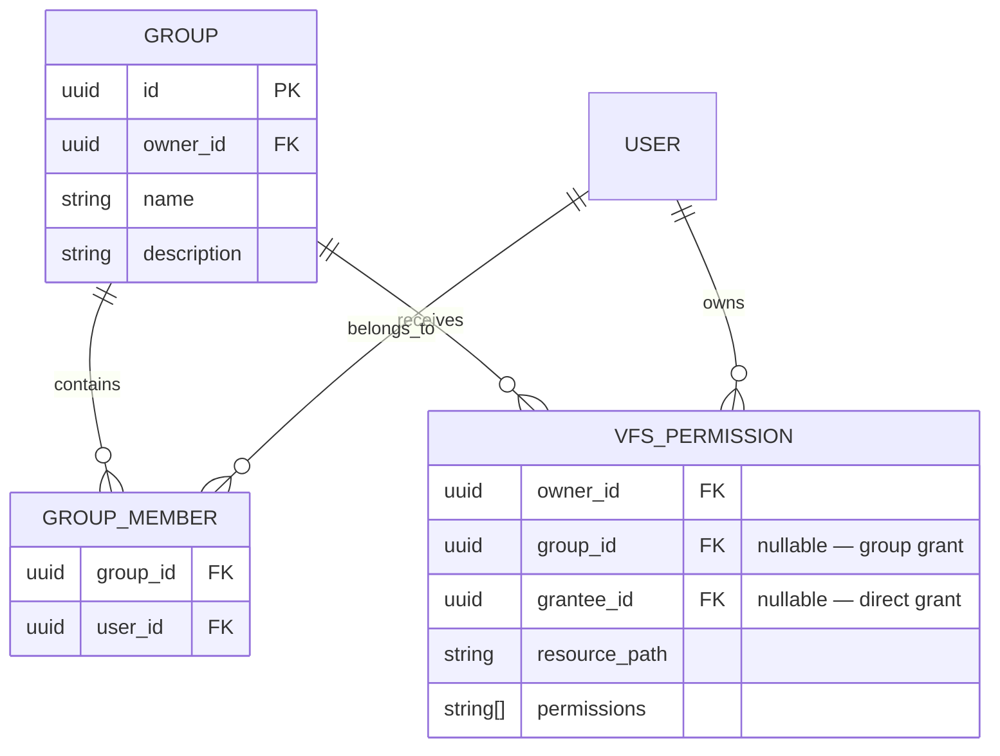
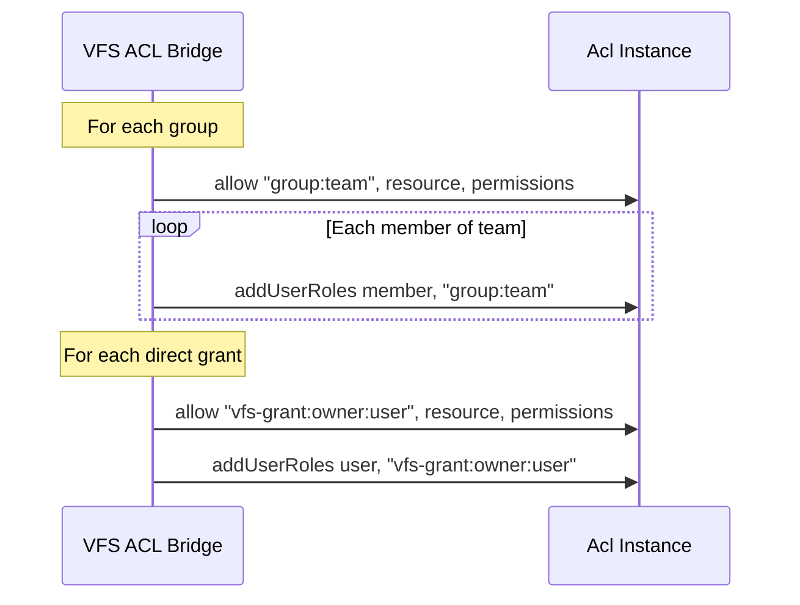
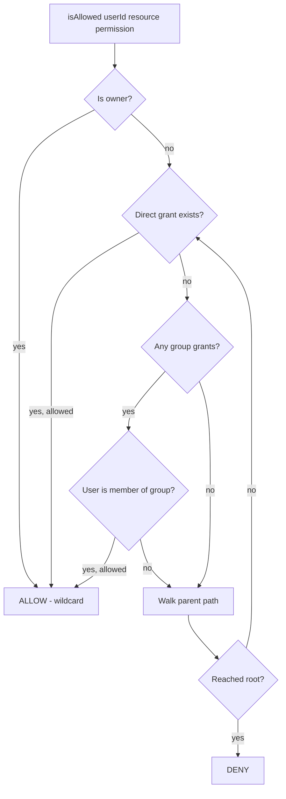

# Groups — Design Proposal

## Problem

Today, VFS permissions are granted **per-user**:

```json
{
  "acl": [
    { "userId": "aaa-...", "path": "/docs", "permissions": ["read", "list"] },
    { "userId": "bbb-...", "path": "/docs", "permissions": ["read", "list"] },
    { "userId": "ccc-...", "path": "/docs", "permissions": ["read", "list"] }
  ]
}
```

If 50 users need the same access, you write 50 entries. Changing the permission set means updating all 50. This doesn't scale.

## Proposal: User Groups

Introduce a **group** — a named set of users. Permissions are granted to groups rather than individual user IDs.

### Data Model



A permission row targets **either** a `group_id` or a `grantee_id` — never both.

### VFS Settings (JSON)

```json
{
  "owner": "3bb4cfbf-...",
  "groups": [
    {
      "name": "team",
      "members": ["aaa-...", "bbb-...", "ccc-..."]
    },
    {
      "name": "viewers",
      "members": ["ddd-...", "eee-..."]
    }
  ],
  "acl": [
    { "group": "team",    "path": "/shared", "permissions": ["read", "write", "list", "mkdir", "delete"] },
    { "group": "viewers", "path": "/docs",   "permissions": ["read", "list"] },
    { "userId": "fff-...", "path": "/private/partner", "permissions": ["read", "list"] }
  ]
}
```

Groups and direct user grants coexist. Direct grants take precedence for individual overrides.

---

## ACL Mapping

### How Groups Become Roles

Each group becomes a role in the ACL. All members of the group inherit that role:



### Role Naming Convention

| Type | Role Name | Example |
|------|-----------|---------|
| Owner | `owner:<ownerId>` | `owner:3bb4-...` |
| Group | `group:<ownerId>:<groupName>` | `group:3bb4-...:team` |
| Direct | `vfs-grant:<ownerId>:<userId>:<path>` | `vfs-grant:3bb4-...:fff-...:/private` |

---

## Implementation

### TypeScript Types

```ts
interface VfsGroup {
    name: string;
    members: string[];
}

interface VfsAclEntry {
    /** Direct user grant */
    userId?: string;
    /** Group grant */
    group?: string;
    /** Scoped path — defaults to "/" */
    path?: string;
    permissions: string[];
}

interface VfsSettings {
    owner: string;
    groups?: VfsGroup[];
    acl: VfsAclEntry[];
}
```

### Loader Changes

```ts
export async function loadVfsSettings(acl: Acl, userDir: string): Promise<VfsSettings | null> {
    // ... read settings ...

    // 1. Owner — wildcard on /
    const ownerRole = `owner:${settings.owner}`;
    await acl.allow(ownerRole, vfsResource(settings.owner, '/'), '*');
    await acl.addUserRoles(settings.owner, ownerRole);

    // 2. Register groups
    const groupMembers = new Map<string, string[]>();
    for (const group of settings.groups ?? []) {
        groupMembers.set(group.name, group.members);
    }

    // 3. Process ACL entries
    for (const entry of settings.acl) {
        const resourcePath = entry.path ?? '/';
        const resource = vfsResource(settings.owner, resourcePath);

        if (entry.group) {
            // Group grant
            const role = `group:${settings.owner}:${entry.group}`;
            await acl.allow(role, resource, entry.permissions);

            const members = groupMembers.get(entry.group) ?? [];
            for (const memberId of members) {
                await acl.addUserRoles(memberId, role);
            }
        } else if (entry.userId) {
            // Direct grant
            const role = `vfs-grant:${settings.owner}:${entry.userId}:${resourcePath}`;
            await acl.allow(role, resource, entry.permissions);
            await acl.addUserRoles(entry.userId, role);
        }
    }

    return settings;
}
```

### AclVfsClient

**No changes needed.** The client only calls `acl.isAllowed(callerId, resource, permission)` — it doesn't care whether the permission was granted via a group or a direct entry. The ACL resolves it transparently through `addUserRoles`.

---

## Postgres Schema

```sql
create table public.vfs_groups (
    id          uuid primary key default gen_random_uuid(),
    owner_id    uuid not null references public.users(id) on delete cascade,
    name        text not null,
    description text,

    unique (owner_id, name)
);

create table public.vfs_group_members (
    group_id    uuid not null references public.vfs_groups(id) on delete cascade,
    user_id     uuid not null references public.users(id) on delete cascade,

    primary key (group_id, user_id)
);

-- Extend vfs_permissions to support group grants
alter table public.vfs_permissions
    add column group_id uuid references public.vfs_groups(id) on delete cascade;

-- Either group_id or grantee_id must be set, never both
alter table public.vfs_permissions
    add constraint grant_target_check
    check (
        (group_id is not null and grantee_id is null)
        or (group_id is null and grantee_id is not null)
    );
```

---

## Permission Resolution Order

When checking `isAllowed(userId, resource, permission)`:



This is already handled by the existing `resourceChain` + `addUserRoles` — no new resolution logic needed.

---

## Open Questions

1. **Nested groups?** — A group containing other groups (e.g. `all-staff` inherits members from `team-a` + `team-b`). This maps to `addRoleParents` but adds complexity. Recommend **no** for v1.

2. **Group-scoped deny?** — Explicitly deny a permission for a group. The current ACL doesn't support deny rules (allow-only). Recommend deferring.

3. **Who can manage groups?** — Only the folder owner, or delegates? RLS naturally restricts to `owner_id = auth.uid()`, but a `group_admin` role could be added later.

4. **Max group size?** — For the in-memory backend, large groups (1000+ members) are fine. For the DB loader, a single `SELECT ... JOIN` handles it. No practical limit for v1.
