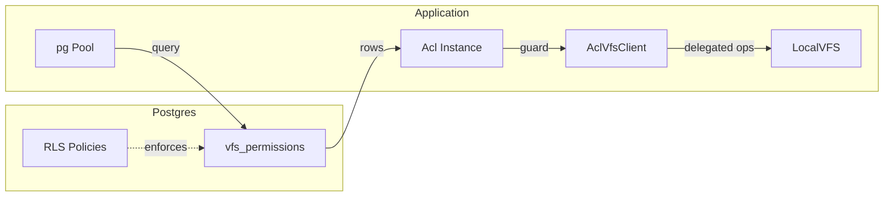
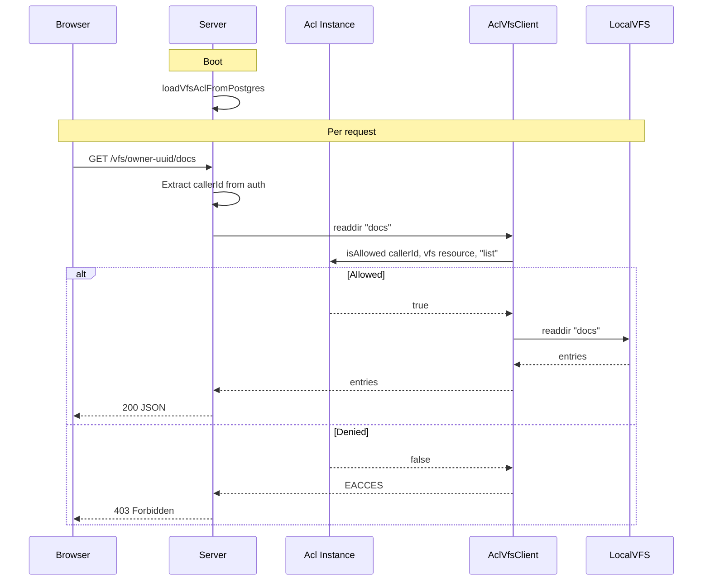
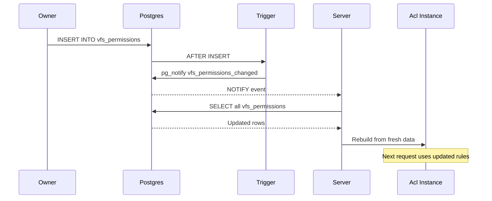

# Pure Postgres RLS — VFS ACL Integration Guide

Adopt `@polymech/acl` as the **application-layer mirror** of native Postgres Row Level Security for your VFS.  
No Supabase SDK required — just `pg` (or any Postgres client) and standard RLS policies.

## Architecture



Postgres RLS is the **authoritative source** for who can access what.  
The `Acl` instance is a fast in-memory cache of those rules, used to guard filesystem operations without hitting the database on every file I/O.

---

## Step 1 — Schema and RLS Policies

```sql
-- Enable pgcrypto for gen_random_uuid
create extension if not exists pgcrypto;

-- Users table (skip if you already have one)
create table if not exists public.users (
  id    uuid primary key default gen_random_uuid(),
  email text unique not null
);

-- VFS permission grants (per resource path)
create table public.vfs_permissions (
  id            uuid primary key default gen_random_uuid(),
  owner_id      uuid not null references public.users(id) on delete cascade,
  grantee_id    uuid not null references public.users(id) on delete cascade,
  resource_path text not null default '/',
  permissions   text[] not null default '{}',
  created_at    timestamptz not null default now(),

  unique (owner_id, grantee_id, resource_path)
);

-- resource_path examples:
--   '/'           → entire user folder (root)
--   '/docs'       → only the docs subfolder
--   '/photos/pub' → only photos/pub and its children

alter table public.vfs_permissions enable row level security;
```

### RLS Policies

Postgres needs to know **who is asking**. Set the current user ID per-connection via a session variable:

```sql
-- Set at the start of every connection / transaction
set local app.current_user_id = '<user-uuid>';
```

Then define policies that reference it:

```sql
-- Owners can do anything with their own grants
create policy "owner_full_access"
  on public.vfs_permissions
  for all
  using  (owner_id = current_setting('app.current_user_id')::uuid)
  with check (owner_id = current_setting('app.current_user_id')::uuid);

-- Grantees can see their own grants (read-only)
create policy "grantee_read_own"
  on public.vfs_permissions
  for select
  using (grantee_id = current_setting('app.current_user_id')::uuid);
```

### Valid Permissions

| Permission | VFS Operation |
|-----------|---------------|
| `read` | `stat`, `readfile`, `exists` |
| `list` | `readdir` |
| `write` | `writefile`, `mkfile` |
| `mkdir` | `mkdir` |
| `delete` | `rmfile`, `rmdir` |
| `rename` | `rename` |
| `copy` | `copy` |

---

## Step 2 — Postgres ACL Loader

Load grants from Postgres into the ACL. Uses a **service connection** (bypasses RLS) to fetch all grants at boot, or a **user-scoped connection** for per-request loading.

### Service-Level Loader (Boot)

```ts
import { Pool } from 'pg';
import { Acl, MemoryBackend } from '@polymech/acl';

const pool = new Pool({
  connectionString: process.env.DATABASE_URL,
});

interface VfsRow {
  owner_id: string;
  grantee_id: string;
  resource_path: string;
  permissions: string[];
}

/**
 * Load all VFS grants into an Acl instance.
 * Uses a service-role connection (no RLS filtering).
 */
export async function loadVfsAclFromPostgres(acl: Acl): Promise<void> {
  const { rows } = await pool.query<VfsRow>(
    'SELECT owner_id, grantee_id, resource_path, permissions FROM public.vfs_permissions',
  );

  // Group by owner
  const byOwner = new Map<string, VfsRow[]>();
  for (const row of rows) {
    const list = byOwner.get(row.owner_id) ?? [];
    list.push(row);
    byOwner.set(row.owner_id, list);
  }

  for (const [ownerId, grants] of byOwner) {
    // Owner gets wildcard on their entire tree
    const ownerResource = `vfs:${ownerId}:/`;
    const ownerRole = `owner:${ownerId}`;
    await acl.allow(ownerRole, ownerResource, '*');
    await acl.addUserRoles(ownerId, ownerRole);

    // Each grantee gets permissions scoped to a specific path
    for (const grant of grants) {
      // Resource = vfs:<ownerId>:<path>  e.g. vfs:aaa-...:/docs
      const resource = `vfs:${ownerId}:${grant.resource_path}`;
      const role = `vfs-grant:${ownerId}:${grant.grantee_id}:${grant.resource_path}`;
      await acl.allow(role, resource, grant.permissions);
      await acl.addUserRoles(grant.grantee_id, role);
    }
  }
}
```

### User-Scoped Loader (Per-Request, RLS-Enforced)

When you want RLS to filter results naturally:

```ts
/**
 * Load grants visible to a specific user (respects RLS).
 */
export async function loadUserVisibleGrants(
  acl: Acl,
  userId: string,
): Promise<void> {
  const client = await pool.connect();
  try {
    // Set RLS context
    await client.query(`set local app.current_user_id = $1`, [userId]);

    const { rows } = await client.query<VfsRow>(
      'SELECT owner_id, grantee_id, permissions FROM public.vfs_permissions',
    );

    for (const row of rows) {
      const resource = `vfs:${row.owner_id}`;
      const role = `vfs-grant:${row.owner_id}:${row.grantee_id}`;
      await acl.allow(role, resource, row.permissions);
      await acl.addUserRoles(row.grantee_id, role);
    }
  } finally {
    client.release();
  }
}
```

---

## Step 3 — Server Integration

```ts
import express from 'express';
import { Acl, MemoryBackend } from '@polymech/acl';
import { AclVfsClient } from '@polymech/acl/vfs/AclVfsClient';
import { loadVfsAclFromPostgres } from './pg-acl-loader.js';

const app = express();

// Boot: populate ACL from Postgres
const acl = new Acl(new MemoryBackend());
await loadVfsAclFromPostgres(acl);

// Middleware: extract userId from session / JWT / cookie
app.use((req, _res, next) => {
  req.userId = extractUserId(req);  // your auth logic
  next();
});

// Route: list files in another user's folder
app.get('/vfs/:ownerId/*', async (req, res) => {
  const { ownerId } = req.params;
  const subpath = req.params[0] ?? '';

  const client = new AclVfsClient(acl, ownerId, req.userId, {
    root: `/data/vfs/${ownerId}`,
  });

  try {
    const entries = await client.readdir(subpath);
    res.json(entries);
  } catch (err) {
    if ((err as NodeJS.ErrnoException).code === 'EACCES') {
      return res.status(403).json({ error: 'Forbidden' });
    }
    res.status(500).json({ error: 'Internal error' });
  }
});
```

### Request Flow



---

## Step 4 — LISTEN/NOTIFY for Real-Time Sync

Use Postgres LISTEN/NOTIFY to keep the ACL in sync without polling:

```sql
-- Trigger function: notify on permission changes
create or replace function notify_vfs_permission_change()
returns trigger as $$
begin
  perform pg_notify('vfs_permissions_changed', '');
  return coalesce(NEW, OLD);
end;
$$ language plpgsql;

create trigger vfs_permissions_change_trigger
  after insert or update or delete
  on public.vfs_permissions
  for each row
  execute function notify_vfs_permission_change();
```

Subscribe in your Node.js server:

```ts
import { Client } from 'pg';

const listener = new Client({ connectionString: process.env.DATABASE_URL });
await listener.connect();
await listener.query('LISTEN vfs_permissions_changed');

listener.on('notification', async () => {
  console.log('VFS permissions changed — rebuilding ACL');
  const freshAcl = new Acl(new MemoryBackend());
  await loadVfsAclFromPostgres(freshAcl);
  replaceGlobalAcl(freshAcl);
});
```

### Sync Flow



---

## Step 5 — Managing Grants via SQL

### Grant access

```sql
-- Give user B read + list on user A's /docs folder
INSERT INTO vfs_permissions (owner_id, grantee_id, resource_path, permissions)
VALUES ('aaa-...', 'bbb-...', '/docs', ARRAY['read', 'list'])
ON CONFLICT (owner_id, grantee_id, resource_path)
DO UPDATE SET permissions = EXCLUDED.permissions;

-- Give user B full access to user A's /shared folder
INSERT INTO vfs_permissions (owner_id, grantee_id, resource_path, permissions)
VALUES ('aaa-...', 'bbb-...', '/shared', ARRAY['read', 'write', 'list', 'mkdir', 'delete'])
ON CONFLICT (owner_id, grantee_id, resource_path)
DO UPDATE SET permissions = EXCLUDED.permissions;
```

### Extend permissions

```sql
-- Add 'write' to the /docs grant
UPDATE vfs_permissions
SET permissions = array_cat(permissions, ARRAY['write'])
WHERE owner_id = 'aaa-...' AND grantee_id = 'bbb-...' AND resource_path = '/docs';
```

### Revoke specific permissions

```sql
-- Remove 'write' from the /docs grant
UPDATE vfs_permissions
SET permissions = array_remove(permissions, 'write')
WHERE owner_id = 'aaa-...' AND grantee_id = 'bbb-...' AND resource_path = '/docs';
```

### Revoke all access

```sql
-- Revoke access to a specific folder
DELETE FROM vfs_permissions
WHERE owner_id = 'aaa-...' AND grantee_id = 'bbb-...' AND resource_path = '/docs';

-- Revoke ALL access (all paths)
DELETE FROM vfs_permissions
WHERE owner_id = 'aaa-...' AND grantee_id = 'bbb-...';
```

---

## Step 6 — Verify RLS Works

Quick sanity check that RLS is enforcing properly:

```sql
-- As owner: sees all their grants
set local app.current_user_id = 'owner-uuid';
select * from vfs_permissions;  -- returns owner's grants

-- As grantee: sees only grants targeting them
set local app.current_user_id = 'grantee-uuid';
select * from vfs_permissions;  -- returns only grantee's rows

-- As stranger: sees nothing
set local app.current_user_id = 'stranger-uuid';
select * from vfs_permissions;  -- empty
```

---

## Summary

| Layer | Enforces | When |
|-------|----------|------|
| **Postgres RLS** | Who can read/modify `vfs_permissions` rows | Every SQL query |
| **LISTEN/NOTIFY** | ACL cache invalidation | On permission changes |
| **Acl Instance** | Fast per-operation permission checks | Every file I/O |
| **AclVfsClient** | EACCES guard before `LocalVFS` | Every VFS API call |
| **LocalVFS** | Root-jail + symlink escape prevention | Every path resolution |

RLS is the lock on the vault. The ACL is the guard at the door. Both enforce the same rules, at different layers.
