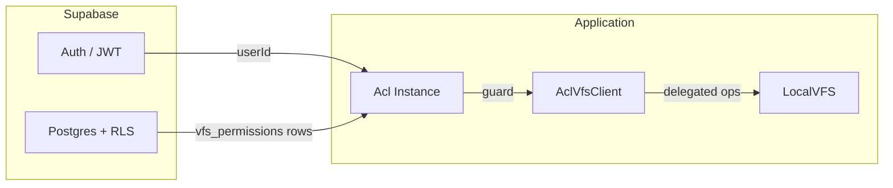
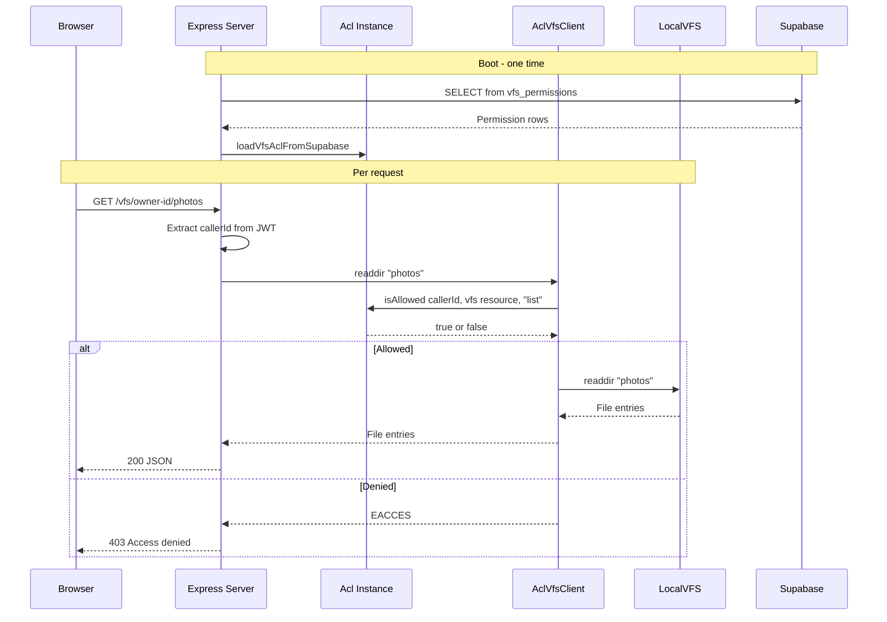

# Supabase RLS Mirror — VFS ACL Integration Guide

Adopt `@polymech/acl` as the **application-layer mirror** of Supabase Row Level Security for your VFS.  
Supabase RLS enforces access at the database level; this library enforces the same rules at the filesystem level — keeping both in sync.

## Architecture



The idea: Supabase owns the **source of truth** for permissions (stored in a `vfs_permissions` table with RLS policies). At server startup or per-request, those rows are loaded into the in-memory `Acl` instance, which then guards every filesystem operation.

---

## Step 1 — Database Schema

Create a `vfs_permissions` table in Supabase to store per-folder grants:

```sql
create table public.vfs_permissions (
  id            uuid default gen_random_uuid() primary key,
  owner_id      uuid not null references auth.users(id) on delete cascade,
  grantee_id    uuid not null references auth.users(id) on delete cascade,
  resource_path text not null default '/',
  permissions   text[] not null default '{}',
  created_at    timestamptz default now(),

  unique (owner_id, grantee_id, resource_path)
);

-- resource_path examples:
--   '/'           → entire user folder (root)
--   '/docs'       → only the docs subfolder
--   '/photos/pub' → only photos/pub and its children

-- Owner can manage their own grants
alter table public.vfs_permissions enable row level security;

create policy "owners manage their grants"
  on public.vfs_permissions
  for all
  using (auth.uid() = owner_id)
  with check (auth.uid() = owner_id);

-- Grantees can read their own grants
create policy "grantees can read their grants"
  on public.vfs_permissions
  for select
  using (auth.uid() = grantee_id);
```

### Valid Permissions

| Permission | VFS Operation |
|-----------|---------------|
| `read` | `stat`, `readfile`, `exists` |
| `list` | `readdir` |
| `write` | `writefile`, `mkfile` |
| `mkdir` | `mkdir` |
| `delete` | `rmfile`, `rmdir` |
| `rename` | `rename` |
| `copy` | `copy` |

---

## Step 2 — Supabase ACL Loader

Fetch grants from Supabase and load them into the ACL at server startup or per-request:

```ts
import { createClient } from '@supabase/supabase-js';
import { Acl, MemoryBackend } from '@polymech/acl';

const supabase = createClient(
  process.env.SUPABASE_URL!,
  process.env.SUPABASE_SERVICE_ROLE_KEY!,
);

interface VfsPermissionRow {
  owner_id: string;
  grantee_id: string;
  resource_path: string;
  permissions: string[];
}

/**
 * Load all VFS permissions from Supabase into an Acl instance.
 * Call this at server startup, or per-request for real-time sync.
 */
export async function loadVfsAclFromSupabase(acl: Acl): Promise<void> {
  const { data, error } = await supabase
    .from('vfs_permissions')
    .select('owner_id, grantee_id, resource_path, permissions');

  if (error) throw error;

  // Group by owner
  const byOwner = new Map<string, VfsPermissionRow[]>();
  for (const row of data as VfsPermissionRow[]) {
    const list = byOwner.get(row.owner_id) ?? [];
    list.push(row);
    byOwner.set(row.owner_id, list);
  }

  for (const [ownerId, grants] of byOwner) {
    // Owner gets wildcard on their entire tree
    const ownerResource = `vfs:${ownerId}:/`;
    const ownerRole = `owner:${ownerId}`;
    await acl.allow(ownerRole, ownerResource, '*');
    await acl.addUserRoles(ownerId, ownerRole);

    // Each grantee gets permissions scoped to a specific path
    for (const grant of grants) {
      const resource = `vfs:${ownerId}:${grant.resource_path}`;
      const grantRole = `vfs-grant:${ownerId}:${grant.grantee_id}:${grant.resource_path}`;
      await acl.allow(grantRole, resource, grant.permissions);
      await acl.addUserRoles(grant.grantee_id, grantRole);
    }
  }
}
```

---

## Step 3 — Server Integration

Wire it into your Express / Hono / Fastify route handler:

```ts
import { Acl, MemoryBackend } from '@polymech/acl';
import { AclVfsClient } from '@polymech/acl/vfs/AclVfsClient';
import { loadVfsAclFromSupabase } from './supabase-acl-loader.js';

// Boot: load permissions once
const acl = new Acl(new MemoryBackend());
await loadVfsAclFromSupabase(acl);

// Per-request: create a guarded client
app.get('/vfs/:ownerId/*', async (req, res) => {
  const callerId = req.auth.userId;           // from Supabase JWT
  const ownerId = req.params.ownerId;
  const subpath = req.params[0] ?? '';

  const client = new AclVfsClient(acl, ownerId, callerId, {
    root: `/data/vfs/${ownerId}`,
  });

  try {
    const entries = await client.readdir(subpath);
    res.json(entries);
  } catch (err) {
    if ((err as NodeJS.ErrnoException).code === 'EACCES') {
      res.status(403).json({ error: 'Access denied' });
    } else {
      res.status(500).json({ error: 'Internal error' });
    }
  }
});
```

### Request Flow



---

## Step 4 — Real-Time Sync (Optional)

To keep the ACL in sync when permissions change without restarting, subscribe to Supabase Realtime:

```ts
supabase
  .channel('vfs-permissions')
  .on(
    'postgres_changes',
    { event: '*', schema: 'public', table: 'vfs_permissions' },
    async () => {
      // Rebuild ACL from scratch (simple approach)
      const freshAcl = new Acl(new MemoryBackend());
      await loadVfsAclFromSupabase(freshAcl);
      // Swap the reference atomically
      replaceGlobalAcl(freshAcl);
    },
  )
  .subscribe();
```

For high-traffic systems, apply incremental updates instead of full rebuilds.

---

## Step 5 — Client-Side Permission Check (UI)

Use the same Supabase RLS policies to show/hide UI elements. The client can query `vfs_permissions` directly (RLS filters automatically by `auth.uid()`):

```ts
const { data } = await supabase
  .from('vfs_permissions')
  .select('owner_id, permissions')
  .eq('grantee_id', currentUserId);

// data = [{ owner_id: '3bb4...', permissions: ['read', 'list'] }]
// Use this to conditionally render write/delete buttons
```

---

## Step 6 — Managing Grants (UI)

Owners manage their own grants through the RLS-protected table:

```ts
// Grant read + list on a specific folder
await supabase.from('vfs_permissions').upsert({
  owner_id: myUserId,
  grantee_id: targetUserId,
  resource_path: '/docs',
  permissions: ['read', 'list'],
});

// Revoke access to a specific folder
await supabase
  .from('vfs_permissions')
  .delete()
  .match({ owner_id: myUserId, grantee_id: targetUserId, resource_path: '/docs' });

// Revoke ALL access (all paths)
await supabase
  .from('vfs_permissions')
  .delete()
  .match({ owner_id: myUserId, grantee_id: targetUserId });
```

---

## Summary

| Layer | Responsibility |
|-------|---------------|
| **Supabase RLS** | Source of truth — who can read/modify `vfs_permissions` rows |
| **Acl Instance** | In-memory mirror — fast permission checks per filesystem operation |
| **AclVfsClient** | Guard layer — wraps `LocalVFS`, throws `EACCES` on denied |
| **LocalVFS** | Actual filesystem I/O — jailed to user's root directory |

Both layers enforce the same rules. Supabase RLS protects the data at rest; the ACL library protects the filesystem in motion.
