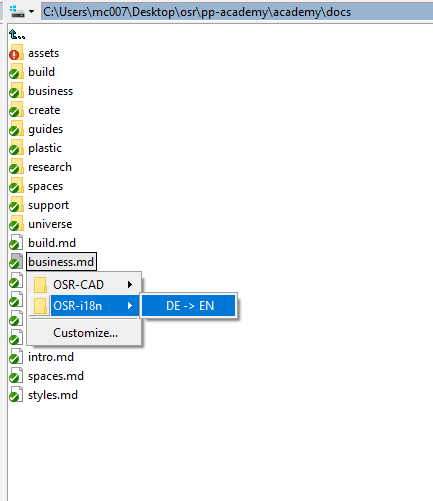
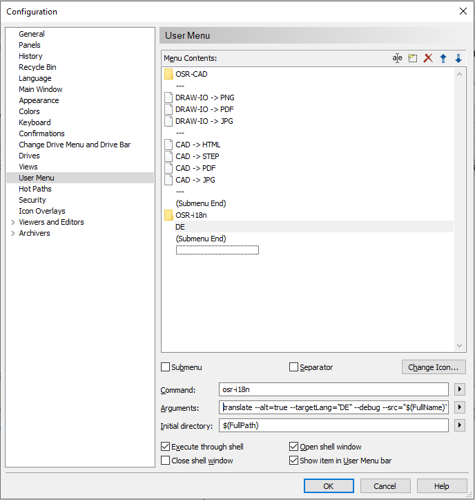

# Integration

## Integration: [Alt-Tap Salamand](https://www.altap.cz/) - Custom Menus

To use OSR-i18n in custom menus, as follows



1. install osr-cad via ```npm i -g @polymech/osr-cad```
2. Register a new custom menu (press F9 on any file)



**command** : ```osr-i18n```

**Arguments** : ```translate --alt=true --targetLang="DE" --debug --src="$(FullName)"  --dst="&{SRC_DIR}/&{SRC_NAME}.&{DST_LANG}.+(md)"```

```sh

translate                                   # osr-i18n command
    --alt=true                              # use alternate tokenizer, '&' instead of '$' to prevent collisions with Alt-Tab's own variable designator
    --debug=true                            # be verbose
    --src="$(FullName)"                     # use Alt-Tab's variable for the current selected file
    --dst="&{SRC_DIR}/&{SRC_NAME}.&{DST_LANG}.+(md)"  # the output destination path
```
