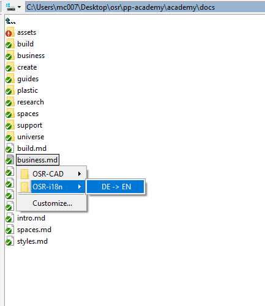
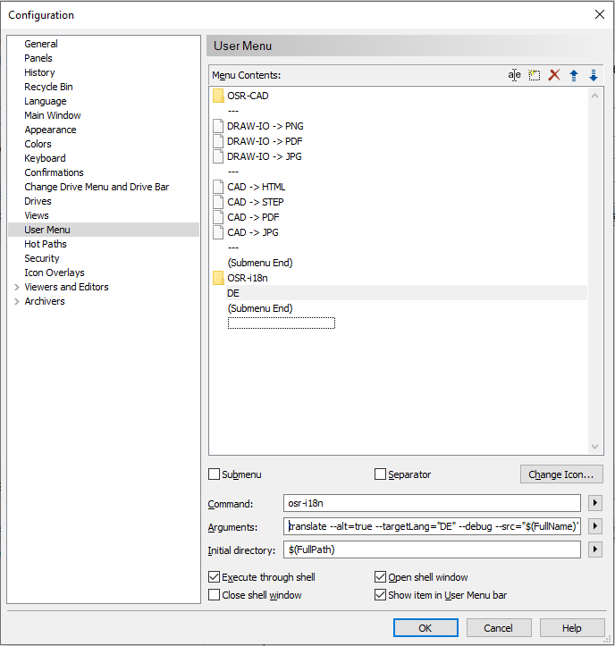

# Integration

## Integration: [Alt-Tap Salamand](https://www.altap.cz/) - Custom Menus

To use OSRL in custom menus, as follows



1. install osrl via ```npm i -g @plastichub/osrl```
2. Register a new custom menu (press F9 on any file)



**command** : ```osrl```

**Arguments** : ```compile --alt=true --debug --source="$(FullName)"  --output="&{SRC_DIR}/&{SRC_NAME}.+(osrl)"```

Here explained, 

```sh

compile                                     # compile command
    --alt=true                              # use alternate tokenizer, '&' instead of '$' to prevent collisions with Alt-Tab's own variable designator
    --debug=true                            # be verbose
    --source="$(FullName)"                  # use Alt-Tab's variable for the current selected file
    --output="&{SRC_DIR}/&{SRC_NAME}.md"   # the output destination path
```

