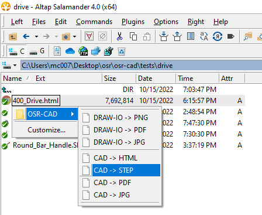
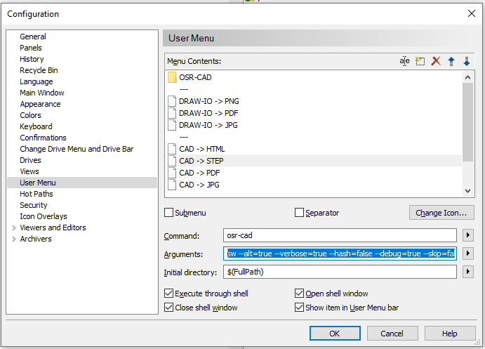

# Integration

## Integration: [Alt-Tap Salamand - Filemanager](https://www.altap.cz/) - Custom Menus

To use osr-sync in custom menus, as follows



1. install osr-sync via ```npm i -g @plastichub/osr-sync```
2. Register a new custom menu (press F9 on any file)



**command** : ```osr-sync```

**Arguments** : ```sync --alt=true --clean=true --verbose=true --debug=true --source="$(FullName)" --target="target directory" --profile="${OSR_ROOT}/osr-commons/profiles/.osr-sync-public.json" ```

Here explained,

```sh

sync                                          # osr-sync command
    --alt=true                              # use alternate tokenizer, '&' instead of '$' to prevent collisions with Alt-Tab's own variable designator
    --verbose=true                          # be verbose
    --clean=true                            # empty target directory before sync
    --debug=true                            # be even more verbose
    --source="$(FullName)"                  # use Alt-Tab's variable for the current selected file
    --target="${OSR_ROOT}/temp"             # target directory
    # path to profile
    --profile="${OSR_ROOT}/osr-commons/profiles/.osr-sync-public.json" 
```

### Remarks

- Run ```osr-sync info``` to see all registered OSR paths (env variables)
