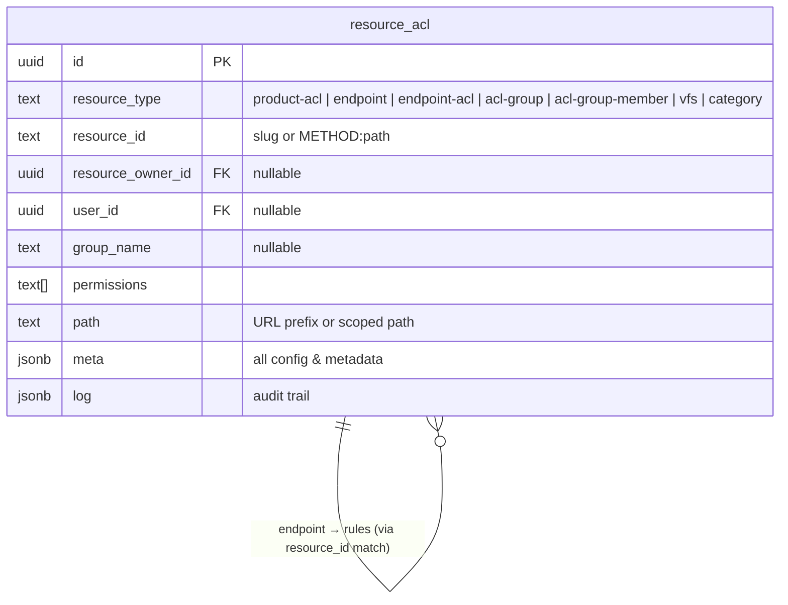

# ACL Management — Endpoint-Level, Database-Driven

> **Status**: Proposal  
> **Scope**: Server-side ACL enforcement, admin CRUD, OpenAPI-first endpoint registry, product & cost metadata  
> **Out of scope (for now)**: Billing/invoicing, UI

---

## 1. Problem Statement

The platform has **two disconnected permission layers** and a hardcoded product config that don't compose:

| Layer | Mechanism | Granularity |
|-------|-----------|-------------|
| `auth.ts` middleware | `PublicEndpointRegistry`, `AdminEndpointRegistry` | Binary: public vs auth vs admin |
| `db-acl.ts` orchestrator | Per-resource backends (VFS file-based, category DB-backed) | Resource-level ACL entries |

Additionally, `products.ts` hardcodes `PRODUCT_ACTIONS` with per-endpoint `costUnits` — this should move to the database so products and their endpoints are fully manageable via admin CRUD.

**What's missing:**

- No way for admins to **manage endpoint access** from a database — everything is code-deployed
- No **group/tier** concept for API endpoints (e.g. "free users get 10 searches/day, pro users get 1000")
- No standard way to express "user X can create pages but not posts" or "group Y can use the AI image generator"
- The `resource_acl` table handles per-object ACL (who can view this category) but not per-endpoint ACL (who can call POST /api/pages)
- No mechanism to feed fine-grained permissions to the frontend (e.g. "hide the Create Page button for this user")

---

## 2. Design Goals

1. **Zero new tables** — Everything fits in the existing `resource_acl` table using new `resource_type` conventions.
2. **OpenAPI-first** — The canonical list of "things you can control" is the OpenAPI spec (`/doc`). Every registered route has a `path`, `method`, and `tags[]`. ACL rules reference these directly.
3. **Database-driven** — All ACL configuration lives in Postgres, manageable via admin API. No more code deploys to change who can do what.
4. **Groups with inheritance** — ACL groups (tiers) can inherit from parent groups. `pro` inherits everything from `free`, then adds more.
5. **Rate-limit tiers** — Each group can have per-endpoint rate limits. The rate limiter middleware reads these from the ACL tables.
6. **Capability surfacing** — A single API call returns the authenticated user's effective permissions, consumable by the frontend to show/hide UI elements.
7. **Backward compatible** — Existing `PublicEndpointRegistry` / `AdminEndpointRegistry` continue to work. The new system layers on top.

---

## 3. Data Model — `resource_acl` Convention Map

### 3.0  Existing table (unchanged)

```sql
create table public.resource_acl (
  id                uuid primary key default gen_random_uuid(),
  resource_type     text not null,
  resource_id       text not null,
  resource_owner_id uuid references auth.users(id),
  user_id           uuid references auth.users(id) on delete cascade,
  group_name        text,
  permissions       text[] not null default '{}',
  path              text default '/',
  meta              jsonb default '{}',
  log               jsonb default '{}',
  created_at        timestamptz default now(),
  updated_at        timestamptz default now(),
  constraint check_grantee check (
    (user_id is not null and group_name is null) or
    (user_id is null and group_name is not null) or
    (user_id is null and group_name is null)     -- definition-only rows
  )
);
```

The `check_grantee` constraint already allows rows where **both** `user_id` and `group_name` are `NULL` — these are perfect for definition/config rows (products, endpoints, groups).

### 3.1  New `resource_type` conventions

All new concepts map to `resource_type` discriminators on the **same table**:

| Concept | `resource_type` | `resource_id` | `user_id` | `group_name` | `permissions` | `path` | `meta` |
|---------|----------------|---------------|-----------|-------------|---------------|--------|--------|
| **Product → Group rule** | `product-acl` | product slug: `places` | — | `pro` | `[]` | `/` | `{effect, rate_limit, rate_window}` — applies to ALL endpoints in product |
| **Product → User override** | `product-acl` | product slug: `places` | `uuid` | — | `[]` | `/` | `{effect, rate_limit, rate_window, reason}` |
| **Endpoint def** | `endpoint` | `GET:/api/pages` | — | — | `[]` | `/api/pages` | `{tag, summary, product, cost_units, cancellable, is_public, is_admin}` |
| **Endpoint → Group rule** | `endpoint-acl` | `GET:/api/pages` | — | `editor` | `['create','update']` | `/` | `{effect, rate_limit, rate_window}` |
| **Endpoint → User override** | `endpoint-acl` | `GET:/api/pages` | `uuid` | — | `['create']` | `/` | `{effect, rate_limit, rate_window, reason, granted_by, expires_at}` |
| **Group def** | `acl-group` | slug: `editor` | — | — | `[]` | `/` | `{name, description, parent, priority, is_default}` |
| **Group member** | `acl-group-member` | group slug: `editor` | `uuid` | — | `[]` | `/` | `{granted_by, expires_at}` |
| VFS ACL (existing) | `vfs` | folder id | `uuid` or — | group or — | perms | scoped path | — |
| Category ACL (existing) | `category` | category id | `uuid` or — | group or — | perms | `/` | — |

> **Product-level vs endpoint-level rules:** A `product-acl` rule is a shorthand for "all endpoints in this product". When both exist, endpoint-level rules (`endpoint-acl`) override product-level rules (`product-acl`). This means admins can set a blanket rule for a product and then override specific endpoints.

### 3.2  Column reuse rationale

| Column | Original purpose | Reused for |
|--------|-----------------|------------|
| `resource_type` | Discriminator (`vfs`, `category`) | New types: `product-acl`, `endpoint`, `endpoint-acl`, `acl-group`, `acl-group-member` |
| `resource_id` | Resource identifier | Product slug, endpoint key (`METHOD:path`), group slug |
| `path` | VFS scoped path | Product prefix (`/api/places`), endpoint URL path |
| `permissions` | VFS/category perms | Endpoint fine-grained perms (`create`, `update`, `delete`) |
| `group_name` | VFS group grant | ACL group slug for endpoint rules |
| `user_id` | VFS user grant | Group membership, user overrides |
| `meta` | Extensible metadata | All config: costs, rate limits, tags, descriptions |
| `resource_owner_id` | VFS folder owner | Not used for new types (NULL) |
| `log` | Audit trail | Audit trail for rule changes |

### 3.3  Required schema changes

Only **one new index** needed — the existing indexes already cover the primary lookups:

```sql
-- New: fast group membership lookups (user → which groups?)
create index if not exists idx_resource_acl_group_name
  on resource_acl(group_name)
  where group_name is not null;

-- New: fast resource_type filtering for the new conventions
create index if not exists idx_resource_acl_type_id
  on resource_acl(resource_type, resource_id)
  where resource_type in ('product-acl', 'endpoint', 'endpoint-acl', 'acl-group', 'acl-group-member');
```

### 3.4  Seeding

```sql
-- Default ACL groups
insert into resource_acl (resource_type, resource_id, meta) values
  ('acl-group', 'anonymous',     '{"name":"Anonymous","priority":0,"is_default":false}'),
  ('acl-group', 'authenticated', '{"name":"Authenticated","priority":10,"is_default":true}'),
  ('acl-group', 'editor',        '{"name":"Editor","priority":20,"is_default":false,"parent":"authenticated"}'),
  ('acl-group', 'admin',         '{"name":"Admin","priority":100,"is_default":false,"parent":"editor"}');
```

### 3.5  Example rows

```
# ── Note: Products themselves are defined in a separate `products` table ──
# e.g., A row in the 'products' table where slug='places' and settings='{"default_cost_units": 1.0}'

# ── Product-level ACL ───────────────────────────────────────
# "free" group gets access to places product, 10 calls/day across ALL its endpoints
resource_type=product-acl  resource_id=places  group_name=free
  meta={effect:"allow", rate_limit:10, rate_window:86400}

# "pro" group gets 1000 calls/day across the whole product
resource_type=product-acl  resource_id=places  group_name=pro
  meta={effect:"allow", rate_limit:1000, rate_window:86400}

# ── Endpoint definition (auto-synced from OpenAPI) ──────────
resource_type=endpoint  resource_id=GET:/api/places/search  path=/api/places/search
  meta={tag:"Places", summary:"Search places", product:"places", cost_units:1.0, cancellable:true}

# ── Endpoint-level ACL override ─────────────────────────────
# Override: the find-email endpoint is more expensive, tighter limit for free
resource_type=endpoint-acl  resource_id=GET:/api/places/email/:id  group_name=free
  meta={effect:"allow", rate_limit:3, rate_window:86400}

# ── User override ───────────────────────────────────────────
# VIP user gets 5000/day on the full product
resource_type=product-acl  resource_id=places  user_id=<alice-uuid>
  meta={effect:"allow", rate_limit:5000, rate_window:86400, reason:"VIP customer"}

# ── Content creation example ────────────────────────────────
resource_type=endpoint-acl  resource_id=POST:/api/pages  group_name=editor
  permissions=[create]  meta={effect:"allow"}

resource_type=endpoint-acl  resource_id=PUT:/api/pages/:id  group_name=editor
  permissions=[update]  meta={effect:"allow"}

resource_type=endpoint-acl  resource_id=DELETE:/api/pages/:id  group_name=editor
  permissions=[]  meta={effect:"deny"}
```

### ER Diagram (logical, single table)



---

## 4. OpenAPI Endpoint Sync

On server boot, the system auto-syncs the OpenAPI spec into `resource_acl`:

```
Boot flow:
  1. app.doc31('/doc', ...) generates the OpenAPI spec
  2. syncEndpointsFromOpenAPI() reads the spec
  3. For each operation:
     UPSERT into resource_acl where resource_type='endpoint' and resource_id='METHOD:/path'
     Sets meta: {tag, summary, is_public, is_admin, product (by longest prefix match)}
  4. Mark stale endpoints (in DB but not in spec) via meta.deprecated = true
```

### Product assignment logic

During sync, each endpoint's `path` is matched against product rows in the *separate `products` table* (via prefix matching). Longest prefix wins:

```
/api/places/search    → matches product 'places' (by settings prefix or path convention)
/api/images/upload    → matches product 'images'
```

### Source: `PublicEndpointRegistry` + `AdminEndpointRegistry`

The existing decorators (`Public()`, `Admin()`) already populate these registries. The sync step reads both to set `meta.is_public` and `meta.is_admin` flags.

---

## 5. Permission Resolution Algorithm

When a request hits the middleware:

```
1. Extract user from JWT (or 'anonymous' sentinel)

2. Load user's groups:
   SELECT resource_id FROM resource_acl
   WHERE resource_type = 'acl-group-member' AND user_id = $1
   UNION
   SELECT resource_id FROM resource_acl
   WHERE resource_type = 'acl-group' AND (meta->>'is_default')::boolean = true
   → then walk parent chain via meta.parent

3. Match endpoint → product:
   a. Find resource_type='endpoint' row matching the request path+method
   b. Read meta.product to get the product slug

4. Load effective rules (two tiers):
   a. Endpoint-level rules:
      SELECT * FROM resource_acl
      WHERE resource_type = 'endpoint-acl'
        AND resource_id = $endpoint_key
        AND (group_name = ANY($user_groups) OR user_id = $user_id)
   b. Product-level rules (fallback if no endpoint-level match):
      SELECT * FROM resource_acl
      WHERE resource_type = 'product-acl'
        AND resource_id = $product_slug
        AND (group_name = ANY($user_groups) OR user_id = $user_id)

5. Apply priority ordering:
   - User overrides (user_id set) beat group rules
   - Endpoint-level rules beat product-level rules
   - Higher-priority groups override lower-priority groups
   - Explicit 'deny' overrides 'allow' at same priority

6. Resolve cost:
   endpoint.meta.cost_units ?? settings.default_cost_units (from separate products table) ?? 0

7. Resolve rate limit:
   endpoint-acl rule > product-acl rule > settings.default_rate_limit (from products table)
   (user override always wins over group rule at any level)

8. Return allow/deny + effective rate limit + cost_units + permissions
```

### Caching Strategy

```
Cache key: `endpoint-acl:${userId}`
TTL: 5 minutes (same as existing ACL_CACHE_TTL)
Invalidation: On membership change, rule change, or override change
```

### Query examples

```sql
-- All groups for a user (including defaults and parents)
WITH RECURSIVE user_groups AS (
  -- Direct memberships
  SELECT r.resource_id AS group_slug
  FROM resource_acl r
  WHERE r.resource_type = 'acl-group-member'
    AND r.user_id = $1
    AND (r.meta->>'expires_at' IS NULL OR (r.meta->>'expires_at')::timestamptz > now())
  UNION
  -- Default groups
  SELECT r.resource_id
  FROM resource_acl r
  WHERE r.resource_type = 'acl-group'
    AND (r.meta->>'is_default')::boolean = true
),
-- Walk parent chain
group_tree AS (
  SELECT g.group_slug, g2.meta->>'parent' AS parent_slug,
         (g2.meta->>'priority')::int AS priority
  FROM user_groups g
  JOIN resource_acl g2 ON g2.resource_type = 'acl-group'
                       AND g2.resource_id = g.group_slug
  UNION
  SELECT gt.parent_slug, g2.meta->>'parent',
         (g2.meta->>'priority')::int
  FROM group_tree gt
  JOIN resource_acl g2 ON g2.resource_type = 'acl-group'
                       AND g2.resource_id = gt.parent_slug
  WHERE gt.parent_slug IS NOT NULL
)
SELECT DISTINCT group_slug, priority FROM group_tree ORDER BY priority DESC;

-- Effective rules for an endpoint + user's groups
SELECT r.*, g.meta->>'priority' AS group_priority
FROM resource_acl r
LEFT JOIN resource_acl g ON g.resource_type = 'acl-group'
                         AND g.resource_id = r.group_name
WHERE r.resource_type = 'endpoint-acl'
  AND r.resource_id = $endpoint_key
  AND (r.group_name = ANY($user_group_slugs) OR r.user_id = $user_id)
ORDER BY
  CASE WHEN r.user_id IS NOT NULL THEN 1000 ELSE 0 END +
  COALESCE((g.meta->>'priority')::int, 0) DESC;
```

---

## 6. API Endpoints (Admin)

All under `/api/admin/acl/` — admin-only.

### 6.1 Products

Products are defined in their own `products` table. They serve as the **grouping unit** for endpoints and define:
- **defaults**: `default_cost_units`, `default_rate_limit`, `default_rate_window` (stored in the JSONB settings column, inherited by all child endpoints)
- **enabled/disabled**: disabling a product sets `settings.enabled=false` denying all its endpoints

Product-level ACL rules (`product-acl` in `resource_acl`) let admins set blanket access per group without creating N rules per endpoint.

| Method | Path | Description |
|--------|------|-------------|
| `GET`    | `/api/admin/products` | List all products from `products` table |
| `POST`   | `/api/admin/products` | Create product in `products` table |
| `PUT`    | `/api/admin/products/:slug` | Update product in `products` table |
| `DELETE` | `/api/admin/products/:slug` | Delete product from `products` table |
| `GET`    | `/api/admin/acl/products/:slug/rules` | List product-level ACL rules (`product-acl` in `resource_acl`) |
| `POST`   | `/api/admin/acl/products/:slug/rules` | Create product-level ACL rule (group or user) |
| `DELETE` | `/api/admin/acl/products/:slug/rules/:id` | Delete product-level rule |

### 6.2 Endpoints Registry

| Method | Path | Description |
|--------|------|-------------|
| `GET`  | `/api/admin/acl/endpoints` | List all endpoints (filters: tag, product, is_public, is_admin) |
| `PUT`  | `/api/admin/acl/endpoints/:id` | Update endpoint (cost_units, product, cancellable) |
| `POST` | `/api/admin/acl/endpoints/sync` | Force re-sync from OpenAPI spec |

### 6.3 Groups CRUD

| Method | Path | Description |
|--------|------|-------------|
| `GET`    | `/api/admin/acl/groups` | List all groups (with membership counts) |
| `POST`   | `/api/admin/acl/groups` | Create group |
| `PUT`    | `/api/admin/acl/groups/:slug` | Update group |
| `DELETE` | `/api/admin/acl/groups/:slug` | Delete group (cascade rules) |

### 6.4 Group Members

| Method | Path | Description |
|--------|------|-------------|
| `GET`    | `/api/admin/acl/groups/:slug/members` | List members |
| `POST`   | `/api/admin/acl/groups/:slug/members` | Add member(s) |
| `DELETE` | `/api/admin/acl/groups/:slug/members/:userId` | Remove member |

### 6.5 Rules

| Method | Path | Description |
|--------|------|-------------|
| `GET`    | `/api/admin/acl/rules` | List all rules (filter by group, endpoint, product, tag) |
| `POST`   | `/api/admin/acl/rules` | Create/update rule |
| `DELETE` | `/api/admin/acl/rules/:id` | Delete rule |
| `POST`   | `/api/admin/acl/rules/batch` | Bulk create/update rules |

### 6.6 User Overrides

| Method | Path | Description |
|--------|------|-------------|
| `GET`    | `/api/admin/acl/overrides/:userId` | Get overrides for user |
| `POST`   | `/api/admin/acl/overrides` | Create override |
| `DELETE` | `/api/admin/acl/overrides/:id` | Delete override |

### 6.7 Capability Query (Non-Admin)

| Method | Path | Description |
|--------|------|-------------|
| `GET` | `/api/acl/capabilities` | Returns the calling user's effective permissions across all endpoints |

Response shape:

```json
{
  "groups": ["authenticated", "editor"],
  "capabilities": {
    "POST /api/pages": {
      "allowed": true,
      "permissions": ["create"],
      "rateLimit": { "max": 100, "windowSec": 3600 }
    },
    "POST /api/posts": {
      "allowed": true,
      "permissions": ["create", "update"],
      "rateLimit": null
    },
    "GET /api/competitors": {
      "allowed": false,
      "reason": "upgrade_required"
    }
  },
  "tags": {
    "Pages": { "create": true, "update": true, "delete": false },
    "Posts": { "create": true, "update": true, "delete": true },
    "AI": { "generate_image": false }
  }
}
```

The `tags` summary is the **key UI bridge** — frontend can check `capabilities.tags.Pages.create` to decide whether to show the "New Page" button.

---

## 7. Middleware Integration

### New middleware: `aclMiddleware`

Inserted **after** `optionalAuthMiddleware` and **before** route handlers:

```
app.use('/api/*', optionalAuthMiddleware)
app.use('/api/*', adminMiddleware)
app.use('/api/*', aclMiddleware)          // ← NEW
```

```typescript
// Pseudocode for aclMiddleware
export async function aclMiddleware(c: Context, next: Next) {
    const path = c.req.path;
    const method = c.req.method;
    
    // 1. Skip for public endpoints (already handled)
    if (PublicEndpointRegistry.isPublic(path, method)) {
        return await next();
    }
    
    // 2. Admin bypass
    if (c.get('isAdmin')) {
        return await next();
    }
    
    // 3. Resolve user
    const userId = c.get('userId') || 'anonymous';
    
    // 4. Check endpoint ACL
    const result = await resolveEndpointAcl(userId, path, method);
    
    if (result.denied) {
        return c.json({ 
            error: 'Forbidden',
            reason: result.reason,       // 'no_permission' | 'rate_limited' | 'upgrade_required'
            upgrade: result.upgradeHint  // optional: which group would unlock this
        }, 403);
    }
    
    // 5. Apply dynamic rate limit
    if (result.rateLimit) {
        const limited = await checkDynamicRateLimit(userId, path, method, result.rateLimit);
        if (limited) {
            return c.json({
                error: 'Rate limit exceeded',
                limit: result.rateLimit.max,
                windowSec: result.rateLimit.windowSec,
                retryAfter: limited.retryAfterSec
            }, 429);
        }
    }
    
    // 6. Attach capabilities to context (for downstream handlers)
    c.set('aclPermissions', result.permissions);
    c.set('aclGroups', result.groups);
    
    await next();
}
```

---

## 8. Relationship to Existing Systems

### Coexistence with existing `resource_acl` usage

| `resource_type` | Controls | Example |
|-----------------|----------|---------|
| `vfs` | VFS folder access per user/group | Team can read `/shared` |
| `category` | Category visibility | Anonymous can view category X |
| `product` | **NEW:** Product definitions | Product `places` with prefix `/api/places` |
| `endpoint` | **NEW:** Endpoint registry | `GET:/api/competitors` with cost_units=1.0 |
| `acl-group` | **NEW:** Permission group defs | `editor` group with priority 20 |
| `acl-group-member` | **NEW:** User ↔ group mapping | Alice is in group `pro` |
| `endpoint-acl` | **NEW:** Endpoint permissions | Group `free` gets 10 searches/day |

All share the same table, same indexes, same `IAclBackend` pattern. The `resource_type` discriminator keeps them cleanly separated.

### Subsumes `PRODUCT_ACTIONS` (config/products.ts)

The hardcoded `PRODUCT_ACTIONS` map is **replaced** by `resource_type='product'` + `resource_type='endpoint'` rows:

| Old (`products.ts`) | New (`resource_acl`) |
|---------------------|----------------------|
| `endpoint: '/api/competitors'` | `resource_id = 'GET:/api/competitors'`, `path = '/api/competitors'` |
| `method: 'GET'` | Encoded in `resource_id` prefix |
| `costUnits: 1.0` | `meta.cost_units = 1.0` |
| `cancellable: true` | `meta.cancellable = true` |
| product key `'competitors'` | `meta.product = 'places'` → links to product row |

**Migration path:**
1. Add 2 new indexes to `resource_acl`
2. Seed `resource_type='product'` rows from `products.json` topology
3. First boot sync populates `resource_type='endpoint'` rows and auto-assigns products
4. Admin reviews and sets `meta.cost_units` for metered endpoints
5. `FunctionRegistry.findByRoute()` switches from reading `PRODUCT_ACTIONS` to querying `resource_acl` (cached)
6. `products.ts` config becomes dead code and is removed

### Migration of `PublicEndpointRegistry` / `AdminEndpointRegistry`

These become **seed data** for `resource_type='endpoint'` rows. The registries continue to function at the code level (for boot-time routing), and `syncEndpointsFromOpenAPI()` mirrors them into the database.

---

## 9. Implementation Phases

### Phase 1: Schema + Sync (Foundation)

- [ ] Add 2 new indexes to `resource_acl`
- [ ] Seed `resource_type='product'` rows from `products.json` topology
- [ ] Seed default `resource_type='acl-group'` rows (anonymous, authenticated, editor, admin)
- [ ] Write `syncEndpointsFromOpenAPI()` function (auto-assigns products by prefix)
- [ ] Run on boot after `registerProductRoutes()`
- [ ] Register new `IAclBackend` implementations: `ProductBackend`, `EndpointBackend`, `GroupBackend`
- [ ] Admin API: `GET /api/admin/acl/endpoints`, `GET /api/admin/acl/products`
- [ ] Admin API: `PUT /api/admin/acl/endpoints/:id` (set cost_units, product, cancellable)
- [ ] Migrate `FunctionRegistry.findByRoute()` to read from `resource_acl` cache

### Phase 2: Groups + Rules CRUD

- [ ] Admin API for groups, members, rules, overrides
- [ ] Zod schemas for all admin endpoints
- [ ] Group membership with expiry support

### Phase 3: Middleware Enforcement

- [ ] `aclMiddleware` with permission resolution
- [ ] Dynamic rate limiting integration
- [ ] Cache layer with invalidation hooks

### Phase 4: Capabilities API

- [ ] `GET /api/acl/capabilities` for frontend consumption
- [ ] Tag-level permission summaries
- [ ] Frontend integration (capability checks for UI gating)

---

## 10. Example Scenarios

### Scenario A: Product-level rate limiting (the common case)

Admin sets up the `places` product with tiered access — one `product-acl` rule per group covers ALL endpoints under `/api/places/*`:

```
# Groups
resource_type=acl-group  resource_id=free   meta={priority:10, is_default:true}
resource_type=acl-group  resource_id=pro    meta={priority:20, parent:"free"}

# Product definition in 'products' table via SQL or admin UI:
# INSERT INTO products (name, slug, settings) VALUES ('places', 'places', '{"enabled":true, "default_cost_units": 1.0}')

# Product-level rules (blanket for the whole product)
resource_type=product-acl  resource_id=places  group_name=free
  meta={effect:"allow", rate_limit:10, rate_window:86400}     ← 10/day

resource_type=product-acl  resource_id=places  group_name=pro
  meta={effect:"allow", rate_limit:1000, rate_window:86400}   ← 1000/day
```

Free user hits `GET /api/places/search` or `GET /api/places/details/:id` → both rate limited at 10/day total.  
Pro user → 1000/day total across all places endpoints.

### Scenario B: Endpoint-level override within a product

The `find-email` endpoint under `places` is expensive. Admin adds an endpoint-level rule that overrides the product blanket:

```
# This overrides the product-acl for free users, specifically for find-email
resource_type=endpoint-acl  resource_id=GET:/api/places/email/:id  group_name=free
  meta={effect:"allow", rate_limit:3, rate_window:86400}      ← only 3/day for free

# Pro users: no endpoint override → inherits product-acl (1000/day)
```

Free user: 10/day for all places endpoints EXCEPT find-email which is 3/day.  
Pro user: 1000/day for everything including find-email.

### Scenario C: Content creation permissions

```
resource_type=endpoint-acl  resource_id=POST:/api/pages       group_name=editor
  permissions=[create]  meta={effect:"allow"}

resource_type=endpoint-acl  resource_id=PUT:/api/pages/:id    group_name=editor
  permissions=[update]  meta={effect:"allow"}

resource_type=endpoint-acl  resource_id=DELETE:/api/pages/:id  group_name=editor
  permissions=[]  meta={effect:"deny"}
```

Frontend calls `GET /api/acl/capabilities`:
```json
{
  "tags": {
    "Pages": { "create": true, "update": true, "delete": false },
    "Posts": { "create": true, "update": true, "delete": false }
  }
}
```
→ UI hides delete buttons, shows create/edit buttons.

### Scenario D: User-specific override at product level

```
User 'alice' is in group 'free' (10 places calls/day via product-acl)

resource_type=product-acl  resource_id=places  user_id=<alice-uuid>
  meta={effect:"allow", rate_limit:500, rate_window:86400, reason:"VIP customer"}
```
→ Alice gets 500/day on ALL places endpoints despite being in the free group.  
(User overrides always win over group rules.)

---

## 11. File Structure

```
server/src/
├── middleware/
│   └── acl.ts                    # aclMiddleware (Phase 3)
├── products/serving/db/
│   ├── db-acl.ts                 # existing resource ACL orchestrator (extended with new backends)
│   ├── db-acl-db.ts              # existing DB backend (unchanged)
│   ├── db-acl-vfs.ts             # existing VFS backend (unchanged)
│   ├── db-endpoint-acl.ts        # NEW: endpoint ACL resolution engine
│   ├── db-endpoint-acl-sync.ts   # NEW: OpenAPI → resource_acl sync
│   ├── db-endpoint-acl-admin.ts  # NEW: admin CRUD handlers
│   └── db-endpoint-acl-routes.ts # NEW: route definitions
```
