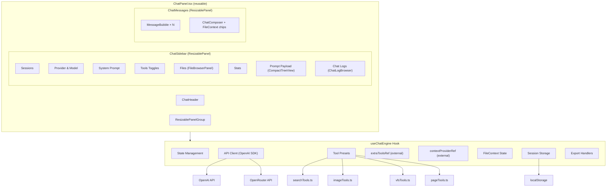
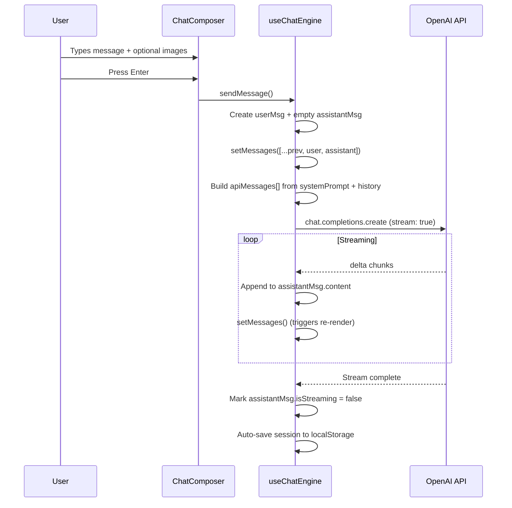
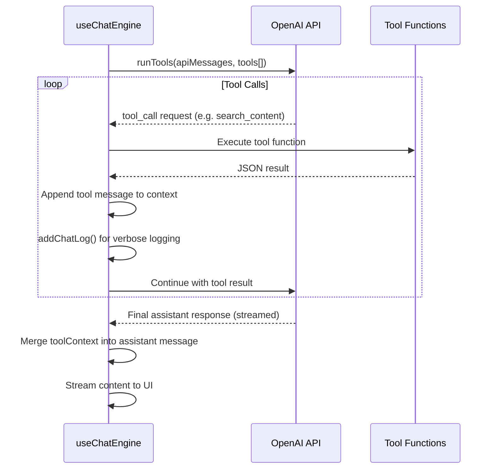
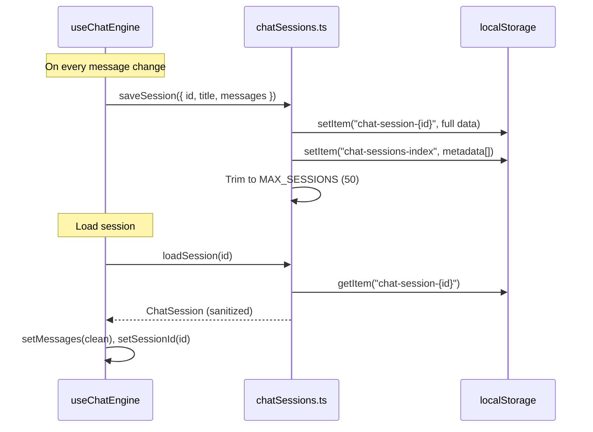

# Chat Module — Architecture & Developer Documentation

> **Location:** [`src/modules/ai/`](../src/modules/ai/)
> **Page:** [`src/pages/PlaygroundChat.tsx`](../src/pages/PlaygroundChat.tsx)

---

## Table of Contents

- [Overview](#overview)
- [Architecture](#architecture)
- [Component Tree](#component-tree)
- [ChatPanel — Reusable Component](#chatpanel--reusable-component)
- [Message Flow](#message-flow)
- [Tool-Calling Flow](#tool-calling-flow)
- [Session Management](#session-management)
- [Features](#features)
- [File Browser Integration](#file-browser-integration)
- [External Context & Tools Injection](#external-context--tools-injection)
- [Tool System](#tool-system)
- [Storage](#storage)
- [File Reference](#file-reference)

---

## Overview

The chat module is a client-side AI playground built on the **OpenAI SDK** (used for both OpenAI and OpenRouter providers). It supports multi-turn conversations, image attachments, file context attachments, streaming responses, tool calling (search, page creation, image generation, file system), session persistence, and full export capabilities.

The core is a **reusable `ChatPanel` component** ([`ChatPanel.tsx`](../src/modules/ai/ChatPanel.tsx)) with preset modes (`simple`, `standard`, `developer`), embeddable anywhere. All state and logic lives in [`useChatEngine`](../src/modules/ai/useChatEngine.ts). The playground page ([`PlaygroundChat.tsx`](../src/pages/PlaygroundChat.tsx)) is a thin wrapper using the `developer` preset.

---

## Architecture



---

## Component Tree

| Component | File | Role |
|-----------|------|------|
| **PlaygroundChat** | [`PlaygroundChat.tsx`](../src/pages/PlaygroundChat.tsx) | Thin page wrapper: `<ChatPanel preset="developer" />` |
| **ChatPanel** | [`ChatPanel.tsx`](../src/modules/ai/ChatPanel.tsx) | Reusable layout: header + sidebar + messages, configurable via presets and props |
| ↳ **ChatHeader** | [`components/ChatHeader.tsx`](../src/modules/ai/components/ChatHeader.tsx) | Top bar: provider badge, New/JSON/MD/Clear/Settings buttons |
| ↳ **ChatSidebar** | [`components/ChatSidebar.tsx`](../src/modules/ai/components/ChatSidebar.tsx) | Collapsible settings: sessions, provider, system prompt, tools, **file browser**, stats, payload inspector, logs |
|   ↳ **FileBrowserPanel** | [`FileBrowserPanel.tsx`](../src/apps/filebrowser/FileBrowserPanel.tsx) | VFS file browser (home mount, list view) with file selection → attach as context |
| ↳ **ChatMessages** | (in ChatPanel.tsx) | Messages area + composer wrapper |
|   ↳ **MessageBubble** | [`components/MessageBubble.tsx`](../src/modules/ai/components/MessageBubble.tsx) | Single message: avatar, copy-to-clipboard, markdown rendering, streaming indicator |
|   ↳ **ChatComposer** | [`components/ChatComposer.tsx`](../src/modules/ai/components/ChatComposer.tsx) | Textarea input, attachments, drag-drop, image picker, **file context chips**, prompt history, send/cancel |
| ↳ **CompactTreeView** | [`ChatLogBrowser.tsx`](../src/components/ChatLogBrowser.tsx) | Keyboard-navigable JSON tree browser (shared by Payload and Logs) |
| ↳ **ChatLogBrowser** | [`ChatLogBrowser.tsx`](../src/components/ChatLogBrowser.tsx) | Log viewer with level filtering and drill-in on data objects |

---

## ChatPanel — Reusable Component

[`ChatPanel.tsx`](../src/modules/ai/ChatPanel.tsx) is the primary entry point for embedding chat anywhere.

### Presets

| Preset | Header | Sidebar | Sidebar open by default |
|-----------|--------|---------|-------------------------|
| `simple` | ❌ | ❌ | — |
| `standard` | ✅ | ✅ | closed |
| `developer` | ✅ | ✅ | open |

### Props

| Prop | Type | Description |
|------|------|-------------|
| `preset` | `'simple' \| 'standard' \| 'developer'` | Layout preset (default: `'developer'`) |
| `showHeader` | `boolean?` | Override header visibility |
| `showSidebar` | `boolean?` | Override sidebar availability |
| `sidebarOpen` | `boolean?` | Override sidebar initial state |
| `className` | `string?` | CSS class on outer container |
| `layoutId` | `string?` | Persistence ID for panel sizes (default: `'chat-layout'`) |
| `getContext` | `() => string \| null` | Dynamic context injected into system prompt per-send |
| `extraTools` | `() => any[]` | Extra tools added to tool-calling payload per-send |

### Usage

```tsx
import ChatPanel from '@/modules/ai/ChatPanel';

// Full developer experience (default)
<ChatPanel preset="developer" />

// Embeddable minimal chat
<ChatPanel preset="simple" />

// With external context and tools
<ChatPanel
    preset="standard"
    getContext={() => `Active page: ${slug}\nSelection: ${ids.join(', ')}`}
    extraTools={() => [myCustomTool]}
/>
```

### Exports

| Export | Description |
|--------|-------------|
| `ChatPanel` (default) | Full layout with header + sidebar + messages |
| `ChatMessages` | Just the messages + composer (for custom layouts) |
| `ChatPreset` | Type: `'simple' \| 'standard' \| 'developer'` |
| `ChatPanelProps` | Props interface |

---

## Message Flow



### Cancellation

The user can cancel an in-progress response via the **Stop** button in the composer or the streaming indicator in the message bubble. This triggers `handleCancel()`, which calls `abortRef.current?.abort()` to abort the fetch and marks the current assistant message as complete.

---

## Tool-Calling Flow

When **tools are enabled**, the engine uses `runTools()` from the OpenAI SDK instead of `create()`:



### Tool Context Persistence

Tool call results are summarized and attached to the assistant message as `toolContext`. This context is included in subsequent API calls, preventing the AI from re-searching the same data in follow-up questions.

---

## Session Management



---

## Features

### Multi-Provider Support
- **OpenAI** — via proxy or direct API key
- **OpenRouter** — custom `baseURL` + API key
- Provider/model selection persisted in localStorage
- API keys stored in Supabase user secrets

### Image Attachments
- **Drag & drop** files onto the composer
- **Paste** images from clipboard
- **File picker** (file input dialog)
- **Gallery picker** — browse platform images via `ImagePickerDialog`
- Remote images proxied via server render API for resizing (`getResizedImageUrl`)

### Streaming Responses
- Uses `stream: true` with the OpenAI SDK
- Real-time content rendering via `isStreaming` flag on assistant messages
- Auto-scroll to bottom during streaming

### Prompt History
- All sent prompts saved to localStorage via `usePromptHistory`
- Navigate with **Ctrl+↑ / Ctrl+↓** in the composer
- History persisted under key `promptHistoryChat`

### Export
| Format | Action | Method |
|--------|--------|--------|
| **JSON** | Download `.json` file + copy to clipboard | [`exportChatAsJson`](../src/modules/ai/chatExport.ts) |
| **Markdown** | Copy to clipboard | [`exportChatAsMarkdown`](../src/modules/ai/chatExport.ts) |
| **Payload JSON** | Copy button in sidebar | `CompactTreeView` headerContent |
| **Logs JSON** | Copy button in sidebar | `ChatSidebar` headerContent |

### Sidebar Inspector
- **Prompt Payload** — live `useMemo` of the API messages array, browseable via `CompactTreeView` with keyboard navigation (↑↓←→, search, breadcrumbs)
- **Chat Logs** — verbose timestamped log of all engine events (tool calls, results, errors)
- Both sections support **copy-to-clipboard** via header buttons

### Desktop/Mobile Layout
- **Desktop** — `ResizablePanelGroup` (sidebar 25% default, 15–45% range; `autoSaveId="chat-layout"` for persistence)
- **Mobile** — sidebar as overlay (85vw, max 360px) with backdrop; full-width chat panel

---

## File Browser Integration

The sidebar includes a **Files** collapsible section embedding a [`FileBrowserPanel`](../src/apps/filebrowser/FileBrowserPanel.tsx) configured for the user's `home` VFS mount.

### File Context Workflow

1. **Browse** — navigate your home drive in the sidebar file browser
2. **Preview** — double-click / Enter / Space opens the lightbox (image, video, or text)
3. **Attach** — click a file, then click the **Attach** button to add it as context
4. **View** — attached files appear as **teal chips** above the composer and listed in the Files section footer
5. **Inject** — file path + content is injected into the system prompt under `--- Attached Files (editable via fs_write) ---`
6. **Write back** — the LLM can modify attached files via the existing `fs_write` tool
7. **Remove** — click the × on any chip or in the sidebar list to detach

### FileContext Type

```typescript
interface FileContext {
    path: string;    // VFS path (e.g. "notes/readme.md")
    mount: string;   // VFS mount (e.g. "home")
    name: string;    // filename only
    content: string; // file text content
}
```

---

## External Context & Tools Injection

Consumers can inject dynamic context and custom tools into the chat engine via `ChatPanel` props, enabling domain-specific integrations without modifying the core chat module.

### `getContext` — Dynamic System Prompt Injection

Called synchronously in `sendMessage()` just before building the API payload. The returned string is appended to the system prompt for that specific request.

```tsx
<ChatPanel
    getContext={() => {
        const sel = getSelectedItems();
        return sel.length ? `Selected items:\n${sel.map(s => `- ${s.name}`).join('\n')}` : null;
    }}
/>
```

### `extraTools` — Custom Tool Injection

Called when assembling the tools array for each send. Return OpenAI-compatible `RunnableToolFunctionWithParse` definitions.

```tsx
<ChatPanel
    extraTools={() => [
        {
            type: 'function',
            function: {
                name: 'update_product',
                parse: JSON.parse,
                description: 'Update a product field',
                parameters: { type: 'object', properties: { id: { type: 'string' } } },
                function: async (args) => { /* ... */ },
            },
        },
    ]}
/>
```

### Implementation

Both use **ref-based injection** in `useChatEngine`:
- `contextProviderRef` — `React.MutableRefObject<(() => string | null) | null>`
- `extraToolsRef` — `React.MutableRefObject<(() => any[]) | null>`

`ChatPanel` wires its props into these refs via `useEffect`, ensuring the engine always has the latest provider functions without prop-drilling into the hook.

## Tool System

All tools follow the OpenAI SDK `RunnableToolFunctionWithParse` interface (Zod parse + async function + JSON schema).

### Search Tools — [`searchTools.ts`](../src/modules/ai/searchTools.ts)

| Tool | Description |
|------|-------------|
| `search_content` | Full-text search across pages, posts, pictures (type filter, limit) |
| `find_pages` | Search pages only |
| `find_pictures` | Search pictures only |
| `get_page_content` | Fetch full page content by user_id + slug |
| `list_categories` | List all category trees |
| `find_by_category` | Find items by category slug |

Bundled via `createSearchToolPreset()`.

### Image Tools — [`imageTools.ts`](../src/modules/ai/imageTools.ts)

| Tool | Description |
|------|-------------|
| `generate_image` | Generate image from prompt → upload to Supabase `temp-images` bucket → return markdown embed |

### VFS Tools — [`vfsTools.ts`](../src/modules/ai/vfsTools.ts)

| Tool | Description |
|------|-------------|
| `vfs_ls` | List directory contents (optional glob filter) |
| `vfs_read` | Read file content |
| `vfs_write` | Write/create file |
| `vfs_mkdir` | Create directory |
| `vfs_delete` | Delete file or directory |

Operates on the user's home drive via authenticated API calls.

### Page Tools — [`lib/pageTools.ts`](../src/lib/pageTools.ts)

| Tool | Description |
|------|-------------|
| `create_page` | Create a new page on the user's account |

### Tool Toggle Controls

Each tool category has an independent toggle in the sidebar:

| Toggle | localStorage Key | Default |
|--------|-----------------|---------|
| Search Tools | `chat-settings-tools` | `true` |
| Page Tools | `chat-settings-page-tools` | `true` |
| Image Tools | `chat-settings-image-tools` | `false` |
| File Tools | `chat-settings-vfs-tools` | `false` |

---

## Storage

All persistence is **client-side via `localStorage`**. No server database is used for chat data.

### localStorage Keys

| Key | Type | Description |
|-----|------|-------------|
| `chat-sessions-index` | `Omit<ChatSession, 'messages'>[]` | Session metadata index (max 50) |
| `chat-session-{uuid}` | `ChatSession` | Full session data (messages + metadata) |
| `chat-settings-provider` | `string` | Selected AI provider |
| `chat-settings-model` | `string` | Selected model |
| `chat-settings-system-prompt` | `string` | System prompt text |
| `chat-settings-tools` | `boolean` | Search tools toggle |
| `chat-settings-page-tools` | `boolean` | Page tools toggle |
| `chat-settings-image-tools` | `boolean` | Image tools toggle |
| `chat-settings-vfs-tools` | `boolean` | VFS tools toggle |
| `chat-settings-show` | `boolean` | Sidebar visibility |
| `chat-settings-sidebar-width` | `number` | (legacy — now managed by ResizablePanelGroup) |
| `chat-layout` | (react-resizable-panels) | Panel sizes (auto-managed) |
| `promptHistoryChat` | `string[]` | Prompt history ring buffer |
| `chat-section-*` | `boolean` | CollapsibleSection open/closed states |

### Session Lifecycle

1. **Auto-save** — sessions save on every message change via `useEffect`
2. **Title generation** — first 60 chars of the first user message
3. **Max sessions** — oldest sessions pruned when exceeding 50
4. **Sanitization** — streaming flags stripped, empty orphan messages filtered on save and load

---

## File Reference

| File | Purpose |
|------|---------|
| [`ChatPanel.tsx`](../src/modules/ai/ChatPanel.tsx) | **Reusable component**: presets, layout, external context/tools injection |
| [`useChatEngine.ts`](../src/modules/ai/useChatEngine.ts) | Central hook: all state, API calls, streaming, tool orchestration, file contexts |
| [`types.ts`](../src/modules/ai/types.ts) | `ChatMessage`, `ImageAttachment`, `FileContext`, helpers |
| [`chatSessions.ts`](../src/modules/ai/chatSessions.ts) | Session persistence (localStorage) |
| [`chatExport.ts`](../src/modules/ai/chatExport.ts) | JSON/Markdown export (download + clipboard) |
| [`searchTools.ts`](../src/modules/ai/searchTools.ts) | 6 search/content tools + `createSearchToolPreset` |
| [`imageTools.ts`](../src/modules/ai/imageTools.ts) | `generate_image` tool |
| [`vfsTools.ts`](../src/modules/ai/vfsTools.ts) | 6 VFS tools (ls/read/write/write_many/mkdir/delete) |
| [`ChatHeader.tsx`](../src/modules/ai/components/ChatHeader.tsx) | Top bar with provider badge and action buttons |
| [`ChatSidebar.tsx`](../src/modules/ai/components/ChatSidebar.tsx) | Settings panel: sessions, provider, prompt, tools, **file browser**, stats, payload, logs |
| [`ChatComposer.tsx`](../src/modules/ai/components/ChatComposer.tsx) | Input area: textarea, attachments, **file context chips**, drag-drop, image picker |
| [`MessageBubble.tsx`](../src/modules/ai/components/MessageBubble.tsx) | Message rendering: avatar, copy, markdown, streaming |
| [`PlaygroundChat.tsx`](../src/pages/PlaygroundChat.tsx) | Page wrapper: `<ChatPanel preset="developer" />` |
| [`ChatLogBrowser.tsx`](../src/components/ChatLogBrowser.tsx) | Log viewer + CompactTreeView (keyboard-nav JSON browser) |
