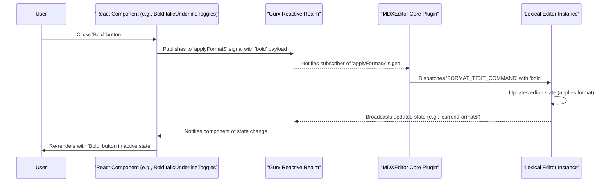

# MDXEditor Content Modification Deep Dive

This document outlines the core concepts behind modifying content in the `MDXEditor` and provides a recommended approach for building custom extensions, based on a deep dive into its source code.

## Key Findings: Reactive Architecture (Gurx)

The editor is built on a reactive architecture powered by a library called `@mdxeditor/gurx`. This is the most critical concept to understand.

- **Signals, not direct calls**: Instead of directly calling methods to change content (like `editor.bold()` or `editor.insertText('foo')`), the editor's UI components **publish** their intent to signals (also called "publishers" or "nodes").

- **State management**: The editor's state, including the current markdown content and selection, is managed within a reactive "realm." Various plugins subscribe to signals within this realm.

- **Decoupled logic**: When a signal is published, the corresponding plugin logic is executed. This decouples the UI (e.g., a toolbar button) from the actual implementation of the feature.

## How Toolbar Actions Work (e.g., Bold)

Let's trace the "bold" action, as it's a perfect example of this architecture in action:

1.  **UI Component**: `BoldItalicUnderlineToggles.tsx` contains the UI button for toggling bold.
2.  **Publishing an action**: When the bold button is clicked, it doesn't directly modify the editor. Instead, it calls `applyFormat('bold')`, which is a publisher for the `applyFormat$` signal.
3.  **Core plugin subscription**: The core editor plugin subscribes to `applyFormat$`. When it receives the 'bold' signal, it executes the logic to apply or remove the bold format to the current text selection within the Lexical editor instance.

This approach is highly reliable because it leverages the editor's internal state management system. The UI simply declares what needs to happen, and the editor's core logic handles the update when it's ready.

## The Problem with `insertMarkdown` and Polling

Our initial approach to inserting markdown had issues because it was imperative and fought against the editor's reactive nature:

1.  **`insertMarkdown$` is a signal**: The `insertMarkdown` method provided on the editor ref is, under the hood, a publisher for the `insertMarkdown$` signal. It's a "fire-and-forget" operation from the outside.
2.  **Asynchronous execution**: When we call `editorRef.current.insertMarkdown('some text')`, we're publishing to a signal. The actual insertion happens asynchronously within the editor's update cycle.
3.  **Why polling is bad**: Attempting to immediately read the new markdown with `getMarkdown()` fails because the update hasn't been processed yet. Our polling with `requestAnimationFrame` and `setTimeout` was a fragile attempt to guess when the update would complete.

## The Correct Approach: Using the Signal Architecture

To build reliable extensions or custom functionality, we must follow the editor's architectural pattern:

1.  **Create a custom signal**: If you need to perform a custom action, the best approach is to define a new signal within a custom plugin.
2.  **Publish from your component**: Your React component (e.g., a custom button or a side panel) should get a publisher for your signal and publish to it when the user takes an action.
3.  **Subscribe within a plugin**: The plugin that defines the signal should also contain the logic that subscribes to it. This logic will receive the signal and can then safely interact with the editor state.

By following this pattern, your custom logic will be integrated into the editor's reactive flow, ensuring that state updates are handled correctly and reliably, without the need for hacks like `setTimeout` or `focus()` workarounds.

## Sequence Diagram: Content Modification Flow

Here is a sequence diagram illustrating the flow for a typical toolbar action, like applying bold formatting, in `MarkdownEditorEx`.

## Knowing When an Action is "Done"

The editor's architecture is based on signals. Actions like applying formats or inserting markdown are published to the reactive system, which then processes them asynchronously. There is no `Promise` or callback returned from methods like `insertMarkdown` to let you know when the operation is complete.

So, how do we know?

1.  **The `onChange` Prop is the Key**: The primary mechanism for an external component to be notified of state changes is the `onChange` prop. When the editor's internal Lexical state is updated and converted back to markdown, `onChange` is triggered with the new content. This is our confirmation that the editor has processed an update.

2.  **The Challenge**: The problem is linking a specific action (e.g., our call to `insertMarkdown`) to a subsequent `onChange` event. A simple `useEffect` on the content is not enough, as `onChange` can fire for many reasons (user typing, other plugins, etc.).

3.  **The Solution: A Transactional Approach**: We can create a temporary "transaction" to bridge the gap between our action and the resulting state change. The flow looks like this:

    1.  **Before Action**: Before calling `insertMarkdown`, we store the text we're about to insert and a success callback (e.g., to show a toast) in a `useRef`.
    2.  **Fire Action**: We call `editorRef.current.insertMarkdown(...)`.
    3.  **Wait for Confirmation**: The `onChange` handler (`handleContentChange`) is now responsible for checking if the new content contains the text from our transaction.
    4.  **On Confirmation**: If the text is found, we know our specific insertion was successful. We can then execute the success callback from the ref and clear the transaction.
    5.  **Safety Net**: A `setTimeout` can be used as a fallback. If `onChange` doesn't fire within a reasonable time, we can assume the update failed or timed out and notify the user accordingly.

This pattern respects the editor's asynchronous and reactive nature while giving us the reliable completion confirmation we need for a smooth user experience.

## Modifying Content Without Stealing Focus

A common requirement is to insert or modify editor content programmatically (e.g., from an AI suggestion) without pulling the user's focus away from their current task (e.g., typing in a prompt input).

-   **`insertMarkdown()` Steals Focus**: The `editorRef.current.insertMarkdown()` method is designed for direct user actions. It internally manages focus and selection to place content where the cursor is. As a result, it will almost always steal focus.

-   **`setMarkdown()` Does NOT Steal Focus**: The `editorRef.current.setMarkdown()` method is the correct tool for this job. It is designed for programmatic updates and works like setting a prop on a controlled component. It replaces the entire editor content with the new markdown string you provide, without affecting the user's focus.

### Recommended Usage

-   **For "Append" or "Replace All"**: `setMarkdown` is perfect. You can get the current content via `getMarkdown()`, construct the new content string (`newContent = oldContent + appendedText`), and then call `setMarkdown(newContent)`. The user's focus remains untouched.

-   **For "Insert at Cursor"**: This is trickier. Since `setMarkdown` replaces everything and doesn't know about the cursor, you cannot use it to insert at the current selection. For this specific use case, stealing focus via `insertMarkdown` is often the intended and most intuitive behavior from a user's perspective.

## Summary: Implementing Merge Operations

To robustly implement `append`, `insert`, and `replace`, you need the following from your `MarkdownEditorEx` component:

1.  **`editorRef`**: Essential for calling `getMarkdown()`, `setMarkdown()`, and `insertMarkdown()`.
2.  **`onSelectionChange` callback**: Required for the **replace** operation to know what text is currently selected.
3.  **`onChange` callback**: The key to confirming that any operation has completed successfully, using the "transactional" pattern described above.

### Cheatsheet:

| Operation | Goal                                      | Recommended Method    | Steals Focus? | Key Dependency         |
| :-------- | :---------------------------------------- | :-------------------- | :------------ | :--------------------- |
| **Append**  | Add content to the end of the document    | `setMarkdown()`       | No            | `getMarkdown()`        |
| **Insert**  | Add content at the user's cursor          | `insertMarkdown()`    | Yes           | User's cursor position |
| **Replace** | Swap selected text with new content       | `setMarkdown()`       | No            | `onSelectionChange`    |
