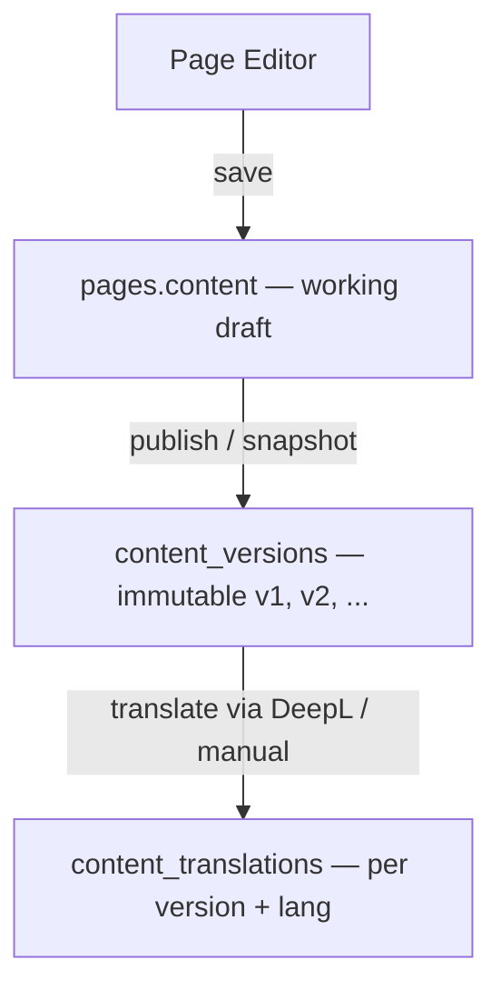
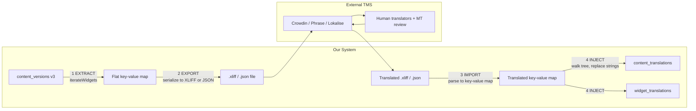
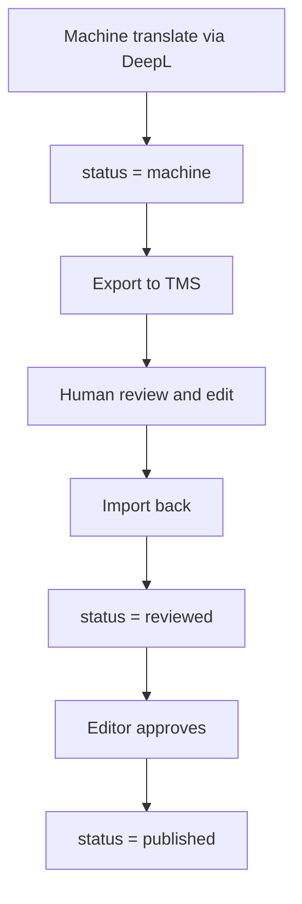

# i18n — Content Translation & Versioning

> Proposal for translating pages, widgets, and other content types with version tracking.

---

## Status Quo

| What exists | Where |
|---|---|
| **`i18n_translations`** — flat `src_text → dst_text` cache | `db-i18n.ts` |
| **`i18n_glossaries` / `i18n_glossary_terms`** — DeepL glossary sync | `db-i18n.ts` |
| **DeepL server-side translate** — translate + cache in one call | `i18n-deepl.ts` |
| **`@polymech/i18n`** — shared `clean()` helper etc. | monorepo package |

The existing system translates **arbitrary text blobs**. It has no awareness of:

- **Which page / widget** a translation belongs to
- **Which version** of the source content was translated
- **Structural identity** — if a widget moves or is deleted, orphaned translations linger

---

## Goals

1. **Page-level translations** — a translated "snapshot" of an entire page  
2. **Widget-level translations** — translate individual widget text props independently  
3. **Content versioning** — track which source version a translation was produced from, detect drift  
4. **Reuse existing infra** — `i18n_translations` stays as the text cache, DeepL stays as the engine  

---

## Proposed Database Schema

### 1. `content_versions`

Tracks every published snapshot of any content entity (pages, posts, collections, …).

```sql
create table content_versions (
  id            uuid primary key default gen_random_uuid(),
  entity_type   text not null,              -- 'page' | 'post' | 'collection'
  entity_id     uuid not null,              -- pages.id / posts.id / …
  version       int  not null default 1,    -- monotonic per entity
  content_hash  text not null,              -- sha256 of JSON content
  content       jsonb,                      -- snapshot of content at this version (optional, for rollback)
  meta          jsonb default '{}',         -- { author, change_note, … }
  created_at    timestamptz default now(),
  created_by    uuid references auth.users(id),

  unique (entity_type, entity_id, version)
);

create index idx_cv_entity on content_versions (entity_type, entity_id);
```

> **Why a separate table?**  
> The `pages` table stores the *current* working state.  
> `content_versions` stores immutable snapshots you can diff, rollback, or translate against.

---

### 2. `content_translations`

Links a translated content blob to a specific source version + language.

```sql
create type translation_status as enum ('draft', 'machine', 'reviewed', 'published');

create table content_translations (
  id               uuid primary key default gen_random_uuid(),
  entity_type      text not null,
  entity_id        uuid not null,
  source_version   int  not null,            -- FK-like ref to content_versions.version
  source_lang      text not null default 'de',
  target_lang      text not null,
  status           translation_status default 'draft',

  -- Translated payload (same shape as source content)
  translated_content  jsonb,                 -- full page JSON with translated strings

  -- Drift detection
  source_hash      text,                     -- hash of source at translation time
  is_stale         boolean default false,    -- set true when source gets a newer version

  meta             jsonb default '{}',       -- { translator, provider, cost, … }
  created_at       timestamptz default now(),
  updated_at       timestamptz default now(),
  translated_by    uuid references auth.users(id),

  unique (entity_type, entity_id, source_version, target_lang)
);

create index idx_ct_entity on content_translations (entity_type, entity_id, target_lang);
```

---

### 3. `widget_translations` *(optional — granular level)*

For widget-by-widget translation without duplicating the whole page JSON.

```sql
create table widget_translations (
  id              uuid primary key default gen_random_uuid(),
  entity_type     text not null default 'page',
  entity_id       uuid not null,
  widget_id       text not null,              -- WidgetInstance.id from the JSON tree
  prop_path       text not null default 'content',  -- e.g. 'content', 'label', 'placeholder'
  source_lang     text not null,
  target_lang     text not null,
  source_text     text not null,
  translated_text text not null,
  source_version  int,                        -- which content_version this was derived from
  status          translation_status default 'machine',
  meta            jsonb default '{}',
  created_at      timestamptz default now(),
  updated_at      timestamptz default now(),

  unique (entity_type, entity_id, widget_id, prop_path, target_lang)
);

create index idx_wt_entity on widget_translations (entity_type, entity_id, target_lang);
```

> **Why both `content_translations` and `widget_translations`?**  
> - `content_translations` = "give me the whole page in French" (fast serve)  
> - `widget_translations` = "give me just widget X in French" (granular edit, partial retranslation)  
> When serving, we prefer `content_translations` (single read). When editing, we use `widget_translations` for surgical updates.

---

## Translatable Widget Props

Not every widget property needs translation. Here's the map of translatable text:

| Widget Type | Translatable Props |
|---|---|
| `html-widget` | `content` |
| `markdown-text` | `content` |
| `tabs-widget` | `tabs[].label` |
| `layout-container-widget` | `nestedPageName` |
| `photo-card` | — *(title/description from `pictures` table)* |
| `gallery-widget` | — |
| `file-browser` | — |
| Container (settings) | `settings.title` |

The shared function `iterateWidgets()` from `@polymech/shared` can walk the full content tree to extract translatable strings per widget.

---

## Content Versioning Flow



### Version Lifecycle

1. **Author saves** → `pages.content` updated (working state, no version bump)  
2. **Author publishes** → new row in `content_versions` (hash of content JSON, version++)  
3. **Translation triggered** → walks content tree, translates per widget, stores `widget_translations` + assembles a full `content_translations` row  
4. **Source changes** → next publish creates version N+1, all `content_translations` for version N get `is_stale = true`  
5. **Retranslation** → only re-translates widgets whose `source_text` changed (compare hashes)

---

## Serving Translated Pages

When a page is requested with `?lang=fr`:

```
1. Look up content_translations WHERE entity_id = ? AND target_lang = 'fr' AND status = 'published'
2. If found → serve translated_content directly (no extra processing)
3. If not found → serve source content (fallback)
4. If is_stale = true → serve but add X-Translation-Stale: true header
```

Add `lang` to the enrichment / cache key in `getPagesState()` or create a parallel `getTranslatedPagesState()`.

---

## Integration with Existing i18n

The existing `i18n_translations` table continues to serve as **the text-level translation cache** (src → dst lookup). The new tables add **structural awareness** on top:

```
i18n_translations        → text cache (DeepL results, any text)
widget_translations      → maps widget+prop → translation pair
content_translations     → full translated content snapshot
content_versions         → immutable source snapshots
```

`translateTextServer()` (from `i18n-deepl.ts`) remains the engine. The new translation logic calls it per widget prop, then assembles results.

---

## External Translation Services (Crowdin, Phrase, Lokalise)

### The Problem

Our page content is **deeply nested JSON** (`RootLayoutData` → pages → containers → widgets → props). External TMS platforms don't understand this structure — they work with **flat key→value files** in standard formats.

We need an **extract/inject pipeline** that converts between our JSON tree and industry-standard formats.

### Exchange Format Strategy

| Format | Best For | Crowdin | Phrase | Lokalise |
|---|---|---|---|---|
| **XLIFF 2.0** | Industry standard, rich metadata, tool support | ✅ | ✅ | ✅ |
| **Flat JSON** | Simple key→value, easy to diff | ✅ | ✅ | ✅ |
| **ICU MessageFormat** | Plurals, gender, variables | ✅ | ✅ | ✅ |

**Recommended primary format: XLIFF 2.0** — it carries source + target in one file, supports notes/context for translators, and every TMS speaks it natively.

**Secondary: Flat JSON** — for scripting, quick diffs, and lightweight integrations.

### Key Design — Stable Translation Keys

Every translatable string gets a **stable key** derived from its position in the content tree:

```
page.<page_id>.widget.<widget_id>.<prop_path>
```

Examples:
```
page.a1b2c3.widget.w-markdown-1.content
page.a1b2c3.widget.w-tabs-1.tabs.0.label
page.a1b2c3.widget.w-tabs-1.tabs.1.label
page.a1b2c3.container.c-hero.settings.title
page.a1b2c3.meta.title                        ← page title itself
```

These keys are **widget-ID-based**, not position-based. If a widget moves within the page, its key stays the same. If a widget is deleted, its key disappears from the next export.

### XLIFF Export Example

```xml
<?xml version="1.0" encoding="UTF-8"?>
<xliff version="2.0" srcLang="de" trgLang="en">
  <file id="page-a1b2c3" original="page/a1b2c3">
    <unit id="page.a1b2c3.meta.title">
      <notes>
        <note category="context">Page title</note>
        <note category="max-length">255</note>
      </notes>
      <segment>
        <source>Kunststoff-Recycling Übersicht</source>
        <target>Plastic Recycling Overview</target>
      </segment>
    </unit>
    <unit id="page.a1b2c3.widget.w-md-1.content">
      <notes>
        <note category="context">Markdown text widget — supports markdown formatting</note>
        <note category="widget-type">markdown-text</note>
      </notes>
      <segment>
        <source>## Einleitung\n\nDiese Seite beschreibt...</source>
        <target/>
      </segment>
    </unit>
    <unit id="page.a1b2c3.widget.w-tabs-1.tabs.0.label">
      <notes>
        <note category="context">Tab label</note>
        <note category="max-length">50</note>
      </notes>
      <segment>
        <source>Übersicht</source>
        <target/>
      </segment>
    </unit>
  </file>
</xliff>
```

### Flat JSON Export Example

```json
{
  "_meta": {
    "entity_type": "page",
    "entity_id": "a1b2c3",
    "source_version": 3,
    "source_lang": "de",
    "exported_at": "2026-02-17T10:00:00Z"
  },
  "page.a1b2c3.meta.title": "Kunststoff-Recycling Übersicht",
  "page.a1b2c3.widget.w-md-1.content": "## Einleitung\n\nDiese Seite beschreibt...",
  "page.a1b2c3.widget.w-tabs-1.tabs.0.label": "Übersicht",
  "page.a1b2c3.widget.w-tabs-1.tabs.1.label": "Details",
  "page.a1b2c3.container.c-hero.settings.title": "Willkommen"
}
```

### Extract → Export → Translate → Import → Inject Pipeline



### How Human Translation Fits the Status Flow



1. **Machine pre-fill**: DeepL translates all strings → stored with `status = 'machine'`
2. **Export to TMS**: export the machine-translated file (with source + target pre-filled) so human translators only need to **review and fix**, not translate from scratch
3. **Import from TMS**: translated file comes back → `status = 'reviewed'`
4. **Publish**: editor approves → `status = 'published'`, `content_translations` assembled

### API Additions for TMS Interop

| Method | Endpoint | Description |
|---|---|---|
| `GET` | `/api/pages/:id/export/:lang?format=xliff` | Export translatable strings as XLIFF or JSON |
| `POST` | `/api/pages/:id/import/:lang` | Import translated XLIFF or JSON file |
| `GET` | `/api/pages/:id/export/:lang?format=json` | Export as flat JSON |
| `POST` | `/api/i18n/webhook/crowdin` | Crowdin webhook for auto-import on completion |

### Crowdin-Specific Integration Notes

- **Source files**: upload the flat JSON export as a "source file" per page
- **File naming**: `page-{slug}-v{version}.json` — Crowdin tracks versions by filename
- **Branches**: use Crowdin branches to match `content_versions` — branch = version
- **Webhooks**: Crowdin fires `file.translated` / `file.approved` → our webhook imports
- **In-Context**: Crowdin's in-context editing can work via our `?lang=pseudo` mode that renders keys instead of text

### Glossary Sync

The existing `i18n_glossaries` / `i18n_glossary_terms` tables can be:
- **Exported** as TBX (TermBase eXchange) or Crowdin-compatible CSV
- **Synced bidirectionally**: terms added in Crowdin → imported to our DB → pushed to DeepL glossary

This keeps DeepL machine translations and human translations using the **same terminology**.

---

## API Surface (Proposed)

| Method | Endpoint | Description |
|---|---|---|
| `POST` | `/api/pages/:id/publish` | Snapshot current content → `content_versions` |
| `GET` | `/api/pages/:id/versions` | List versions for a page |
| `GET` | `/api/pages/:id/versions/:v` | Get specific version snapshot |
| `POST` | `/api/pages/:id/translate` | Translate page to target lang(s) |
| `GET` | `/api/pages/:id/translations` | List available translations |
| `GET` | `/api/pages/:id/translations/:lang` | Get translated content for lang |
| `PATCH` | `/api/pages/:id/translations/:lang/widgets/:wid` | Update single widget translation |
| `POST` | `/api/content/:type/:id/publish` | Generic publish for any entity type |
| `POST` | `/api/content/:type/:id/translate` | Generic translate for any entity type |

---

## Open Questions / Decisions Needed

1. **Publish-on-save vs explicit publish?**  
   Do we auto-version on every save, or require an explicit "Publish" action?  
   *Recommend:* explicit publish to avoid version spam.

2. **Widget-level table — now or later?**  
   `widget_translations` adds complexity. We could start with page-level only (`content_translations`) and add widget-level later.  
   *Recommend:* start with both — widget-level is needed for partial retranslation.

3. **Store full content in `content_versions` or just the hash?**  
   Storing full JSON enables rollback but costs storage.  
   *Recommend:* store it — pages are small (< 100 KB each), rollback is high value.

4. **Which entity types beyond pages?**  
   Posts? Collections? Categories?  
   *Recommend:* start with pages only, the schema is generic enough to extend.

5. **UI for translation management?**  
   A side-by-side translation editor? Or just an "auto-translate" button?  
   This doc covers the backend schema only — UI TBD.

---

## Migration Priority

| Phase | Scope | Tables |
|---|---|---|
| **Phase 1** | Content versioning for pages | `content_versions` |
| **Phase 2** | Page-level translations | `content_translations` |
| **Phase 3** | Widget-level translations | `widget_translations` ✅ |
| **Phase 4** | Extend to posts / collections | Same tables, new `entity_type` values |

---

## Implemented Features

### Client i18n Loading (`src/i18n.tsx`)

Translations are loaded from `src/i18n/*.json` using Vite's `import.meta.glob` with `eager: true`. This ensures:

- All JSON files are statically included at build time
- Vite HMR pushes updates instantly when a JSON file changes on disk
- No stale module cache issues (unlike dynamic `import()`)

```typescript
const langModules = import.meta.glob('./i18n/*.json', { eager: true });
```

**Requested terms** (keys seen in the app but not yet translated) are cached in `localStorage` under `i18n-requested-terms`. These are merged with the loaded JSON translations, with JSON taking priority.

---

### Glossary Term Editing (DeepL v3 API)

#### API Endpoints

| Method | Endpoint | Description |
|---|---|---|
| `GET` | `/api/i18n/glossaries/:id/terms` | Fetch all terms for a glossary |
| `PUT` | `/api/i18n/glossaries/:id/terms` | Replace all terms (syncs with DeepL v3, updates DB, flushes cache) |

The PUT endpoint uses the **DeepL v3 API** (`PUT /v3/glossaries/{id}/dictionaries`) to replace the entire glossary dictionary in TSV format. It then syncs the local DB (`i18n_glossary_terms`) and updates `entry_count`.

#### Client Functions

- `fetchGlossaryTerms(glossaryId)` — fetches term pairs as `Record<string, string>`
- `updateGlossaryTerms(glossaryId, entries)` — replaces all terms

#### Playground UI

Glossaries in the management section are **expandable** — click to load and inline-edit terms. Each glossary row shows:
- Add/delete individual terms
- "Save" button (enabled only when there are unsaved changes via dirty-state detection)

---

### Glossary Selection Improvements

- **Bidirectional filter**: The glossary dropdown in the Translation section shows glossaries matching the language pair in **either direction** (e.g. when translating `en→de`, both `en→de` and `de→en` glossaries appear)
- **Direction label**: Each glossary option shows its direction: `osr (de→en, 2 entries)`
- **DeepL target lang normalization**: `en`/`EN` → `en-GB`, `pt`/`PT` → `pt-PT` (DeepL rejects bare `en`/`pt` target codes)

---

### Widget Translations

#### Schema (Actual — Deployed)

```sql
CREATE TABLE widget_translations (
    id              uuid PRIMARY KEY DEFAULT gen_random_uuid(),
    entity_type     text NOT NULL DEFAULT 'page',
    entity_id       text,                        -- nullable for system translations
    widget_id       text,                        -- nullable for system translations
    prop_path       text NOT NULL DEFAULT 'content',
    source_lang     text NOT NULL,
    target_lang     text NOT NULL,
    source_text     text,
    translated_text text,
    source_version  int,
    status          text DEFAULT 'draft',
    meta            jsonb DEFAULT '{}',
    created_at      timestamptz DEFAULT now(),
    updated_at      timestamptz DEFAULT now(),

    CONSTRAINT uq_widget_translation
    UNIQUE NULLS NOT DISTINCT (entity_type, entity_id, widget_id, prop_path, target_lang)
);
```

> Uses `NULLS NOT DISTINCT` so system translations (with NULL `entity_id`/`widget_id`) are still properly deduplicated. The unique constraint is required by PostgREST for upsert conflict resolution.

#### API Endpoints

| Method | Endpoint | Description |
|---|---|---|
| `GET` | `/api/i18n/widget-translations` | Query with filters: `entity_type`, `entity_id`, `widget_id`, `target_lang` |
| `PUT` | `/api/i18n/widget-translations` | Upsert single translation |
| `PUT` | `/api/i18n/widget-translations/batch` | Upsert multiple translations |
| `DELETE` | `/api/i18n/widget-translations/:id` | Delete by ID |
| `DELETE` | `/api/i18n/widget-translations/entity/:type/:id` | Delete all translations for an entity (optional `?target_lang=`) |

#### Client Functions

- `fetchWidgetTranslations(filters)` — query with optional entity/widget/lang filters
- `upsertWidgetTranslation(input)` — upsert a single translation
- `upsertWidgetTranslationsBatch(inputs)` — upsert multiple (used by "Update Database")
- `deleteWidgetTranslation(id)` — delete by ID
- `deleteWidgetTranslationsByEntity(type, id, lang?)` — bulk delete

---

### Update i18n Language Files

#### API Endpoint

| Method | Endpoint | Description |
|---|---|---|
| `PUT` | `/api/i18n/update-lang-file` | Merge translations into `src/i18n/{lang}.json` |

**Request body**: `{ lang: string, entries: Record<string, string> }`

**Behavior**:
1. Reads `CLIENT_SRC_PATH` from server `.env` (set to `../`)
2. Resolves `${CLIENT_SRC_PATH}/src/i18n/${lang}.json`
3. Reads existing file, merges new entries (skips empty values)
4. Sorts alphabetically by key
5. Writes back with `JSON.stringify(sorted, null, 2)`
6. Returns `{ success, total, added, updated }`

**Client function**: `updateLangFile(lang, entries)`

---

### Playground UI — Widget Translations Section

The i18n Playground (`/playground` → i18n tab) provides a full management UI:

#### Search & Filter
- **Entity type / Entity ID / Widget ID / Target lang** — server-side filters for querying
- **Client-side search** — filter loaded results by source or translation text (case-insensitive)
- **Show missing** toggle — filter to untranslated entries only

#### Row Selection
- **Checkbox per row** with **select-all** in header
- Selected rows get a subtle highlight
- Selection affects: batch translate, Update Database, and Update i18n

#### Batch Translation
- **Glossary picker** — select a glossary for batch translation (shows all glossaries with direction labels)
- **Translate All Missing** / **Translate Selected** — batch-translates via DeepL
- Progress indicator during batch translation

#### Persistence Actions
- 🟠 **Update Database** — batch-upserts translated entries to Supabase via `upsertWidgetTranslationsBatch`
- 🟢 **Update i18n** — merges translations into `src/i18n/{lang}.json` files (groups by `target_lang`, uses `source_text` as key)

Both buttons respect checkbox selection: if rows are selected, only those are processed; otherwise all translated entries.

#### Import from i18n
- **Import from app** — loads terms from `localStorage` requested-terms cache, cross-references with existing translations, and populates the list

#### Inline Editing
- Click any row to expand and edit source text, translated text, status, and metadata
- Single-row translate button (DeepL) in edit mode

---

### Environment Variables

| Variable | Location | Value | Purpose |
|---|---|---|---|
| `CLIENT_SRC_PATH` | `server/.env` | `../` | Path to client source root (for writing `src/i18n/*.json`) |
| `CLIENT_DIST_PATH` | `server/.env` | `../dist` | Path to client build output |

---

### E2E Tests (`i18n.e2e.test.ts`)

Tests cover:
- Glossary CRUD (create, list, get terms, update terms via DeepL v3, delete)
- Translation with glossary
- Widget translation CRUD (upsert, batch upsert, query, delete)
- Authentication checks (401 for unauthorized requests)
