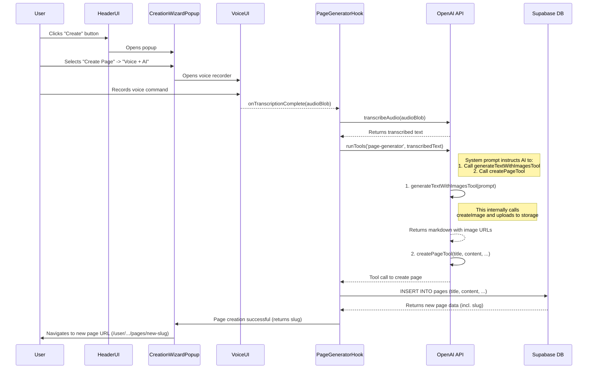

# AI Page Generation Wizard

## 1. Overview

The AI Page Generation Wizard introduces a high-level, AI-driven workflow for creating complete pages, not just individual images. It leverages the existing voice input and image generation capabilities to offer a seamless "voice-to-page" experience. Users can dictate an idea, and the AI will generate a fully-formed page containing rich text content, embedded images, and appropriate metadata like tags and a title.

This feature will be accessed through a new, unified creation popup in the header, which will serve as a central starting point for both the existing Image Wizard and the new Page Wizard.

## 2. User Interface & Flow

### New Entry Popup

A new button will be added to the `Header`, triggering a "Creation Wizard" popup. This popup will be the primary entry point for AI-assisted content creation.

**Popup Design:**

- **Title:** What would you like to create?
- **Two Main Options:**
    1.  **Generate Image:** For creating standalone images.
        -   **Fast & Direct:** Opens the standard Image Wizard.
        -   **Smart & Optimized:** Opens the Image Wizard in Agent mode.
        -   **Voice + AI:** Opens the Image Wizard's voice agent popup directly.
    2.  **Create Page:** For generating entire pages.
        -   **From Scratch:** Opens a new page editor.
        -   **AI Agent:** A future feature for more complex, multi-step page generation.
        -   **Voice + AI:** This is the primary new flow. It opens a voice recording UI to start the voice-to-page process.

### Voice-to-Page Flow

1.  **Initiation:** The user clicks the "Voice + AI" button under "Create Page".
2.  **Recording:** A voice recording modal appears (reusing the component from `ImageWizard`). The user describes the page they want to create (e.g., "Write a tutorial on how to brew the perfect cup of green tea, include an image of a serene tea setup").
3.  **Processing:** The UI shows a status progression: `Transcribing...` -> `Generating content...` -> `Creating page...`.
4.  **Completion:** Once the page is created, the user is automatically redirected to the new page in view mode. A success toast notification confirms the creation.

## 3. Dependencies

This feature will leverage many existing parts of the application and introduce a few new components.

### Existing Components & Modules to Reuse:

-   **`Header.tsx`**: To add the new wizard trigger button.
-   **`ImageWizard.tsx` / `VoiceRecordingPopup.tsx`**: The UI for voice recording and transcription.
-   **`lib/openai.ts`**: The core `runTools` function, `zodFunction` helper, and existing tool definitions (`transcribeAudioTool`). We will add a new preset and tools here.
-   **`lib/markdownImageTools.ts`**: The `generateTextWithImagesTool` will be crucial for the AI to generate the main content of the page.
-   **`integrations/supabase/client.ts`**: For database interactions within the new page creation tool.
-   **`pages/UserPage.tsx`**: The destination view for the newly created page.

### New Components & Modules to Create:

-   **`components/CreationWizardPopup.tsx`**: The new modal that serves as the entry point.
-   **`hooks/usePageGenerator.ts`**: A new hook to orchestrate the multi-step voice-to-page generation process.
-   **`lib/pageTools.ts`**: A new file to house the AI tool(s) responsible for page creation to keep concerns separated.

## 4. Implementation Plan

The implementation can be broken down into the following tasks:

1.  **Task 1: Create New AI Tools for Page Management**
    -   Create a new file: `src/lib/pageTools.ts`.
    -   Define a new tool `createPageTool` using `zodFunction`.
    -   **Schema:** `({ title: string, content: string, tags: string[], slug: string, is_public?: boolean, visible?: boolean })`.
    -   **Functionality:**
        -   It will accept the page title, markdown content, and tags.
        -   It must format the markdown content into the required page JSON structure (with `containers`, `widgets`, and `widgetId: "markdown-text"`).
        -   It will insert a new row into the `pages` table in Supabase.
        -   It will return the `slug` of the newly created page so the UI can navigate to it.

2.  **Task 2: Define a New `runTools` Preset**
    -   In `src/lib/openai.ts`, create a new preset called `'page-generator'`.
    -   **Tools:** This preset will include `generateTextWithImagesTool` (from `markdownImageTools.ts`) and the new `createPageTool` (from `pageTools.ts`).
    -   **System Prompt:** A detailed system prompt will guide the LLM through the process:
        1.  First, understand the user's request from the transcribed text.
        2.  Use the `generateTextWithImagesTool` to create rich markdown content, including one or more relevant images.
        3.  From the generated content, derive a concise title and a list of relevant tags.
        4.  Generate a URL-friendly slug from the title.
        5.  Finally, call the `createPageTool` with the title, slug, tags, and the full markdown content to save the page.

3.  **Task 3: Develop the Orchestration Logic**
    -   Create a new hook `usePageGenerator` (`src/hooks/usePageGenerator.ts`).
    -   This hook will manage the state of the voice-to-page flow (`isTranscribing`, `isGenerating`, `isCreating`).
    -   It will contain a function, e.g., `generatePageFromVoice(audioFile)`, which:
        1.  Calls `transcribeAudio`.
        2.  Calls `runTools` with the `'page-generator'` preset and the transcribed text.
        3.  Processes the result from `createPageTool` to get the new page slug.
        4.  Uses the `navigate` function from `react-router-dom` to redirect the user.

4.  **Task 4: Build the UI Components**
    -   Create the `CreationWizardPopup.tsx` component with the layout described in the UI section.
    -   Add a new state and button to `Header.tsx` to open this popup.
    -   The "Voice + AI" button for page creation will trigger the `usePageGenerator` logic and display the status to the user.

## 5. Sequence Diagram (Mermaid)

This diagram illustrates the full voice-to-page workflow.

