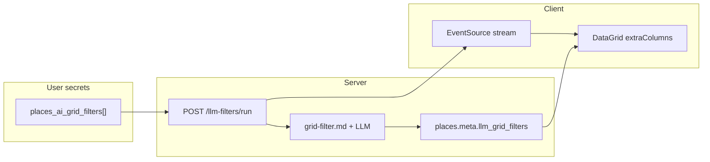

# Places AI grid filters

This document describes the **AI grid filters** feature: user-defined prompts stored in **user secrets**, batch LLM evaluation over grid search results, results cached on **`places.meta`**, and **MUI DataGrid** columns driven by those definitions.

It replaces the older **per-search “potential customer” context** on place summaries; scoring and extraction are **per filter definition** under `meta.llm_grid_filters`.

---

## Overview

1. **Definitions** live in `user_secrets.settings.places_ai_grid_filters` (array), edited in the **Grid filters** panel when the grid search is expanded.
2. **Runs** call `POST /api/places/llm-filters/run` with `placeIds` and `filterIds`; the server evaluates each pair, merges into `places.meta.llm_grid_filters`, and emits **SSE** events on `GET /api/places/llm-filters/stream?runId=…`.
3. **Columns** are built client-side (`useAiGridColumns`) from enabled definitions: `GridColDef.field === targetField`, cell value from `row.llm_grid_filters[filterId].value` (by **filter UUID**, not by `targetField` key in meta — see below).



---

## Filter definitions (`places_ai_grid_filters`)

Stored as JSON via existing **`/api/me/secrets`** (same pattern as `gridsearch_exclude_types`). TypeScript: `PlacesAiGridFilterDef` in `src/modules/places/client-gridsearch.ts`.

| Field | Description |
|--------|-------------|
| `id` | Stable UUID; **key** for `meta.llm_grid_filters[id]` and SSE payloads. |
| `label` | Optional display name for the column header. If empty or the legacy default “New filter”, the UI falls back to **`targetField`**. |
| `prompt` | User instructions combined with the server template `grid-filter.md`. |
| `targetField` | Slug for **`GridColDef.field`** (must match `^[a-z][a-z0-9_]{0,63}$`). Must **not** collide with built-in columns (`types`, `title`, … — see `RESERVED_GRID_FIELDS` in `llm.ts`). |
| `enabled` | Optional; default **on**. Disabled filters are skipped by the runner. |
| `valueType` | Optional: **`auto`** (default), **`number`**, or **`string`**. Controls coercion of the LLM `value` for sorting/filtering and MUI column `type`. Included in **prompt hash** so changing it invalidates cached cells until you re-run. |

**UI:** `GridFiltersPanel.tsx` — add/remove filters, save definitions, run on selection or all rows (owner-only).

---

## Per-place cache (`meta.llm_grid_filters`)

Merged with `updatePlaceMeta`. Shape per filter id:

```ts
meta.llm_grid_filters[filterId] = {
  value: string | number;       // normalized for the grid (see below)
  raw: { value, value_type?, detail? };  // parsed LLM JSON (value may match stored value after normalization)
  promptHash: string;             // invalidates when template version, prompt, targetField, or valueType changes
  model: string;                  // resolved model id at run time
  computedAt: string;             // ISO timestamp
  sourceUserId: string;           // user who ran the job
};
```

**Skip / idempotency:** If `promptHash` for this filter already matches the stored entry, the server **skips** another LLM call for that `(placeId, filterId)` until the definition or template version changes.

---

## LLM contract

### Prompt template

- Default path: `server/data/products/places/llm/grid-filter.md`.
- Override: env **`LLM_GRID_FILTER_PROMPT_PATH`** (absolute or relative to server cwd as implemented by `resolvePromptPath`).
- Substitutions include place fields from `buildPlaceSubstituteVars`, plus `filter_prompt`, `filter_label`, `target_field`, **`value_type_hint`** (from `valueType`: auto / number / string).

### JSON response (`AiGridFilterResultSchema`)

| Field | Type | Description |
|--------|------|-------------|
| `value` | `string \| number` | Primary cell value (short; no PII per prompt). |
| `value_type` | optional `"number" \| "string"` | **Guided** hint: use `"number"` for numeric scales (1–5) so the server coerces and DataGrid can filter numerically. |
| `detail` | optional `string` | Longer rationale. |

After parse, **`normalizeAiGridFilterValue`** applies **user `valueType`** and/or **`value_type`** and/or numeric-string heuristics so `meta` stores a **number** when appropriate (see `server/src/products/places/llm.ts`).

### Template version

- Constant **`LLM_GRID_FILTER_TEMPLATE_VERSION`** (currently **`2`**) is part of **`promptHash`**. Bump it when the base template or normalization rules change in a way that should force re-computation.

---

## Environment variables (grid filter LLM)

Resolution order for **provider**:

1. `LLM_GRID_FILTER_PROVIDER`
2. `LLM_PLACE_FILTERS_PROVIDER`
3. `LLM_PLACE_PROVIDER`
4. `LLM_REGION_PROVIDER`
5. default `openrouter`

Resolution order for **model**:

1. `LLM_GRID_FILTER_MODEL`
2. `LLM_PLACE_FILTERS_MODEL`
3. `LLM_PLACE_MODEL`
4. `LLM_REGION_MODEL`
5. default `openai/gpt-5.2`

Set e.g. `LLM_PLACE_FILTERS_PROVIDER` / `LLM_PLACE_FILTERS_MODEL` in `server/.env` when you want grid filters to use a dedicated model without changing place-info or region LLMs.

---

## HTTP API

| Method | Path | Purpose |
|--------|------|---------|
| `POST` | `/api/places/llm-filters/run` | Body: `{ placeIds: string[], filterIds: string[], lang?: string }`. Returns **`202`** with `{ data: { runId } }`. Max **80** place ids, **20** filter ids (see route validation). |
| `GET` | `/api/places/llm-filters/stream?runId=` | **SSE** (`text/event-stream`). For browsers, pass **`?token=`** (auth) when using `EventSource`. Events include progress, per-cell updates, completion, errors. |

Handlers: `handlePostLlmFiltersRun`, `handleGetLlmFiltersStream` in `server/src/products/places/llm.ts`; route definitions in `server/src/products/places/routes.ts`.

---

## Frontend

| Area | Behavior |
|------|----------|
| `GridSearchResults.tsx` | Loads filter defs (`getPlacesAiGridFilters`), passes **`extraColumns={useAiGridColumns(aiFilterDefs)}`** to the grid for **owners**; wires `GridFiltersPanel`, SSE refresh hooks. |
| `useAiGridColumns.tsx` | Builds `GridColDef[]`: `field: targetField`, `headerName` from label / targetField, **`type: 'number' \| 'string'`** when `valueType` is set, `valueGetter` reads `row.llm_grid_filters[def.id].value`. |
| `PlacesGridView.tsx` | Merges **`extraColumns`** after base columns; filter model sync when toggling **“Apply saved type excludes as DataGrid filters”** without remounting the grid (preserves column visibility/order). |
| `GridFiltersPanel.tsx` | Edit definitions, save to secrets, run batch. |

**Auth:** Only the search **owner** sees the AI filter editor and dynamic columns; viewers use the standard grid without those columns.

---

## Numeric scores (1–5, etc.)

1. Prefer **`valueType: number`** on the filter (dropdown in the panel) so the column is typed as numeric in MUI.
2. In the prompt, ask for a **JSON number** and optionally **`"value_type":"number"`** in the model output (see `grid-filter.md`).
3. **Re-run** AI filters after changing `valueType` or normalization logic so old string cells are replaced.

---

## Related features

- **Saved type excludes:** Same **Grid filters** panel; `gridsearch_exclude_types` + optional **seeded** `types` column filter when “Apply saved type excludes as DataGrid filters” is on (`seedExcludeTypeFilters` / `PlacesGridView`).
- **Place tab LLM** (`place-info.md`): Separate flow; does not use `places_ai_grid_filters` definitions.

---

## File reference

| Area | Files |
|------|--------|
| Server logic & SSE | `server/src/products/places/llm.ts` |
| Routes | `server/src/products/places/routes.ts`, `server/src/products/places/index.ts` |
| Prompt | `server/data/products/places/llm/grid-filter.md` |
| Client API & types | `src/modules/places/client-gridsearch.ts` |
| Grid UI | `src/modules/places/gridsearch/GridSearchResults.tsx`, `GridFiltersPanel.tsx` |
| Dynamic columns | `src/modules/places/gridsearch/useAiGridColumns.tsx` |
| Grid shell | `src/modules/places/PlacesGridView.tsx`, `useGridColumns.tsx` |

---

## Operational notes

- **Cost / abuse:** Batch size is capped; consider rate limits per deployment.
- **Meta size:** Keep `value` / `detail` short; avoid large blobs in `raw` if list payloads grow.
- **Public grid searches:** Non-owners do not get AI filter columns or the editor; LLM writes require an authenticated owner context for runs tied to their secrets.

---

*Implementation reference — behavior is defined by `server/src/products/places/llm.ts` and the routes above.*
