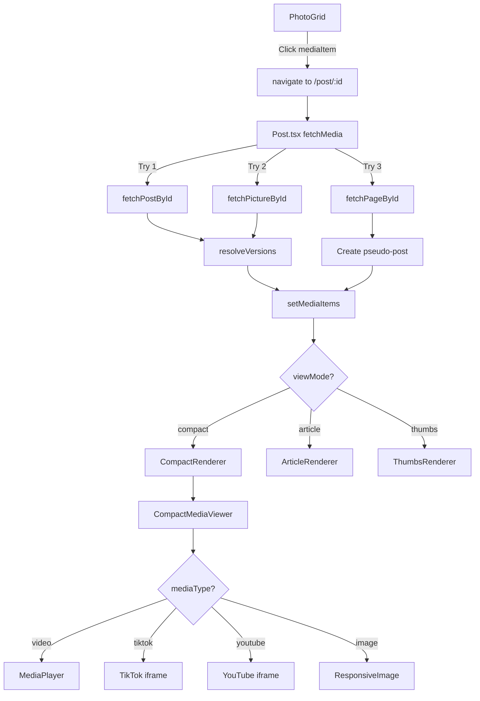

# Post Rendering Flow Documentation

This document traces the complete data flow and rendering pipeline for opening and displaying a post in the pm-pics application, from the PhotoGrid component through to the CompactMediaViewer.

---

## Overview

The post rendering system follows this component chain:

```
PhotoGrid → Post.tsx → CompactRenderer → CompactMediaViewer
```

Each layer transforms and enriches the data, handling navigation state, media types, and rendering options.

---

## 1. Entry Point: PhotoGrid Component

**File**: [PhotoGrid.tsx](../src/components/PhotoGrid.tsx)

### Data Source

PhotoGrid receives media items from two possible sources:

1. **Custom Pictures** (props): Pre-loaded media items passed directly
2. **Feed Data** (hook): Fetched via `useFeedData` hook with parameters:
   - `source`: 'home' | 'collection' | 'tag' | 'user' | 'widget'
   - `sourceId`: Identifier for the source
   - `sortBy`: 'latest' | other sort options
   - `categorySlugs`: Optional category filtering

### Data Structure: MediaItemType

```typescript
interface MediaItemType {
  id: string;
  picture_id?: string;
  title: string;
  description: string | null;
  image_url: string;
  thumbnail_url: string | null;
  type: MediaType;
  meta: any | null;
  likes_count: number;
  created_at: string;
  user_id: string;
  comments: { count: number }[];
  
  // Enriched fields
  author?: UserProfile;
  job?: any;
  responsive?: any;
  versionCount?: number;
}
```

### Navigation Data Setup

When a user clicks on a media item (line 258-274):

```typescript
const handleMediaClick = (mediaId: string, type: MediaType, index: number) => {
  // Special handling for internal pages
  if (type === 'page-intern') {
    navigate(`/user/${username}/pages/${slug}`);
    return;
  }
  
  // Update navigation context with current index
  setNavigationData({ ...navigationData, currentIndex: index });
  
  // Navigate to post view
  navigate(`/post/${mediaId}`);
}
```

**Navigation Context** includes:
- `posts`: Array of post metadata (id, title, image_url, user_id, type)
- `currentIndex`: Position in the feed
- `source`: Where the user came from
- `sourceId`: Source identifier

---

## 2. Post Container: Post.tsx

**File**: [Post.tsx](../src/pages/Post.tsx)

### Data Fetching Strategy

The `fetchMedia` function (lines 477-674) implements a **3-tier fallback strategy**:

#### Tier 1: Fetch as Post
```typescript
const postData = await db.fetchPostById(id);
```

Returns a `PostItem` with:
- Post metadata (title, description, settings)
- Array of `pictures` (sorted by position)
- User information

#### Tier 2: Fetch as Picture
```typescript
const pictureData = await db.fetchPictureById(id);
```

If found and has `post_id`, fetches the full post. Otherwise creates a **pseudo-post** with single picture.

#### Tier 3: Fetch as Page
```typescript
const pageData = await db.fetchPageById(id);
```

Creates a pseudo-post for internal page content with `type: 'page-intern'`.

### Version Resolution

After fetching, the system resolves image versions (lines 478-526):

```typescript
const resolveVersions = async (items: any[]) => {
  // 1. Extract root IDs (parent_id || id)
  const rootIds = items.map(i => i.parent_id || i.id);
  
  // 2. Fetch all related versions
  const allVersions = await db.fetchRelatedVersions(rootIds);
  
  // 3. Preserve original positions
  // 4. Sort by position, then created_at
  // 5. Deduplicate by ID
}
```

This ensures that:
- AI-generated variations are grouped with originals
- User-selected versions are displayed
- Position order is maintained

### State Management

Key state variables:

```typescript
const [post, setPost] = useState<PostItem | null>(null);
const [mediaItems, setMediaItems] = useState<MediaItem[]>([]);
const [mediaItem, setMediaItem] = useState<MediaItem | null>(null); // Currently displayed
const [viewMode, setViewMode] = useState<'compact' | 'article' | 'thumbs'>('compact');
```

### View Mode Synchronization

View mode is synchronized with URL parameters (lines 82-124):

```typescript
// Initialize from URL
const viewParam = searchParams.get('view');
if (viewParam === 'article' || viewParam === 'compact' || viewParam === 'thumbs') {
  return viewParam;
}

// Sync state to URL
useEffect(() => {
  const newParams = new URLSearchParams(searchParams);
  newParams.set('view', viewMode);
  setSearchParams(newParams, { replace: true });
}, [viewMode]);
```

### Data Types

#### PostItem
```typescript
interface PostItem {
  id: string;
  title: string;
  description: string | null;
  user_id: string;
  created_at: string;
  updated_at: string;
  pictures?: PostMediaItem[];
  settings?: Json;
  meta?: Json;
  isPseudo?: boolean; // For single pictures without posts
  type?: string; // 'page-intern' for internal pages
}
```

#### PostMediaItem
```typescript
interface PostMediaItem {
  id: string;
  title: string;
  description: string | null;
  image_url: string;
  thumbnail_url: string | null;
  user_id: string;
  type: MediaType;
  created_at: string;
  position: number | null;
  post_id: string | null;
  parent_id: string | null; // For versions
  meta: Json | null;
  likes_count: number;
  visible: boolean;
  is_liked?: boolean; // Enriched by user context
  renderKey: string; // Unique key for React rendering
}
```

---

## 3. Renderer Selection: CompactRenderer

**File**: [CompactRenderer.tsx](../src/pages/Post/renderers/CompactRenderer.tsx)

### Props Interface

```typescript
interface PostRendererProps {
  post: PostItem;
  authorProfile: UserProfile;
  mediaItems: PostMediaItem[];
  mediaItem: PostMediaItem; // Currently selected
  
  // State
  isOwner: boolean;
  isLiked: boolean;
  likesCount: number;
  currentImageIndex: number;
  
  // Media-specific
  videoPlaybackUrl?: string;
  videoPosterUrl?: string;
  versionImages: ImageFile[];
  
  // Callbacks
  onMediaSelect: (item: PostMediaItem) => void;
  onExpand: (item: PostMediaItem) => void;
  onLike: () => void;
  onDeletePicture: (id: string) => void;
  // ... many more action handlers
  
  // Navigation
  navigationData: any;
  handleNavigate: (direction: 'next' | 'prev') => void;
  
  // Edit mode
  isEditMode?: boolean;
  localPost?: { title: string; description: string };
  localMediaItems?: any[];
  // ... edit-related handlers
}
```

### Layout Strategy

CompactRenderer implements a **responsive 2-column layout**:

#### Desktop (lg breakpoint):
- **Left Column**: Media viewer + filmstrip
- **Right Column**: Header + details (scrollable)

#### Mobile:
- **Stacked Layout**: Header → Media feed → Details

### Component Breakdown

```
CompactRenderer
├── CompactPostHeader (mobile top, desktop right)
│   ├── User info, title, description
│   ├── View mode switcher
│   └── Action menu (edit, delete, export)
│
├── Left Column (Desktop)
│   ├── CompactMediaViewer (main media display)
│   └── CompactFilmStrip (thumbnail navigation)
│
├── MobileGroupedFeed (Mobile only)
│   └── Vertical scrolling media cards
│
└── Right Column (Desktop)
    ├── CompactPostHeader (repeated)
    └── CompactMediaDetails
        ├── Like/comment stats
        ├── Description
        ├── Comments section
        └── Action buttons
```

---

## 4. Media Display: CompactMediaViewer

**File**: [CompactMediaViewer.tsx](../src/pages/Post/renderers/components/CompactMediaViewer.tsx)

### Media Type Handling

The viewer handles **6 distinct media types**:

#### 1. Internal Videos (`video`, `video-intern`)
```typescript
<MediaPlayer
  src={videoPlaybackUrl}
  poster={videoPosterUrl}
  load="idle"
  posterLoad="eager"
/>
```

#### 2. TikTok Videos (`tiktok`)
```typescript
<iframe
  src={mediaItem.image_url} // Embed URL
  className="h-full aspect-[9/16]"
  allow="encrypted-media;"
/>
```

#### 3. YouTube Videos (detected from `page-external` meta)
```typescript
const ytId = getYouTubeVideoId(url);
<iframe
  src={`https://www.youtube.com/embed/${ytId}`}
  allow="accelerometer; autoplay; clipboard-write; encrypted-media;"
  allowFullScreen
/>
```

#### 4. TikTok Links (detected from `page-external` meta)
```typescript
// Shows thumbnail with play button overlay
// On click, loads iframe embed
const tikTokId = getTikTokVideoId(url);
<iframe src={`https://www.tiktok.com/embed/v2/${tikTokId}`} />
```

#### 5. Images (default)
```typescript
<ResponsiveImage
  src={`${mediaItem.image_url}${cacheBustKeys[mediaItem.id] ? `?v=${cacheBustKeys[mediaItem.id]}` : ''}`}
  onClick={() => onExpand(mediaItem)}
  sizes="(max-width: 1024px) 100vw, 1200px"
/>
```

#### 6. External Pages (`page-external`)
Falls through to image display with thumbnail.

### Version Control

CompactMediaViewer implements **version navigation** (lines 59-84):

```typescript
const getVersionsForCurrentItem = () => {
  const rootId = mediaItem.parent_id || mediaItem.id;
  
  // Filter versions in same family
  const visibleVersions = mediaItems.filter(item => {
    const isGroupMatch = (item.id === rootId) || (item.parent_id === rootId);
    if (!isOwner && !item.visible) return false;
    return isGroupMatch;
  });
  
  // Sort by creation time
  return visibleVersions.sort((a, b) => 
    new Date(a.created_at).getTime() - new Date(b.created_at).getTime()
  );
};
```

**Keyboard Navigation**:
- `ArrowUp`: Previous version
- `ArrowDown`: Next version
- `ArrowLeft`: Previous media item or post
- `ArrowRight`: Next media item or post

### Navigation Controls

Two layers of navigation:

#### 1. Media Item Navigation (within post)
```typescript
onClick={() => {
  if (currentImageIndex < mediaItems.length - 1) {
    onMediaSelect(mediaItems[currentImageIndex + 1]);
  } else {
    handleNavigate('next'); // Move to next post
  }
}}
```

#### 2. Post Navigation (between posts)
Uses `navigationData` context to move between posts in the feed.

---

## Data Flow Summary



---

## Refactoring Considerations

### Current Issues

1. **Data Duplication**: `MediaItemType` (PhotoGrid) vs `PostMediaItem` (Post.tsx) have overlapping fields
2. **Type Confusion**: `type` field is overloaded (media type vs page type)
3. **Meta Ambiguity**: `meta` field contains different structures for different types
4. **Navigation Coupling**: Navigation state tightly coupled to PhotoGrid
5. **Version Logic Scattered**: Version resolution happens in multiple places

### Proposed Improvements

#### 1. Unified Media Type System

```typescript
// Base media item
interface BaseMediaItem {
  id: string;
  title: string;
  description: string | null;
  user_id: string;
  created_at: string;
  likes_count: number;
  visible: boolean;
}

// Discriminated union for media types
type MediaItem = 
  | ImageMediaItem
  | VideoMediaItem
  | YouTubeMediaItem
  | TikTokMediaItem
  | PageMediaItem;

interface ImageMediaItem extends BaseMediaItem {
  mediaType: 'image';
  image_url: string;
  thumbnail_url: string | null;
  parent_id?: string; // For versions
  responsive?: ResponsiveImageData;
}

interface VideoMediaItem extends BaseMediaItem {
  mediaType: 'video';
  video_url: string;
  thumbnail_url: string;
  duration?: number;
  resolution?: { width: number; height: number };
}

interface YouTubeMediaItem extends BaseMediaItem {
  mediaType: 'youtube';
  videoId: string;
  thumbnail_url: string;
}

interface TikTokMediaItem extends BaseMediaItem {
  mediaType: 'tiktok';
  videoId: string;
  thumbnail_url: string;
}

interface PageMediaItem extends BaseMediaItem {
  mediaType: 'page';
  pageType: 'internal' | 'external';
  slug?: string; // For internal pages
  url?: string; // For external pages
  thumbnail_url?: string;
}
```

#### 2. Centralized Version Management

```typescript
class VersionManager {
  // Group items by version family
  groupByFamily(items: MediaItem[]): Map<string, MediaItem[]>
  
  // Get selected version for each family
  getSelectedVersions(items: MediaItem[], userId?: string): MediaItem[]
  
  // Navigate versions within a family
  getNextVersion(currentId: string, items: MediaItem[]): MediaItem | null
  getPrevVersion(currentId: string, items: MediaItem[]): MediaItem | null
}
```

#### 3. Separate Navigation State

```typescript
interface NavigationContext {
  // Feed-level navigation
  feedState: {
    posts: PostReference[];
    currentIndex: number;
    source: FeedSource;
    sourceId?: string;
  };
  
  // Post-level navigation
  postState: {
    mediaItems: MediaItem[];
    currentIndex: number;
    versionFamilies: Map<string, MediaItem[]>;
  };
}
```

#### 4. Renderer Configuration

```typescript
interface RenderOptions {
  viewMode: 'compact' | 'article' | 'thumbs';
  layout: {
    showFilmstrip: boolean;
    showComments: boolean;
    showVersions: boolean;
    autoplayVideos: boolean;
  };
  permissions: {
    canEdit: boolean;
    canDelete: boolean;
    canComment: boolean;
  };
}
```

### Migration Strategy

1. **Phase 1**: Create new type definitions alongside existing ones
2. **Phase 2**: Add adapters to convert between old and new types
3. **Phase 3**: Refactor CompactMediaViewer to use discriminated unions
4. **Phase 4**: Extract VersionManager as standalone service
5. **Phase 5**: Update PhotoGrid and Post.tsx to use new types
6. **Phase 6**: Remove old type definitions and adapters

---

## Key Files Reference

- [PhotoGrid.tsx](../src/components/PhotoGrid.tsx) - Feed display and navigation setup
- [Post.tsx](../src/pages/Post.tsx) - Post container and data fetching
- [CompactRenderer.tsx](../src/pages/Post/renderers/CompactRenderer.tsx) - Layout orchestration
- [CompactMediaViewer.tsx](../src/pages/Post/renderers/components/CompactMediaViewer.tsx) - Media type rendering
- [types.ts](../src/integrations/supabase/types.ts) - Database schema types

---

## Database Schema Reference

### Key Tables

#### `posts`
```sql
- id: string (PK)
- title: string
- description: string | null
- user_id: string
- settings: json | null
- meta: json | null
- created_at: timestamp
```

#### `pictures`
```sql
- id: string (PK)
- title: string
- description: string | null
- image_url: string
- thumbnail_url: string | null
- user_id: string
- post_id: string | null (FK)
- parent_id: string | null (FK) -- For versions
- position: integer | null
- type: string | null
- meta: json | null
- visible: boolean
- likes_count: integer
- created_at: timestamp
```

#### `pages`
```sql
- id: string (PK)
- title: string
- slug: string
- owner: string
- content: json | null
- meta: json | null
- type: string | null
- is_public: boolean
- visible: boolean
- created_at: timestamp
```

---

*Last updated: 2026-02-06*
