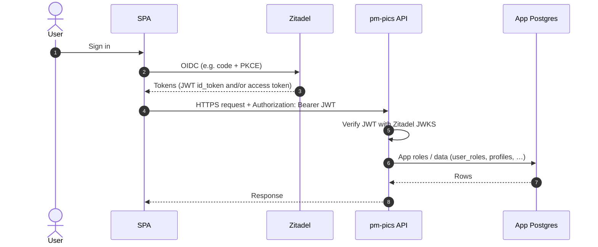
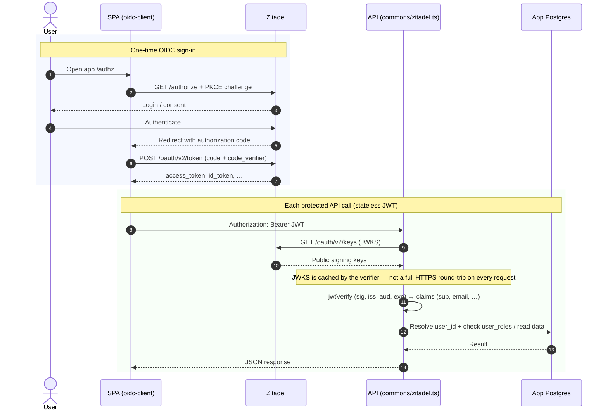
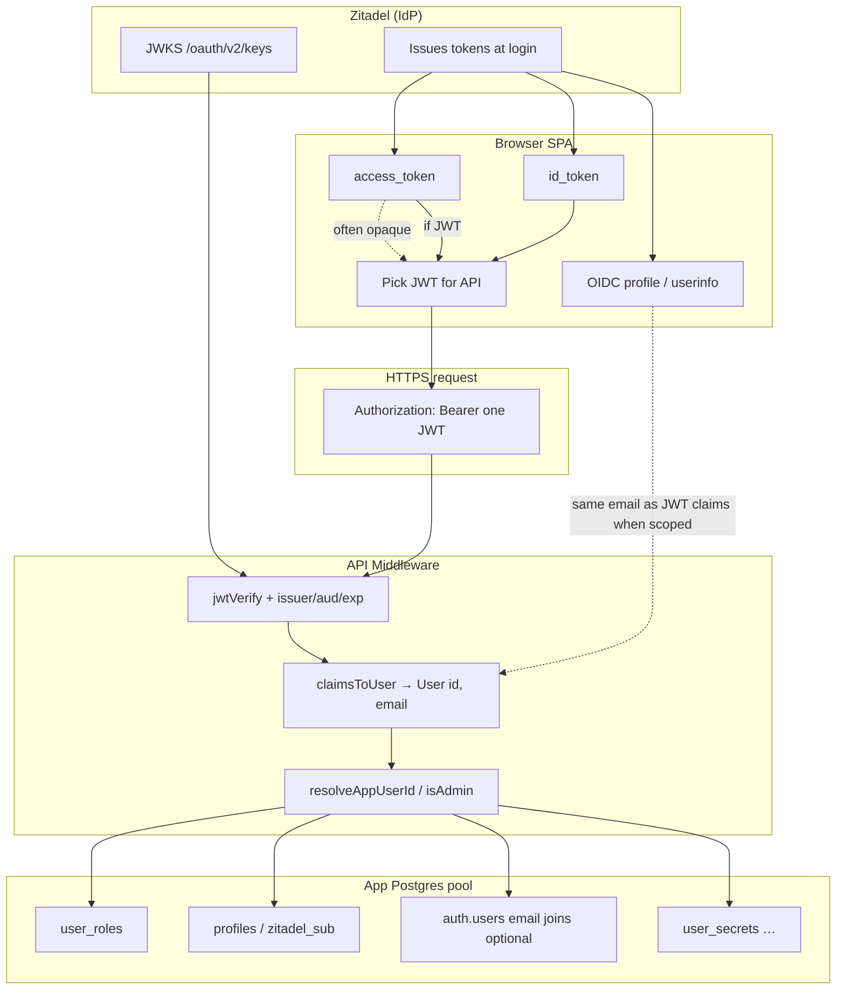
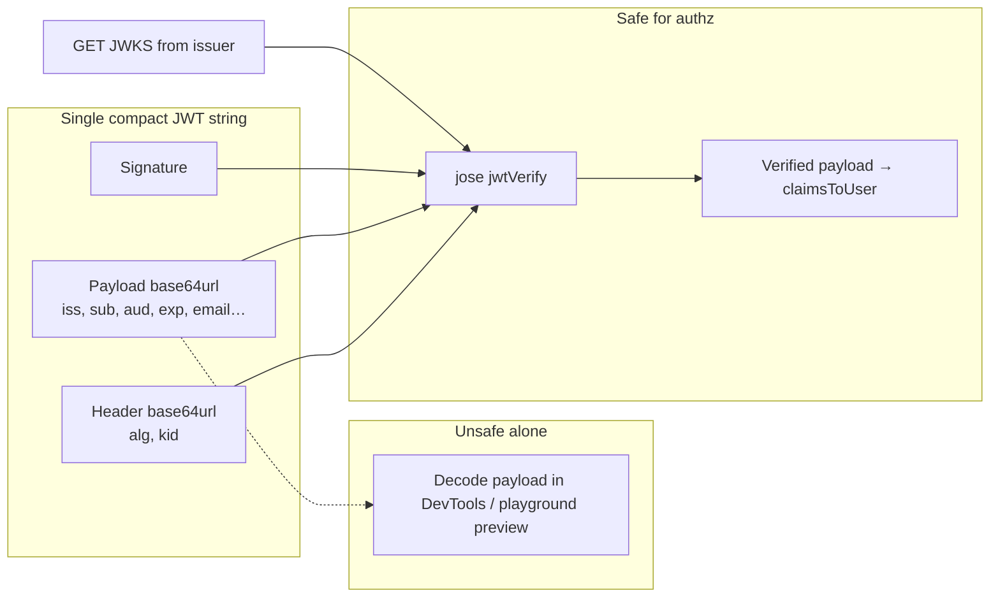

# Auth with Zitadel (Leaving Supabase)

## Overview

Chapter in the **Leaving Supabase** series: identity moves from Supabase Auth to **Zitadel (OIDC)** while the app database remains Postgres with **application-level** authorization.

**Contents**

1. **§1 — Chapter focus** — Why Zitadel, trust model, architecture.
2. **§2 — Flows, payloads, security** — OIDC/JWKS, claims, diagrams, threats.
3. **§3 — Host and IdP** — Binary install, systemd, endpoints, Google IdP steps.
4. **§4 — Configuration snapshots** — `zitadel.yaml`, service unit, Apache proxy, `start.sh`.
5. **References** — External specs, upcoming chapters.

---

## 1. Chapter focus (auth + identity)

**Why Zitadel instead of Supabase Auth?** Supabase Auth is tightly coupled to **PostgREST**, **`auth.users`**, and **JWTs signed by Supabase**. As we move to **self-hosted Postgres**, direct `pg` access, and clearer multi-tenant boundaries, we needed an **OIDC-native identity provider**.

During the migration architecture phase, we evaluated several alternatives before selecting Zitadel:

### Evaluation: Zitadel vs Better Auth vs Keycloak

| Feature | Zitadel | Better Auth | Keycloak |
|:---|:---|:---|:---|
| **Architecture** | **Standalone IdP** (Go binary) | **Library** (runs in Node.js) | **Standalone IdP** (Java / Quarkus) |
| **B2B / Multi-tenant** | Native, granular organization contexts | DIY or limited | Supported, but complex realm overhead |
| **SSO / SAML / OIDC** | Native, turnkey IdP integrations | Mostly OAuth2 social logins | Comprehensive, enterprise-heavy |
| **Operational Weight** | **Low** (Single binary execution, no Docker) | **None** (Embeds in existing app) | **High** (Java ecosystem, heavy memory footprint) |
| **Database Coupling** | Owns its isolated DB state (`zitadel`) | Creates tables in *your* core app DB | Owns its isolated DB state |
| **Rust / API Portability** | ✅ Decoupled. APIs just verify JWKS offline. | ⚠️ Highly coupled to TypeScript / JS. | ✅ Decoupled. |

**Why Zitadel was the winning choice:**

1. **Decoupled Security Surface**: Unlike **Better Auth**, which tightly couples the auth logic and token generation to our daily Node.js application process and core database, Zitadel runs completely out-of-band. If our Node app goes down or has a vulnerability, the Identity Provider remains insulated. This perfectly aligns with our zero-downtime, microservices-bound future (such as porting API modules to Rust or C++).
2. **Operational Simplicity**: Unlike **Keycloak**, which is famously robust but brings the heft of the JVM, Zitadel runs as a single, compiled Go executable. It is trivial to run securely directly via Systemd without Docker.
3. **True OIDC/SAML Provider**: Zitadel doesn't just bolt social login onto an app—it acts as a universal Identity Broker with native B2B tenancy.

Therefore, Zitadel is the IdP in our target architecture. Supabase Postgres (`auth` schema) and connection-level RLS patterns are **not** the source of truth for authorization; enforcement has moved definitively to our application code and custom ACL layer.

### Architecture at a glance

| Layer | Responsibility |
|--------|----------------|
| **Zitadel** | Login UI, sessions, token issuance, JWKS at the issuer. |
| **Browser (SPA)** | OIDC authorization code + PKCE (`react-oidc-context`), stores tokens, sends a **JWT** as `Authorization: Bearer` to the API (often the **id_token** when the access token is opaque). |
| **pm-pics API** | Verifies JWTs with **`ZITADEL_ISSUER`** + JWKS (`server/src/commons/zitadel.ts`), maps claims to a user identity, then reads/writes **app Postgres** using a **privileged pool** (`DATABASE_URL_NEXT` / `DATABASE_URL`). |
| **App Postgres** | Profiles, `user_roles`, `user_secrets`, etc. **Authorization** for API behavior is enforced in code; the pool does **not** impersonate end-user RLS the way PostgREST + `auth.uid()` did. |

### What the server trusts

1. **Cryptographic verification** of the Bearer JWT (signature + `iss` + optional `aud` + time claims) using Zitadel’s keys.
2. **Identity claims** in that verified payload — notably **`sub`** and **`email`** (`claimsToUser` in `zitadel.ts`).
3. **App roles and row ownership** resolved in **our** tables (`resolveAppUserId`, `isAdmin`, product handlers), **not** from trusting raw client input or from RLS on the server connection.

Email for API logic comes from **signed JWT claims** when scopes include `email`; Supabase **`auth.users.email`** is only used where we still join for legacy listing/mapping, and only if that schema exists on the connected database.

### Application wiring

- **SPA OIDC**: The frontend uses an `OidcProvider` (authority, client id, redirect URIs, `scope: "openid profile email"`, post-logout URI aligned with Zitadel allowlists).
- **Auth UI**: Sign-in / sign-out flows rely on the standard OIDC redirects.
- **API verification**: The backend implements JWT verification (`jwtVerify`), reading the `sub` and `email` claims before mapping them to the app's `user_roles`.
- **Debug / experiment routes**: Optional endpoints (e.g. `/api/admin/authz/debug`) can be exposed strictly in non-production environments to inspect tokens.

Environment variables for the API: `ZITADEL_ISSUER`, optional `ZITADEL_JWKS_URL`, `ZITADEL_AUDIENCE`, `AUTH_CACHE_TTL`, `DATABASE_URL_NEXT` / `DATABASE_URL` (details in §2).

---

## 2. Flows, payloads, security, and operations

### 2.1 Auth flow — simple version

1. **User signs in** in the browser via OIDC at Zitadel (password, Google, etc.). Zitadel issues tokens (often an **access token** and an **id_token**).
2. **Browser calls your API** with `Authorization: Bearer <JWT>` (when the access token is opaque, the SPA may send the **id_token** instead — it must be a JWT the API can verify).
3. **API does not “log in” to Zitadel per request.** It **verifies the JWT** using Zitadel’s **public keys (JWKS)**, checks issuer/audience/expiry, then reads claims (`sub`, `email`, …) from the verified payload.
4. **App permissions** (e.g. admin) come from **your Postgres** (`user_roles`, `profiles`, and sometimes `auth.users` for email joins), not from Zitadel project roles alone.

**One line:** Zitadel proves *who* the user is (signed JWT); your database proves *what they may do* in the app.

#### Simple sequence diagram



### 2.2 Auth flow — detailed version

#### A. Browser ↔ Zitadel (OIDC)

- The SPA uses **OpenID Connect** (e.g. authorization code with **PKCE**).
- After successful login, tokens are stored (e.g. `localStorage` via `oidc-client-ts` / `react-oidc-context`).
- **Issuer** is your Zitadel URL (e.g. `https://auth.polymech.info`). Discovery and **JWKS** are under that issuer (`/.well-known/openid-configuration`, `/oauth/v2/keys`).
- **Redirect URIs** and **post-logout redirect URIs** must be explicitly allowlisted in the Zitadel application; mismatch causes `invalid_request` / `post_logout_redirect_uri invalid`.

#### B. Browser ↔ API (Bearer JWT)

- Protected routes expect `Authorization: Bearer <token>`.
- On the server:
  - We use **`jwtVerify`** from `jose` + remote **JWKS** (`ZITADEL_ISSUER`, optional `ZITADEL_JWKS_URL`, optional `ZITADEL_AUDIENCE`).
  - On success, the payload is mapped to a standard `User` model — extracting notably **`sub`** and **`email`** (from `email` or `preferred_username` claims when present).
- **No server-side token introspection** is required for this path: email and identity come **from the JWT claims** after signature verification, not from a second HTTP call to Zitadel for each API request.

#### C. API ↔ your app database (authorization)

- **Admin and other app roles** are **not** inferred only from Zitadel. They live in **your** Postgres (e.g. `public.user_roles` keyed by app `user_id`).
- **`sub` in the JWT** may be a **UUID** (legacy Supabase `auth.users.id`) or a **non-UUID** Zitadel subject. The code maps OIDC identity to `profiles.user_id` via `profiles.zitadel_sub`, **JWT email** vs `auth.users.email`, or `profiles.username`, then checks `user_roles`.
- **Supabase `auth.users`**: email for *listing* users or *joining* identity is read from **`auth.users`** only when that schema exists on the connection (`DATABASE_URL_NEXT` / `DATABASE_URL`). **`public.profiles`** does not store email in the generated types; canonical email in Supabase is in **`auth.users`**. If the pool has no `auth` schema, JWT email still works for verification; DB email joins are skipped or return empty.

#### D. What is *not* happening

- The API does **not** exchange the Bearer token with Zitadel’s token endpoint on each request.
- The API does **not** trust the client’s claims without cryptographic verification.

#### Advanced sequence diagram

OIDC login (once) vs. each API call: JWKS verification is **local crypto** after keys are fetched (typically cached). No per-request “login” to Zitadel’s token endpoint for Bearer APIs.



### 2.3 Data, payloads, and token handling

### Diagram: payloads in context (who holds what)

Where each piece of data lives relative to **Zitadel**, the **browser**, the **API**, and **your Postgres**. Arrows show the **happy path** for API calls that use `getUserCached`.



**Read top-to-bottom:** Zitadel mints tokens; the SPA stores them and usually sends **one JWT** as Bearer; the API **never** reads email from Postgres first — it verifies the JWT, maps **claims → `User`**, then uses **`sub` + email** to query **your** tables. **`profile.email`** in the SPA should align with the **`email`** claim in the id_token when scopes include `email`.

### Diagram: JWT segments vs. trust boundary

The middle segment is only **trustworthy after** signature verification against **JWKS** (same issuer keys Zitadel used to sign).



*Decoding the payload alone (dashed) only proves you can read base64 — **not** that Zitadel signed it. Use **`jwtVerify`** for any authorization decision.*

### Compact JWT shape

OIDC tokens are often **JWS compact** strings:

```text
<base64url(header)>.<base64url(payload)>.<base64url(signature)>
```

- **Header** typically includes `alg` (e.g. `RS256`) and `kid` (key id for JWKS lookup).
- **Payload** is a JSON object with registered OIDC/JWT claims (`iss`, `sub`, `aud`, `exp`, `iat`, …) plus optional claims (`email`, `preferred_username`, …).
- **Signature** is verified with Zitadel’s **public** keys from **JWKS** — never trust the payload without that step.

**Opaque access tokens** are not three dot-separated JWT segments; the API **cannot** run JWKS verification on them.

### Server: verification vs. “decoding”

| Step | What runs | Purpose |
|------|-----------|---------|
| Shape check | `looksLikeCompactJwt` — three non-empty dot-separated parts | Reject obvious non-JWTs before crypto |
| Early expiry hint | `getJwtExp` — **JSON.parse** of **payload segment only** (base64url → UTF-8), read `exp` | Fast reject of expired tokens + cache behavior; **not** a security boundary (unsigned) |
| Cryptographic verify | `jose` **`jwtVerify(token, JWKS, { issuer, audience?, clockTolerance })`** | Signature, `iss`, optional `aud`, time claims |
| Map to app user | **`claimsToUser(payload)`** | Build `User` with `id = sub`, `email` from claims (see below) |

After **`jwtVerify`**, the payload is **authenticated**. Anything decoded **without** signature verification (e.g. reading the middle segment in DevTools) is **for debugging only** and must not drive authorization.

### Claims used after verification (`claimsToUser`)

The server maps the **verified** JWT payload to a Supabase-shaped `User` for downstream code:

| Field on `User` | Source in JWT payload |
|-----------------|------------------------|
| `id` | **`sub`** (required) |
| `aud` | `aud` (string or first element if array) |
| `email` | **`email`** if non-empty string, else **`preferred_username`** if string, else `''` |

So **email for API logic** comes from **signed claims**, not from Postgres. The **`email`** claim is normally present when the client requested scope **`email`** (see SPA `scope: "openid profile email"`).

### Email: JWT vs. Supabase `auth.users`

| Source | When it applies |
|--------|-----------------|
| **JWT** (`email` / `preferred_username`) | Every successful `getUserCached` path — identity for `isAdmin(..., user.email)`, `resolveAppUserId(oidcSub, email)`, debug handlers |
| **`auth.users.email`** | Only when your app Postgres connection has table **`auth.users`** (Supabase-style). Used in SQL joins to map non-UUID subjects or enrich lists — **not** the primary source for “who is calling” on the Bearer path |
| **`public.profiles`** | No `email` column in generated types; profile row is keyed by `user_id` |

If the DB pool has **no** `auth` schema, JWT email still works; joins that reference `auth.users` are skipped or return empty email fields in list endpoints.

### Environment variables (API)

| Variable | Role |
|----------|------|
| `ZITADEL_ISSUER` | Expected token **`iss`** (normalized, no trailing slash). Required for verification. |
| `ZITADEL_JWKS_URL` | Optional override; default `{issuer}/oauth/v2/keys`. |
| `ZITADEL_AUDIENCE` | Optional comma-separated **`aud`** values; if set, access tokens must match one of them. |
| `AUTH_CACHE_TTL` | Optional; ms to cache `getUserCached` results per token (default ~30s). |
| `DATABASE_URL_NEXT` / `DATABASE_URL` | App Postgres pool — **not** used to “decode” the token; used **after** identity is known for roles and data. |

### Illustrative JWT payload (after decode — structure only)

**Example** (values are fictional; real tokens are longer):

```json
{
  "iss": "https://auth.polymech.info",
  "sub": "123456789012345678",
  "aud": "367440527605432321",
  "exp": 1710000000,
  "iat": 1709996400,
  "email": "user@example.com",
  "email_verified": true,
  "preferred_username": "user@example.com"
}
```

Zitadel may use a **numeric** `sub` or a **UUID** depending on configuration and user linkage; `resolveAppUserId` handles mapping to `profiles.user_id`.

### Browser (SPA): OIDC and which token is sent to the API

- The frontend configuration should include `scope: "openid profile email"` and `loadUserInfo: true` so the OIDC client can populate **`profile.email`** and related claims.
- Libraries like **`react-oidc-context`** store both **`access_token`** and **`id_token`**. If the **access token is opaque**, the API cannot verify it using JWKS; the client should instead send the **`id_token`** (a verified JWT) as the `Authorization: Bearer` token for endpoints that rely on user identity.

### 2.4 Security model (what JWKS verification gives you)

- **Integrity & authenticity:** Only tokens signed with Zitadel’s keys validate; tampered tokens fail.
- **Binding to issuer / audience (when configured):** `ZITADEL_ISSUER` and optional `ZITADEL_AUDIENCE` reduce cross-app token reuse.
- **Expiry:** Expired tokens are rejected (JWT `exp` and local checks).

**Limitations (inherent to bearer JWTs):**

- **Possession = access:** Anyone who holds a valid token can use it until it expires (same as any Bearer secret).
- **Revocation:** Standard JWT validation does **not** ask Zitadel “is this token revoked?” on every request. Compromise or logout may not invalidate the JWT until **exp** unless you add short lifetimes, refresh rotation, or explicit revocation/introspection.
- **Opaque access tokens:** If Zitadel issues an **opaque** access token, the API **cannot** verify it with JWKS; the client must send a **JWT** (typically **id_token** with `openid`) for this code path, or you must implement **token introspection** separately.

### 2.5 Threats and mitigations

| Threat | What happens | What to do |
|--------|----------------|------------|
| **Token leaked** (XSS, shoulder surf, stolen device, paste in chat) | Attacker replays `Authorization: Bearer` until **exp**. | Prefer **short access token TTL**, **HTTPS everywhere**, **Content-Security-Policy** and XSS hygiene, **never log** Bearer tokens, consider **HttpOnly** cookies only if you redesign (current SPA localStorage pattern is common but XSS-sensitive). |
| **MITM / mixed content** | Token or code stolen on the wire. | **HTTPS** for SPA and API; **HSTS**; no token in query strings in production. |
| **Wrong IdP configuration** | Accept tokens from wrong issuer/audience. | Set **`ZITADEL_ISSUER`** (and **`ZITADEL_AUDIENCE`** when using audience-bound access tokens) correctly; review Zitadel app client settings. |
| **JWKS confusion / MITM to JWKS** | Theoretical key substitution if TLS broken. | TLS to issuer; optional pin or internal network for JWKS fetch in high-threat models. |
| **Replay** | Same JWT used many times until expiry. | Expected for stateless JWT; mitigate with **short TTL** + refresh; for high-risk actions consider **step-up** or server-side session. |
| **Admin / role confusion** | User is valid in Zitadel but **not** in `user_roles`. | By design — **always** enforce app roles in Postgres; do not trust Zitadel “roles” for app admin unless you explicitly map them. |
| **Email-only mapping** | Attacker could theoretically exploit weak email collision if misconfigured. | Keep **`user_roles`** on stable **`user_id`**; use **`profiles.zitadel_sub`** for OIDC subjects; treat email match as a **fallback** path only. |
| **OIDC redirect / logout URI abuse** | Open redirects, logout to attacker site. | **Exact allowlists** in Zitadel for redirect and **post-logout** URIs; match SPA routes (e.g. `/authz`). |
| **CSRF on code flow** | Code interception. | Use **PKCE** (library default for modern OIDC); state parameter. |

### 2.6 Verification and cutover

- **JWT-shaped** values are what JWKS tests use. When running local integration tests, prefer passing an OIDC `id_token` or a JWT **access** token. A long **opaque** API access token is **not** a JWT; verification will fail unless you manually implement introspection or pass a true JWT.
- Ensure that staging environments exercise verification and `user_roles` queries before flipping the switch.
- Production middleware can continue serving legacy Supabase Auth requests while incrementally routing new traffic to the Zitadel-backed paths until the migration finishes.

### 2.7 Sample implementations

Here are examples demonstrating how to configure the frontend provider and how to perform server-side JWT verification.

#### Frontend: Setting up the OIDC Provider (React)

```tsx
import { AuthProvider } from "react-oidc-context";

const oidcConfig = {
  authority: "https://auth.polymech.info",
  client_id: "your-client-id@your-project",
  redirect_uri: `${window.location.origin}/auth/callback`,
  post_logout_redirect_uri: window.location.origin,
  scope: "openid profile email", // Request 'email' claim in the token
  onSigninCallback: () => {
    // Remove the OIDC payload from URL after login
    window.history.replaceState({}, document.title, window.location.pathname);
  }
};

export function Root() {
  return (
    <AuthProvider {...oidcConfig}>
      {/* App routing / Auth guards here */}
    </AuthProvider>
  );
}
```

#### Backend: Verifying the JWT (Node.js/jose)

```typescript
import { createRemoteJWKSet, jwtVerify } from "jose";

const ISSUER = process.env.ZITADEL_ISSUER!; // e.g. "https://auth.polymech.info"

// createRemoteJWKSet caches public keys, fetching them only when necessary
const JWKS = createRemoteJWKSet(new URL(`${ISSUER}/oauth/v2/keys`));

export async function verifyUserToken(authHeader: string | undefined) {
  if (!authHeader?.startsWith("Bearer ")) throw new Error("Missing token");
  const token = authHeader.substring(7);

  try {
    const { payload } = await jwtVerify(token, JWKS, {
      issuer: ISSUER,
      // audience: process.env.ZITADEL_AUDIENCE, // Uncomment to validate Audience
    });

    // Token is cryptographically valid! Map claims to the application identity:
    return {
      sub: payload.sub, // The canonical Zitadel Subject ID
      email: typeof payload.email === 'string' 
        ? payload.email 
        : payload.preferred_username,
      verified: true
    };
  } catch (error) {
    console.error("JWT Verification failed:", error);
    throw new Error("Unauthorized");
  }
}
```

### 2.8 Migration Patterns: Bridging the Gap

When migrating off Supabase slowly, a "hybrid" application architecture is often necessary. The following patterns demonstrate how to elegantly decouple the backend without breaking existing downstream code.

#### The "Supabase Shim"

Existing API middleware and downstream functions likely expect a `@supabase/supabase-js` `User` object. Instead of rewriting all business logic, you can construct a shim mapping the verified OIDC payload to match the legacy Supabase interface exactly:

```typescript
function claimsToUser(payload: JWTPayload): User {
    const sub = payload.sub;
    if (!sub) throw new Error('JWT missing sub');

    // Extract email from OIDC token if scopes permit
    const email = 
        (typeof payload.email === 'string' && payload.email) ||
        (typeof payload.preferred_username === 'string' && payload.preferred_username) || '';

    const now = new Date().toISOString();
    
    // Cast to Supabase User object to fool legacy downstream services
    return {
        id: sub,
        aud: payload.aud,
        app_metadata: {},
        user_metadata: {},
        email,
        phone: '',
        created_at: now,
        updated_at: now,
        is_anonymous: false,
    } as User;
}
```

#### Four-Tier Identity Resolution

Legacy Postgres rows (like `public.profiles`) are intimately bound to Supabase UUIDs. A new IdP like Zitadel might issue its own differently-formatted IDs (e.g., numerical strings). A robust resolution function (`resolveAppUserId`) bridges this gap by attempting a fallback waterfall:

1. **Direct UUID Match**: If the Zitadel `sub` is already a UUID, match it directly against `profiles.user_id`.
2. **Dedicated ID Column**: Check a migration column (e.g., `profiles.zitadel_sub`) designed specifically to map new identity strings to legacy internal UUIDs.
3. **Legacy Schema Check (`auth.users`)**: If the old Supabase auth schema still exists, attempt an email join between `auth.users` and your `profiles` table.
4. **App-Level Email Match**: Fallback to checking the OIDC email against an application-level `profiles.username` or `profiles.email` column.

To prevent query crashes as you prepare to drop the Supabase schemas, you should dynamically check `information_schema.tables` upon startup to see if the legacy `auth.users` table is still present before attempting any fallback ID resolution against it.

---

## 3. Host, systemd, and IdP setup

This section describes the **installed Zitadel instance** (separate Postgres DB `zitadel`, reverse proxy TLS). It is **not** the application `DATABASE_URL` used by pm-pics for posts/profiles.

### 3.1 Setup overview

Zitadel was installed via a native binary (`v4.13.1`) downloaded from the official GitHub Release and extracted into `/usr/local/bin/zitadel`.
No Docker containers are used for this instance.

### 3.2 Configuration files (on the host)

All persistent configs for the service are stored in `/var/polymech/service/zitadel`:

- `zitadel.yaml`: The main configuration file containing database connection details, the server port (`8887`), and SSL configurations.
- `machinekey`: A mandatory encryption file housing 32 bytes of secure key material initialized to secure the platform.
- `start.sh`: A manual CLI launch script preserved for debugging. In normal running conditions, rely on Systemd instead.
- `plesk_apache_override.conf`: Custom proxy directives applied inside Plesk's custom HTTPS configuration for the domain to pipe traffic directly inside the node securely.

### 3.3 Database (Zitadel’s own Postgres)

Zitadel uses the local `PostgreSQL 14` instance located at `127.0.0.1:5432`:

- **Database Name**: `zitadel`
- **Owner Role**: `zitadel`
  - Secured using `ENCRYPTED PASSWORD 'ZitadelSecurePass123DB'`.
- The role was given `SUPERUSER`, `CREATEDB`, `CREATEROLE` capabilities to execute background schema migrations (`setup`) automatically, successfully completing schema projections upon initial start.

### 3.4 Running Zitadel (systemd)

Zitadel has been configured to run via **Systemd** across reboots implicitly.

#### Systemd administration

Manage the background daemon directly with standard commands:

- Start up: `sudo systemctl start zitadel.service`
- Stop instance: `sudo systemctl stop zitadel.service`
- View Status: `sudo systemctl status zitadel.service`
- Toggle Startup On-Boot: `sudo systemctl enable/disable zitadel.service`

**View historical logs dynamically:**

```bash
sudo journalctl -u zitadel.service -f
```

### 3.5 Endpoints

Because port `8080` was bound to an existing service (Filebrowser), the internal port was shifted properly inside `zitadel.yaml`.

- **Port:** `8887`
- **Health-Check URL:** `https://auth.polymech.info/debug/healthz`
- **Console UI:** `https://auth.polymech.info/ui/console`

### 3.6 Adding Google Login (External Identity Providers)

Zitadel natively supports plugging in strict Identity Providers (like Google Workspace, GitHub, Entra, etc.) entirely through its management UI. You **do not** need to edit command line configuration to support this!

Here is the exact step-by-step process required to setup **Google Login Providers**:

### Step 1: Create a Google OAuth App

1. Go to your [Google Cloud Console](https://console.cloud.google.com/).
2. Select your project and navigate to **APIs & Services > Credentials**.
3. Click **+ CREATE CREDENTIALS** and choose **OAuth client ID**.
4. Set the Application type to **Web application**.
5. You MUST set the **Authorized redirect URI** exactly to:
   - `https://auth.polymech.info/ui/login/login/externalidp/callback`
6. Click **Create** to receive your Google **Client ID** and **Client Secret**.

### Step 2: Configure in Zitadel Console

1. Log into your Zitadel instance via `https://auth.polymech.info/ui/console`.
2. Under your Instance (or specific Organization) settings, find the **Identity Providers** tab.
3. Click **New** and select the **Google** template.
4. Input the **Client ID** and **Client Secret** that you procured in Step 1. Save and ensure the widget is activated.

### Step 3: Link the Default Login Policy (Required)

*Just because it is enabled doesn't mean it forces it onto login screens!*

1. Head to your **Settings > Login Policy**.
2. Click **Identity Providers** and add **Google** to the list of acceptable IDPs.
3. A "Sign in with Google" button will instantly materialize organically on your main native login endpoint!

---

## 4. Configuration file snapshots

Configuration snapshots to act as reference for operators. Secrets in `zitadel.yaml` must be rotated per your policy.

### 4.1 `zitadel.yaml`

```yaml
Port: 8887
ExternalSecure: true
ExternalDomain: auth.polymech.info
ExternalPort: 443
TLS:
  Enabled: false
Database:
  postgres:
    Host: 127.0.0.1
    Port: 5432
    Database: zitadel
    User:
      Username: zitadel
      Password: 'ZitadelSecurePass123DB'
      SSL:
        Mode: disable
    Admin:
      Username: zitadel
      Password: 'ZitadelSecurePass123DB'
      SSL:
        Mode: disable
Machine:
  MachineKeyPath: /var/polymech/service/zitadel/machinekey
```

### 4.2 `zitadel.service`

```ini
[Unit]
Description=Zitadel IAM Service
After=network.target postgresql.service

[Service]
Type=simple
User=root
WorkingDirectory=/var/polymech/service/zitadel
ExecStart=/usr/local/bin/zitadel start-from-init --config /var/polymech/service/zitadel/zitadel.yaml --masterkeyFile /var/polymech/service/zitadel/machinekey --tlsMode disabled
Restart=on-failure
RestartSec=5

[Install]
WantedBy=multi-user.target
```

### 4.3 `plesk_apache_override.conf`

```apache
# Additional Apache directives for Plesk HTTPS
# Domain: auth.polymech.info

ProxyPreserveHost On
ProxyRequests Off

# Forward all traffic to the local Zitadel instance
ProxyPass / http://127.0.0.1:8887/
ProxyPassReverse / http://127.0.0.1:8887/

<Location />
    # Ensure Zitadel knows the original request was over HTTPS
    RequestHeader set X-Forwarded-Proto "https"
    RequestHeader set X-Forwarded-Port "443"
</Location>

# NOTE: For Plesk, paste this into:
# "Apache & nginx Settings" -> "Additional directives for HTTPS"
```

### 4.4 `start.sh`

```bash
#!/bin/bash

echo "Running Zitadel Setup..."
/usr/local/bin/zitadel setup --masterkeyFile /var/polymech/service/zitadel/machinekey --config /var/polymech/service/zitadel/zitadel.yaml --tlsMode disabled

echo "Starting Zitadel..."
/usr/local/bin/zitadel start-from-init --masterkeyFile /var/polymech/service/zitadel/machinekey --config /var/polymech/service/zitadel/zitadel.yaml --tlsMode disabled
```

---

## References

### External

- **Zitadel — claims matrix:** [Claims in ZITADEL](https://zitadel.com/docs/apis/openidoauth/claims) (what appears in userinfo / id_token / access token).
- **OIDC:** [OpenID Connect Core](https://openid.net/specs/openid-connect-core-1_0.html) (ID Token, `nonce`, `scope`).

---
