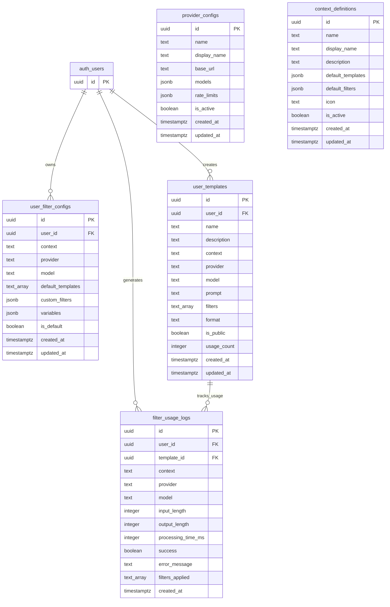

# Templates System Database Schema

This document describes the database schema for the LLM templates and filters system.

## Database Schema (Mermaid ERD)

## Table Descriptions

### `user_filter_configs`
Stores user-specific filter configurations and preferences for different contexts.

**Key Fields:**
- `context`: One of 'maker-tutorials', 'marketplace', 'directory', 'commons'
- `provider`: AI service provider (default: 'openai')
- `model`: AI model to use (default: 'gpt-4o-mini')
- `default_templates`: Array of default template names
- `custom_filters`: JSONB object containing custom filter configurations
- `variables`: JSONB object for template variables

### `user_templates`
User-defined custom templates for various contexts.

**Key Fields:**
- `context`: The context this template applies to
- `prompt`: The actual LLM prompt text
- `filters`: Array of filter names to apply
- `format`: Output format ('text', 'json', 'markdown')
- `is_public`: Whether template is shared publicly
- `usage_count`: Tracking popularity

**Constraints:**
- Unique constraint on `(user_id, name, context)`

### `filter_usage_logs`
Analytics and performance tracking for filter usage.

**Key Fields:**
- `processing_time_ms`: Performance tracking
- `success`: Whether the operation succeeded
- `input_length`/`output_length`: Token usage tracking
- `filters_applied`: Which filters were used

### `provider_configs`
Configuration for different AI service providers.

**Key Fields:**
- `base_url`: API endpoint for the provider
- `models`: JSONB array of available models
- `rate_limits`: JSONB object with rate limiting info

**Initial Providers:**
- OpenAI (gpt-4o, gpt-4o-mini, gpt-4-turbo, gpt-3.5-turbo)
- Anthropic (claude-3-5-sonnet, claude-3-haiku)
- Google (gemini-pro, gemini-pro-vision)
- OpenRouter (various models)

### `context_definitions`
Defines available contexts and their default configurations.

**Key Fields:**
- `default_templates`: JSONB array of default template names
- `default_filters`: JSONB object with default filter configurations
- `icon`: UI icon identifier

**Initial Contexts:**
- **maker-tutorials**: DIY and maker content
- **marketplace**: Product and commerce content  
- **directory**: Listing and categorization content
- **commons**: General-purpose templates

## Security

All tables use Row Level Security (RLS) with policies ensuring:
- Users can only access their own data
- Public templates are visible to all users
- Provider configs and context definitions are read-only for authenticated users

## Indexes

Performance indexes are created on:
- User foreign keys
- Context fields
- Public template flag
- Usage log timestamps
- Active provider/context flags

