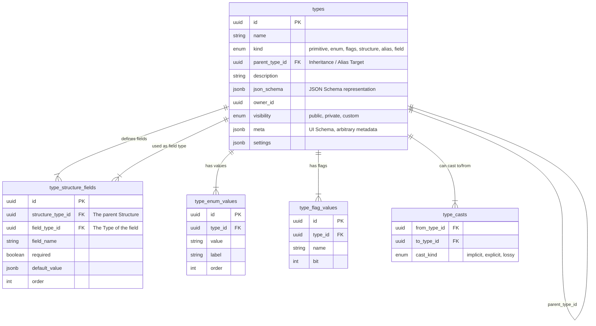
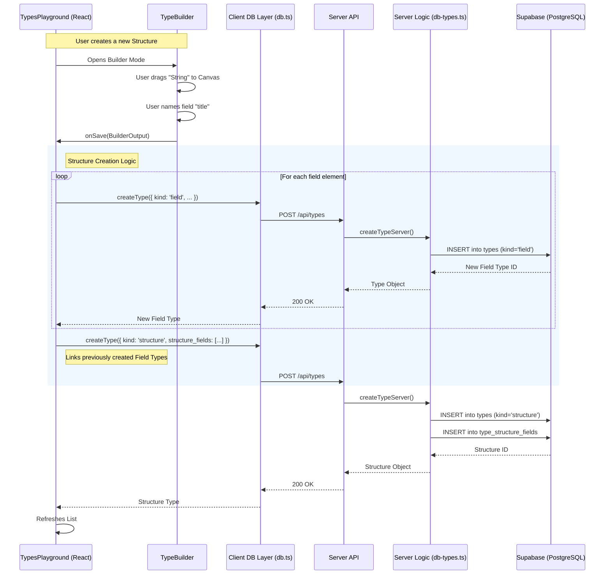
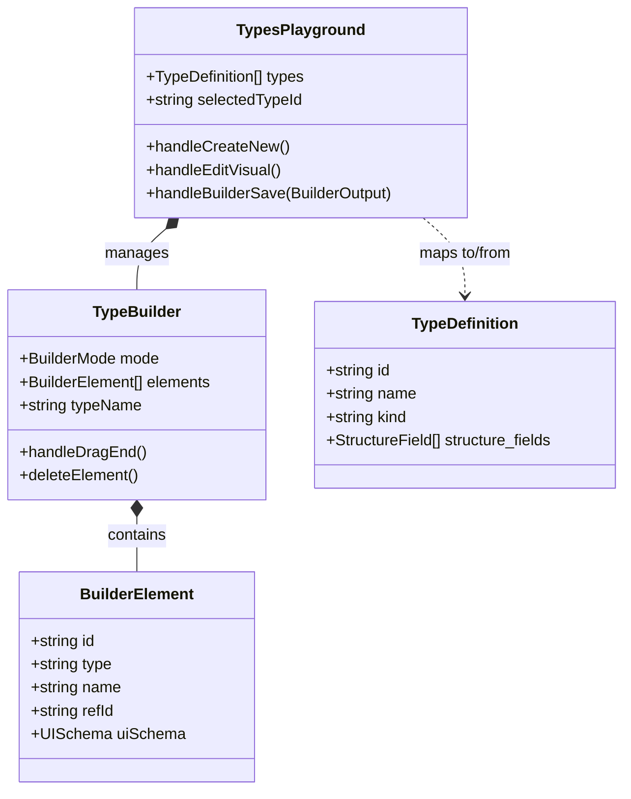

# Type System Documentation

This document outlines the architecture of the Polymech Type System, covering the database schema, server-side logic, and the client-side visual builder.

## Overview

The Type System allows for dynamic definition of data structures, enums, flags, and aliases. It is built on top of Supabase (PostgreSQL) and supports a visual builder interface for creating and managing these types. The system is designed to be recursive, allowing structures to contain fields that refer to other types.

## Database Schema

The core of the system is the `types` table, which stores the definitions. Relationships between types (inheritance, composition) are modeled via auxiliary tables.

### Source Reference
- **Supabase Types Definition**: [src/integrations/supabase/types.ts](../src/integrations/supabase/types.ts)

## Architecture & Data Flow

The system uses a synchronized Client-Server model. The client (React) uses a visual builder to construct a schema, which is then translated into API calls to the server (Hono/Node.js). The server handles the persistence logic, ensuring referential integrity.

### Data Flow Pattern

### Source Reference
- **Client DB Layer**: [src/components/types/db.ts](../src/components/types/db.ts)
- **Server DB Logic**: [server/src/products/serving/db/db-types.ts](../server/src/products/serving/db/db-types.ts)

## Client-Side: Type Builder

The `TypeBuilder` component provides a drag-and-drop interface for composing types. It manages an internal state of `measurements` which are then converted to the `TypeDefinition` format expected by the DB.

### Builder Class Diagram

### Key Components
- **TypesPlayground**: Main orchestrator. Handles loading types, selection, and the save logic which coordinates the atomic creation of fields and structures.
    - Source: [src/components/types/TypesPlayground.tsx](../src/components/types/TypesPlayground.tsx)
- **TypeBuilder**: The Dnd-Kit powered canvas. It transforms the user's visual arrangement into a structured `BuilderOutput`.
    - Source: [src/components/types/TypeBuilder.tsx](../src/modules/types/TypeBuilder.tsx)

## Server-Side Logic

The server enforces the schema structure. When creating a `structure`, it handles the insertion of the main type record and the associated `structure_fields` records.

### Logic Highlights
1.  **Creation**:
    - Inserts the `types` record.
    - If `structure_fields` are present, performs batch inserts into `type_structure_fields`.
    - Handles `enum_values` and `flag_values` similarly.
2.  **Updates**:
    - Updates attributes of the main `types` record.
    - **Replacement Strategy**: For `structure_fields`, it often performs a `DELETE` (of all existing link records for that structure) followed by an `INSERT` of the new set to ensure order and composition are exactly as requested.
    - **Orphan Cleanup**: Accepts `fieldsToDelete` array to clean up `field` types that were removed from the structure.

### Source Reference
- [server/src/products/serving/db/db-types.ts](../server/src/products/serving/db/db-types.ts)

## Performance & Caching

To ensure low-latency access to type definitions (which are read frequently but updated rarely), a robust server-side caching strategy is implemented.

### Strategy
- **Load-All-On-Demand**: The system treats the entire set of Types as a single cohesive unit. When any type is requested, if the cache is cold, *all* types, fields, enums, casts, and flags are loaded from the database in parallel.
- **In-Memory Cache**: The Enriched Types map is stored in the application's memory (`AppCache`) with a TTL (default 5 minutes).
- **Write-Through / Invaludation**:
    - **Mutations**: Any Create, Update, or Delete operation triggers a `flushTypeCache()` call.
    - **Invalidation**: This clears the `types` cache key.
    - **Reload**: The mutation response typically triggers a fresh fetch, which immediately repopulates the cache with the latest data.

### Event Propagation
Invalidation events are broadcasted to connected clients via Server-Sent Events (SSE).

1.  **Server**: `AppCache.invalidate('types')` emits an `app-update` event.
2.  **Stream**: The event stream manager forwards this to all active client connections.
3.  **Client**: The `StreamContext` receives the `cache` event (type: `types`) and triggers a React Query invalidation, ensuring the UI reflects the schema change instantly.
