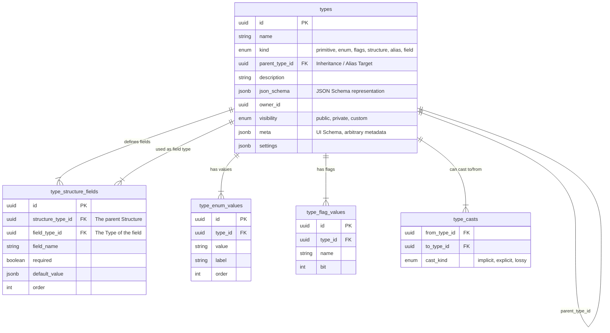
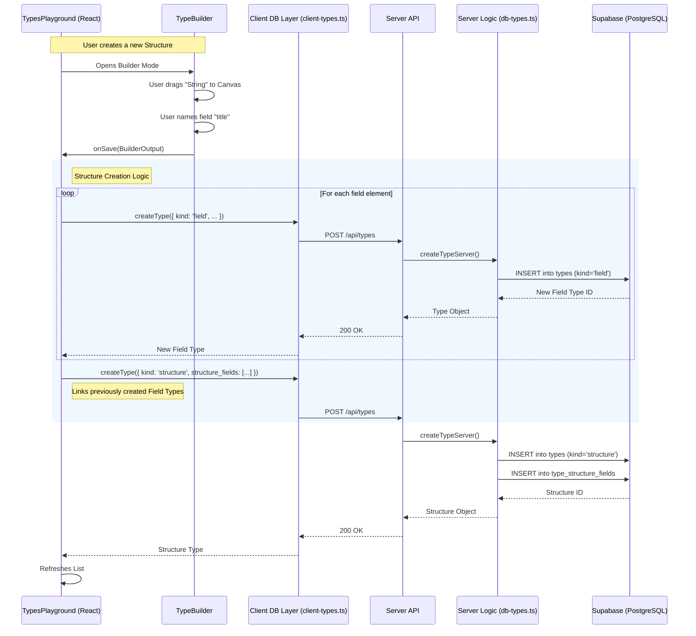

# Types Module

The `types` module is the foundation of PoolyPress's high-level schema definition system. It provides an intuitive, drag-and-drop interface for users to construct complex data forms while storing the underlying data in a fully relational database and mapping to standard React JSON Schema Form (RJSF) payloads for the frontend.

## Architecture & Data Flow

At its core, this module is the interface between our dynamic backend types system (with primitives, structures, enums, and flags) and front-end forms. 

### Key Files and Directories
* `./TypesEditor.tsx` - The central orchestrator switching between Visual DND mode and JSON/UI Schema edit mode. Contains the complex logic bridging Flat Builder Output <-> Relational DB fields.
* `./TypeRenderer.tsx` - Raw schema editor rendering the Live Preview in the sidebar using RJSF.
* `./builder/` - Code strictly related to the Drag-and-Drop Form Builder
  * `./builder/TypeBuilder.tsx` - Configures `@dnd-kit` contexts and ties drag operations into the Zustand store.
  * `./builder/TypeBuilderContent.tsx` - Three-pane visual layout (Palette, Canvas, Config) powered by UI components and the drag context.
  * `./builder/useStore.ts` - Local Zustand store that eliminates component prop-drilling for managing builder layout state.

### Relational Data Structures & Caching

The schemas defined in `src/modules/types/client-types.ts` (Frontend) and `server/src/products/serving/db/db-types.ts` (Backend) define the boundaries of the Type System. 

A single `TypeDefinition` is actually a composite of multiple relational tables:
1. `types` (The root definition: `id`, `name`, `kind`, `json_schema`, `meta`, `settings`)
2. `type_structure_fields` (When kind is 'structure': The 1-to-many joined edges connecting this structure's `id` to native child `field_type_id` rows)
3. `type_enum_values` & `type_flag_values` (For specific strict sets)

**Backend Caching Model (`db-types.ts`)**:
Because types map the entire application schema, they must be exceptionally fast. The system heavily guards PostgreSQL by using `appCache` (a 5-minute memory cache). Inside the backend loader (`getTypeState`), all tables (`types`, `type_structure_fields`, `type_enum_values`, etc.) are pulled fully into memory arrays, manually mapped into heavily joined `typesMap` Dictionary Nodes, and preserved across requests. The client receives these pre-enriched `TypeDefinition` payloads directly via the unified GET route.
## Built-In Types vs App Level Types

### Built-in Primitives
The base types managed in this system mirror JSON schema scalars:
* **String** (Text lines, Textareas)
* **Number/Integer** 
* **Boolean**

### Complex Formats
* **Structures / Objects**: Nested collections of fields.
* **Enums**: Hardcoded dropdowns and specific arrays of allowed values.
* **Flags**: Bitmask-style boolean representations.

### App Level Context Pickers
PoolyPress doesn't just manage raw JSON scalar data; it handles relational metadata for the entire app. For these references, we use specific UI *Widgets*.
Instead of storing complex objects, forms store UUIDs (Strings) and display a specialized picker for them:
* **Users**
* **Groups** 
* **Categories**
* **Apps/Products**
* **Images / Media**

## How We Deal With Custom Widgets (RJSF)

By default, RJSF generates standard HTML inputs based on the variable's type.
To override this (e.g. rendering our custom "Category Picker" rather than a raw UUID text input field), we inject a custom widget via `uiSchema`.

```json
{
  "ui:widget": "category_picker"
}
```

### Widget and Template Registration
To prevent fragmented widget and template files, everything is highly consolidated:

* **`./AppTypeWidgets.tsx`** - Contains all specialized form components. Rather than having a `userPickerWidget.tsx`, `groupPickerWidget.tsx`, etc., they are all exported from here tightly grouped.
* **`./RJSFTemplates.tsx`** - Combines custom RJSF structural overwrites (like customized submit buttons, field templates, grid layouts, ObjectField layouts) alongside compiling the `customWidgets` object registry used by the builder.
* **`./RJSFFormWrapper.tsx`** - The highest-level component that wraps a standard RJSF `<Form>`. It statically injects the custom components (from `RJSFTemplates.tsx`) without the rest of the application having to worry about widget hydration.

## Usage Example
If a developer needs a completely new app-level data field (e.g. a "Video Chooser"):
1. Build the specific picker logic component inside `./AppTypeWidgets.tsx`.
2. Add its text key (e.g., `video_chooser`) to the export registry in `./RJSFTemplates.tsx`.
3. In the platform builder UI, users can now assign `ui:widget: "video_chooser"` to any string field.

## Satisfying RJSF: Tricks & Hacks

React JSON Schema Form (RJSF) is exceptionally powerful but natively produces unstyled or Bootstrap-specific markup, and can be inflexible regarding deeply nested configuration overrides. Here is how we adapted it to the PoolyPress architecture:

1. **Massive Template Overrides (`RJSFTemplates.tsx`)**:
   Native RJSF layouts are deeply nested ``<fieldset>`` blobs. We override almost every core template (`ObjectFieldTemplate`, `ArrayFieldTemplate`, `FieldTemplate`, `SubmitButton`) to map their internal node structures to our clean `shadcn/ui` Tailwind CSS components (like `Card`, standard inputs, and icon buttons).
2. **Deep UI Schema Merging (`schema-utils.ts`)**:
   A generic primitive `field_type` in the database might have a default `uiSchema` (e.g., specifying a text area). However, a parent **Structure** might want to override that specific child's presentation. To accomplish this, `TypesEditor` runs a deep merge (`deepMergeUiSchema`) overriding the child's base `uiSchema` with the parent structure's nested `uiSchema[fieldName]` configuration right before handing it to the Builder or Renderer.
3. **Empty Dependency Stripping**:
   RJSF's validation engine throws aggressive visual errors if it encounters half-written `required` arrays or null structural nodes. When moving between modes or generating live previews, we actively clean up unused top-level keys before passing the payload into the `<Form>` wrapper to bypass these strict standard evaluations.

## TODOs & Future Improvements

* **Dynamic Imports for Heavy Widgets**: Widgets like `MermaidWidget` or the `ThreeDViewer` currently increase the base bundle size. These should be refactored into dynamic `use() / React.lazy()` lazyloads specifically within `AppTypeWidgets.tsx` to fix Vite chunk-size warnings.
* **Typescript Polish**: Clean up lingering strict typing violations mapping from our internal `TypeDefinition` model to the `@rjsf/utils` library standards (notably inside `randomDataGenerator.ts` and `TypesList.tsx`).
* **Validation Pushdown**: Continue improving the logic inside `handleBuilderSave` (`TypesEditor.tsx`) to ensure top-level JSON schema validation constraints (regex, min/max limits) properly distribute down to their distinct relational `field_type` row configurations in the DB.
* **Runtime Type Safety & Codegen**: Currently, types are purely dynamic mapping to RJSF JSON schemas. Implement a pipeline to generate strict Typescript interfaces (`.d.ts`) or `zod` schemas at runtime directly from the PostgreSQL definitions to provide robust runtime/compile-time safety when utilizing app-level entity data throughout the codebase.

---

## Architectural Diagrams & Internals

The following diagrams illustrate the deep connections between the visual React Builder, our API layer, and the relational Supabase PostgreSQL database.

### Database Schema

The core of the system is the `types` table, which stores the definitions. Relationships between types (inheritance, composition) are modeled via auxiliary tables.



### Data Flow Pattern

The system uses a synchronized Client-Server model. The visual builder constructs a schema, which is translated into API calls. The server handles persistence and guarantees referential integrity.



### Server-Side Invalidation

To ensure low-latency access to type definitions, the robust server-side caching strategy broadcasts invalidations to clients seamlessly.

1.  **Server Mutation**: Any Create, Update, or Delete operation triggers `flushTypeCache()`.
2.  **AppCache**: `AppCache.invalidate('types')` emits an `app-update` event.
3.  **SSE Stream**: The event stream manager forwards this invalidate signal to all active client connections.
4.  **Client ReactQuery**: The frontend `StreamContext` receives the `cache` event (type: `types`) and forces an immediate re-fetch so the UI reflects the new schema instantly without polling.
